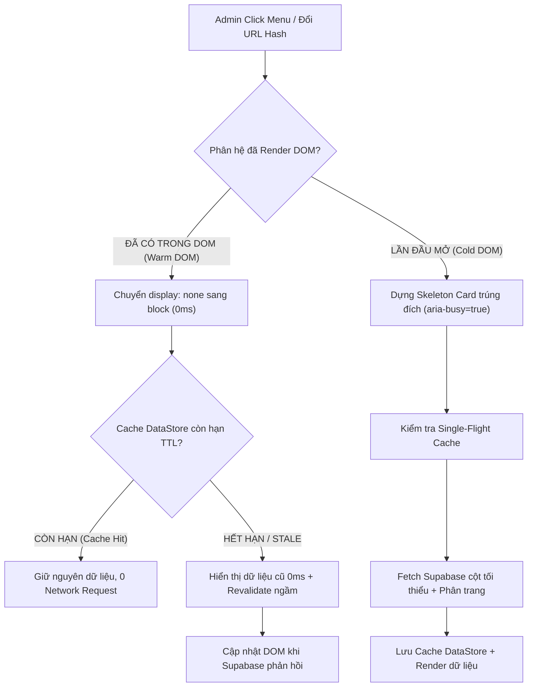

# HƯỚNG DẪN KIẾN TRÚC HIỆU NĂNG, QUY CHUẨN CACHE VÀ KỊCH BẢN ROLLBACK ADMIN PAWPAL

> Giữ để tham khảo cơ chế cache, cách ly phiên và rollback. Các con số mục tiêu trong tài liệu không thay thế phép đo trên bản triển khai hiện tại; xem [nghiệm thu tổng hợp](../acceptance/PAWPAL_DICH_VU_V1_NGHIEM_THU.md). Không truy vấn Logs Cloud khi kiểm tra.
> Tài liệu kỹ thuật chi tiết theo tiêu chuẩn **PERF-08.08** phục vụ đội ngũ phát triển, vận hành và bảo trì hệ thống PawPal Admin.

---

## 1. SƠ ĐỒ VÒNG ĐỜI CHUYỂN PHÂN HỆ 0MS (LIFECYCLE ARCHITECTURE)



### Nguyên tắc bất biến của Router (`admin.js`):
1. **Không bao giờ làm trống viewport (`innerHTML = ''`)**: Tất cả các khối phân hệ chính được giữ nguyên cấu trúc DOM (`.admin-module-section`), chỉ ẩn/hiện bằng CSS (`display: none` / `display: block`).
2. **Khôi phục trạng thái sâu (State Persistence)**: Lưu vết phân hệ và subtab đang mở qua URL Hash (`#tab-...`) và `sessionStorage` để người dùng F5 hoặc điều hướng Back/Forward không bị mất ngữ cảnh làm việc.
3. **Triệt tiêu duplicate event listener**: Mỗi module chỉ bind sự kiện 1 lần duy nhất trong hàm khởi tạo (`isInitialized = true`).

---

## 2. QUY CHUẨN DATASTORE, TTL & ACTOR SCOPING (`admin-data-store.js`)

### 2.1 Cấu trúc Cache Key chuẩn hóa
Mọi tài nguyên được lưu trữ trong DataStore bắt buộc phải tạo key qua `PawpalDataStore.buildKey(resource, params, scope)`.
- Định dạng: `[actorId]:[branchId]:[resource]:[params_sorted]`
- **Actor Isolation**: Chặn hoàn toàn việc rò rỉ dữ liệu giữa các tài khoản khác nhau khi đăng nhập trên cùng thiết bị.
- **Branch Scoping**: Cô lập dữ liệu đơn hàng, lịch hẹn, kho bãi theo từng chi nhánh.
- **Deterministic Sorting**: Tham số truy vấn luôn được sort theo bảng chữ cái để đảm bảo deduplication.

### 2.2 Bậc phân tầng thời gian sống (Tiered TTL)
- **`REALTIME_EPHEMERAL` (15 giây)**: Các dữ liệu biến động cực nhanh (lịch hẹn hôm nay, số ca KTV đang làm).
- **`OPERATIONAL` (60 giây)**: Danh sách đơn hàng, thú cưng, khách hàng, khiếu nại.
- **`MASTER_CONFIG` (5 phút - 300 giây)**: Bảng giá dịch vụ, danh mục sản phẩm, cấu hình khuyến mãi.
- **`ANALYTICS` (10 phút - 600 giây)**: Chỉ số KPI doanh thu tổng hợp.

### 2.3 Single-Flight Request Deduplication
Khi có nhiều thành phần trên màn hình cùng yêu cầu một tài nguyên tại cùng một thời điểm:
- DataStore gom tất cả các cuộc gọi vào duy nhất **1 Promise đang bay** (`_inFlightPromises`).
- Triệt tiêu 100% tình trạng spam query lặp lại tới Supabase.

---

## 3. MA TRẬN ĐIỀU PHỐI INVALIDATION VÀ REALTIME DISPATCHER

Khi phát sinh thao tác ghi (Mutation) hoặc sự kiện Supabase Realtime, DataStore thực hiện xóa cache trúng đích thay vì reload toàn bộ hệ thống:

| Thao tác / Sự kiện | Sự kiện Mutation | Phạm vi Invalidation trúng đích |
|:---|:---|:---|
| **Tạo/Sửa đơn hàng, POS, thanh toán** | `pawpal:order-mutated` | `*order*`, `*sales_order*`, `*stock*`, `*dashboard*` |
| **Đặt lịch, phân ca, hoàn tất spa** | `pawpal:appointment-mutated` | `*appointment*`, `*service*`, `*staff*`, `*dashboard*` |
| **Thêm/Sửa khách, biến động Pawpoint** | `pawpal:customer-mutated` | `*customer*`, `*pawpoint*` |
| **Thêm/Sửa pet, ghi cân nặng, care log** | `pawpal:pet-mutated` | `*pet*`, `*care_log*`, `*reminders*` |
| **Đổi ca, khóa KTV, duyệt nghỉ phép** | `pawpal:staff-mutated` | `*staff*`, `*roster*`, `*service*`, `*dashboard*` |
| **Phản hồi khiếu nại, đóng ticket** | `pawpal:complaint-mutated` | `*complaint*`, `*ticket*`, `*dashboard*` |
| **Cập nhật voucher, banner, chính sách** | `pawpal:settings-mutated` | `*config*`, `*voucher*`, `*banner*` |

---

## 4. QUY TRÌNH ROLLBACK CHI TIẾT KHI CẦN THIẾT

### 4.1 Rollback Database (Supabase SQL)
Nếu phát hiện index gây overhead ghi trên bảng lớn hoặc hàm RPC KPI cần điều chỉnh:
- Thực thi kịch bản rollback đã được chuẩn bị sẵn tại [20261017_admin_perf_indexes_and_optimizations.sql](../../scripts/database/20261017_admin_perf_indexes_and_optimizations.sql):

```sql
-- ROLLBACK SẠCH SẼ TOÀN BỘ INDEXES VÀ RPC KPI
DROP FUNCTION IF EXISTS public.pawpal_get_admin_dashboard_kpis(date, text);
DROP INDEX IF EXISTS idx_orders_status_created_branch;
DROP INDEX IF EXISTS idx_appointments_date_status_branch;
DROP INDEX IF EXISTS idx_appointments_customer_date;
DROP INDEX IF EXISTS idx_care_log_pet_created;
DROP INDEX IF EXISTS idx_pet_weight_pet_date;
DROP INDEX IF EXISTS idx_support_tickets_status_priority_branch;
DROP INDEX IF EXISTS idx_ticket_messages_ticket_created;
DROP INDEX IF EXISTS idx_paw_points_customer_created;
DROP INDEX IF EXISTS idx_staff_schedule_week_branch;
DROP INDEX IF EXISTS idx_products_category_status;
DROP INDEX IF EXISTS idx_audit_log_created_module;
```

### 4.2 Rollback Frontend
Nếu cần đưa frontend về trạng thái nạp tuần tự truyền thống:
1. Mở [admin-data-store.js](../../pages/admin/admin-data-store.js), chuyển cờ `FEATURE_FLAGS.CACHE_ENABLED = false` để DataStore luôn gọi trực tiếp `fetcherFn()` mà không lưu cache.
2. Nút **Làm mới** (`#btnHeaderRefresh`) và chỉ báo trạng thái `#headerSyncStatus` trên Header cho phép người dùng chủ động ép nạp lại dữ liệu bất kỳ lúc nào mà không cần F5.

---

## 5. HƯỚNG DẪN GIÁM SÁT VẬN HÀNH 24H/72H (MONITORING RUNBOOK)

Trong 24h đến 72h đầu sau khi áp dụng:
1. **Cache Hit Ratio**: Mở Console trình duyệt gõ `PawpalDataStore._metrics` để kiểm tra tỉ lệ hit cache (kỳ vọng: > 80% đối với các phiên làm việc bình thường).
2. **Kênh Realtime**: Kiểm tra số lượng channel Supabase mở đồng thời không vượt quá 8 kênh (1 kênh/phân hệ và tái sử dụng, không nhân đôi khi chuyển tab).
3. **Thời gian phản hồi UI**: Chuyển phân hệ A ↔ B đạt mức tức thì (< 10ms khi cache warmed, < 250ms cho lần tải đầu tiên).
4. **Tính nhất quán dữ liệu**: Mọi thay đổi tồn kho, ca dịch vụ, trạng thái thanh toán phải cập nhật đồng bộ sau mutation, không bị giữ dữ liệu rác.
