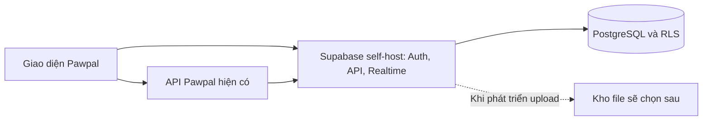

# Kế hoạch triển khai Supabase self-host cho Pawpal

Ngày chọn phương án: 21/10/2026. Đây là kế hoạch đang áp dụng, thay phương án chuyển sang PostgreSQL thuần.

**Cập nhật giao diện V1:** đã hoàn tất và kiểm tra phân hệ Khách hàng của admin local, gồm các luồng ghi, điểm, thú cưng trong hồ sơ và Realtime. Xem [nghiệm thu Khách hàng V1](../../acceptance/PAWPAL_KHACH_HANG_V1_NGHIEM_THU.md). Công việc chuyển các phân hệ khác và triển khai server online/Vercel vẫn còn; không coi đây là nghiệm thu toàn bộ website. Các mốc “mã Admin chưa chuyển” bên dưới là lịch sử trước cập nhật này.

**Cập nhật dữ liệu nghiệp vụ:** đã nhập phần hợp lệ từ bản xuất Cloud; giữ 35 khách, 82 thú cưng, thêm 16 nhân viên mới với Auth bị khóa và bút toán mở đầu điểm/kho có ghi nguồn. Chưa chuyển được tất cả lịch sử vì các tổng/quan hệ nguồn không khớp V1. Chi tiết và danh sách nhóm bị giữ lại nằm trong [báo cáo nhập nghiệp vụ](PAWPAL_NHAP_DU_LIEU_NGHIEP_VU_V1.md). Công việc chuyển mã các màn hình V1 vẫn đang chờ, không lấy dữ liệu đã nhập làm bằng chứng UI đã nghiệm thu.

**Mốc mới nhất — đã tạo V1 trên local:** ngày 21/10/2026, public đã chuyển từ baseline 21 bảng sang đúng 105 bảng/906 cột/160 FK của V1; RLS bật 105 bảng. Backup baseline và V1 đều đã thử restore, REST nhận đủ 105 bảng. Xem [kết quả triển khai](../../database/PAWPAL_DATABASE_V1_TRIEN_KHAI.md). Bước tiếp theo là chuyển mã ứng dụng sang V1; bản Admin cũ chưa được nghiệm thu với schema mới. Các mục ghi “21 bảng” hoặc “chưa triển khai V1” bên dưới là lịch sử trước mốc này.

**Điều chỉnh sau đối chiếu schema ngày 21/10/2026:** bản local hiện có 21 bảng tương thích mã cũ, chưa triển khai V1. V1 có 105 thực thể; 20 bảng local trùng tên, 1 bảng ngoài V1 (`customer_activation_sms`), 85 bảng V1 chưa có. Xem [báo cáo sai khác và kế hoạch chuyển schema](PAWPAL_DOI_CHIEU_DATABASE_SELF_HOST_VOI_3NF_V1.md). Từ mốc này dừng mở rộng schema tương thích; công việc schema tiếp theo theo V1, kèm sửa mã và kiểm thử. Các mốc hoàn thành bên dưới là kết quả kiểm tra baseline, không phải nghiệm thu 3NF V1.

## 1. Mục tiêu và thứ tự ưu tiên

Tiếp tục phát triển Pawpal trên một bộ Supabase do mình vận hành, giữ phần lớn cách tích hợp Supabase SDK, Auth, RLS, RPC, Storage và Realtime hiện tại. PostgreSQL vẫn là cơ sở dữ liệu bên trong; không xây lại toàn bộ dịch vụ nền.

1. Dựng bộ self-host riêng và chứng minh một luồng hiện có chạy được.
2. Đối chiếu bản nền với [thiết kế 3NF V1](../../database/PAWPAL_THIET_KE_DATABASE_3NF_V1.md), chốt đặc tả vật lý và chuyển từng nhóm schema cùng mã gọi theo [kế hoạch chuyển đổi](PAWPAL_DOI_CHIEU_DATABASE_SELF_HOST_VOI_3NF_V1.md).
3. Kiểm tra toàn bộ chức năng trên V1 trước khi chuyển cấu hình nguồn của bản chạy chính.

Việc đổi nơi chạy và việc đổi schema là hai đợt độc lập. Không áp dụng ngay toàn bộ tên trường/bảng mới trong V1 vào code đang dùng schema cũ.

Phạm vi giữ nguyên: một cửa hàng, một kho chung, Spa/Grooming, hotel, taxi và bán hàng; không thú y. Các bảng người dùng đã yêu cầu bỏ không được dựng lại trong schema 3NF mới. Nếu schema tương thích ban đầu còn đối tượng cũ, phải kiểm kê thành phần đang dùng và chuyển mã trước khi loại bỏ; không chạy xóa tự động.

### Phạm vi đợt triển khai đầu

| Hạng mục | Cách thực hiện |
|---|---|
| Đăng nhập và phân quyền | Dùng Supabase Auth thực với tài khoản thử mới; giữ liên kết hồ sơ khách/nhân viên, RLS và quyền phía máy chủ |
| Email và OTP | Giữ mô phỏng hiện có phục vụ thử nghiệm; chưa cần thuê dịch vụ gửi email hoặc cấu hình SMTP thật. Ghi rõ mô phỏng, không coi đây là bước xác minh danh tính thật hoặc cho phép vượt quyền đăng nhập |
| Ảnh và file | Chưa phát triển upload, chưa chọn nơi lưu và không có dữ liệu file cần chuyển. Không lấy upload/download làm điều kiện hoàn thành đợt này |
| Dữ liệu nghiệp vụ | Baseline tương thích đã dựng để kiểm chứng hạ tầng; tiếp theo chuyển theo V1. Dữ liệu thử ghi trực tiếp trong database; không dùng file JSON hoặc dữ liệu giả làm phương án dự phòng trên giao diện |
| Thiết kế 3NF mới | Là thiết kế đích cho công việc schema tiếp theo; chưa triển khai. Không thêm bảng/cột cũ ngoài thiết kế chỉ để xử lý lỗi màn hình |
| Vercel | Kiểm chứng trên bản Preview sau khi có máy chủ Supabase online; bản chạy ở laptop chỉ dùng để phát triển và nghiệm thu tại máy |

Storage có thể vẫn chạy trong bộ Compose chính thức để giữ các phụ thuộc của bản phát hành. Việc đó không đồng nghĩa đã triển khai tính năng lưu ảnh/file cho Pawpal.

## 2. Kết quả kiểm tra ban đầu

- Đã khởi động Docker Desktop qua CLI và xác minh Docker Engine phiên bản `29.4.3`, Docker Compose `v5.1.3` hoạt động. Lúc bắt đầu kiểm tra Engine chưa chạy; hiện điều kiện này đã được giải quyết.
- Chưa có bộ Docker Compose Supabase trong workspace.
- Supabase Cloud hiện trả lỗi 402 do vượt egress qua REST ở lần kiểm tra trước; chưa xác minh lại kết nối PostgreSQL nguồn trực tiếp.
- Đã có SQL migration và tài liệu schema, nhưng chưa xác nhận có đủ schema nền để dựng từ database rỗng.
- Dữ liệu cũ là dữ liệu thử nghiệm, không bắt buộc di chuyển đầy đủ. Giữ nguyên dự án Cloud và cấu hình hiện tại để quay lui.
- Chưa chọn VPS hoặc mua dịch vụ. Chưa đổi `.env` ứng dụng sang máy chủ mới.

## 3. Kiến trúc

- Thử trên máy trước; đây là bản self-host riêng với Compose chính thức, phân biệt với stack phát triển do Supabase CLI quản lý.
- Nếu website trên Vercel cần hoạt động khi laptop tắt, bộ self-host phải đặt trên VPS/máy chủ online có HTTPS.
- Trình duyệt dùng key công khai cùng RLS; service-role/secret key và mật khẩu database chỉ thuộc máy chủ.
- Không còn hạn mức Supabase Cloud cho request đi tới bộ self-host, nhưng vẫn chịu tài nguyên, dung lượng và băng thông của máy chạy bộ đó.

## 4. Các giai đoạn

### Giai đoạn 0 — Chuẩn bị hạ tầng và đường lui

- [x] Khởi động Docker Desktop và kiểm tra Docker Engine phản hồi, Compose dùng được; xác minh chi tiết chế độ container khi chuẩn bị stack.
- [ ] Kiểm tra RAM, CPU và ổ đĩa còn trống. Bộ đầy đủ theo tài liệu hiện tại tối thiểu 4 GB RAM, 2 lõi CPU và 40 GB SSD; khuyến nghị cao hơn. [Yêu cầu chính thức](https://supabase.com/docs/guides/self-hosting/docker).
- [ ] Lưu mốc mã có thể quay lui, bao gồm các thay đổi tối ưu băng thông chưa commit; không reset working tree.
- [ ] Lấy cấu hình từ repository Supabase chính thức, ghim tag/commit và phiên bản image; không dùng cấu hình ngẫu nhiên hoặc tag `latest` không kiểm soát.
- [ ] Đặt cấu hình hạ tầng, volume và secret trong vị trí riêng không được Express phục vụ như file tĩnh.
- [ ] Tạo secret mới cho môi trường thử nghiệm, không dùng mật khẩu/key mặc định. Sinh key theo đúng phiên bản Supabase đã chọn; giữ chúng ngoài Git và log.
- [ ] Thử đầu tiên chỉ bind cổng vào loopback, không mở PostgreSQL, Studio hoặc API ra Internet.

**Bàn giao:** vị trí cài đặt riêng, phiên bản nguồn/image được ghi lại, cấu hình mẫu không có secret và mốc mã/cấu hình để quay lui. Chỉ sang giai đoạn 1 khi tài nguyên đủ và xác định được các cổng không xung đột.

### Giai đoạn 1 — Dựng bộ dịch vụ

- [ ] Chuẩn bị các thành phần cần dùng: PostgreSQL, Auth, API gateway/PostgREST, Realtime, Storage và Studio cùng các thành phần phụ thuộc của bản phát hành.
- [ ] Cấu hình volume dữ liệu và file để không mất khi dừng/khởi động lại container.
- [ ] Kiểm tra cấu hình Compose đã resolve và health của từng dịch vụ trước khi đổi ứng dụng.
- [ ] Cấu hình URL API/Auth, site URL và redirect cho trang khách, Admin và API đang chạy thử.
- [ ] Xác định luồng Email/OTP mô phỏng trong mã; giữ chế độ thử rõ ràng, không yêu cầu SMTP thật trong đợt này. Tạo tài khoản thử bằng Auth Admin API để việc đăng nhập không phụ thuộc email xác nhận chưa có dịch vụ gửi.
- [ ] Giữ Studio được bảo vệ, kiểm tra tài khoản/mật khẩu quản trị riêng.

**Bàn giao:** bộ Compose khởi động được, hướng dẫn bật/tắt và báo cáo health các dịch vụ bắt buộc của bản phát hành.

**Đạt khi:** Auth, API và Realtime phản hồi; volume database tồn tại sau restart; các dịch vụ phụ thuộc không có lỗi chặn. Chưa coi container healthy là ứng dụng Pawpal đã chạy được.

### Giai đoạn 2 — Schema và tài khoản thử nghiệm

- [ ] Nếu có mật khẩu nguồn: thử kết nối chỉ đọc; xuất schema/roles và dữ liệu cần thiết theo hướng dẫn khôi phục chính thức.
- [ ] Nếu chưa xuất được: đối chiếu CDSLfinal, enum, SQL và truy vấn thực tế để tạo schema tương thích. Các migration bổ sung hiện có không được coi là bộ dựng nền hoàn chỉnh.
- [ ] Kiểm tra extension, view, hàm, trigger, RLS, grants và bảng được đăng ký Realtime. Chỉ kiểm kê tham chiếu Storage hiện có; chưa tạo bucket/policy nghiệp vụ mới khi tính năng file chưa phát triển.
- [ ] Giữ `auth.users`, `auth.uid()` và Auth Admin API; không tạo bộ bảng đăng nhập riêng của Pawpal.
- [ ] Tài khoản thử mới được tạo qua Supabase Auth Admin API rồi liên kết đúng `customer.auth_user_id` hoặc `staff.auth_user_id`. Không chèn mật khẩu vào bảng hồ sơ hoặc hardcode tài khoản quản trị.
- [ ] Kiểm tra FK và loại tài khoản của hai cổng. Phiên Admin và khách có storage key riêng; không tin role do trình duyệt gửi lên.
- [ ] Nếu khôi phục tài khoản cũ, xác minh cách di chuyển theo phiên bản nguồn/đích và yêu cầu đăng nhập lại; không bảo đảm token Cloud cũ dùng được trên self-host.
- [ ] Chuẩn bị bộ dữ liệu thử tối thiểu và có thể nạp lại vào database riêng: nhân viên, khách hàng, thú cưng, dịch vụ và sản phẩm cần cho các luồng nghiệm thu. Không sử dụng dữ liệu thử để che lỗi truy vấn hoặc fallback khi API lỗi.

**Bàn giao:** danh mục bảng/hàm/policy mà mã đang dùng, bộ SQL dựng nền có thứ tự chạy, cách tạo tài khoản thử và các phần schema còn thiếu nếu có.

**Đạt khi:** dựng lại được database nghiệp vụ từ môi trường sạch, tài khoản thử đăng nhập được và truy vấn qua API với quyền đúng. Không chờ mật khẩu Cloud để chuẩn bị danh mục; nếu schema thiếu thì phải bổ sung trước khi chuyển các chức năng liên quan.

Tham chiếu: [khôi phục Cloud sang self-host](https://supabase.com/docs/guides/self-hosting/restore-from-platform). Không chạy nguyên xi bản dump chứa đối tượng hệ thống hoặc migration chưa rà soát vào máy chủ mới.

### Giai đoạn 3 — Đổi cấu hình Pawpal trên môi trường thử

- [ ] Lập danh sách mọi nơi lấy URL/key: cấu hình trình duyệt, localStorage override, `.env` máy chủ, entrypoint `api/` và biến môi trường Vercel.
- [ ] Cấu hình nguồn thử nghiệm rõ ràng; không để fallback URL/key Cloud khiến một màn hình ghi nhầm nguồn.
- [ ] Giữ phần lớn `.from()`, `.rpc()`, `.auth`, `.storage`, `.channel()`; chỉ sửa khi có khác biệt đã kiểm chứng.
- [ ] Đồng bộ URL/key của frontend và backend cùng một bộ self-host, xóa phiên/cache nguồn cũ và đăng nhập lại.
- [ ] Kiểm tra đầu tiên: Admin đăng nhập → danh sách khách → tạo khách → thêm thú cưng → mở hồ sơ → reload.
- [ ] Kiểm tra Network không còn request nghiệp vụ vô tình gửi tới Supabase Cloud.

**Bàn giao:** bản Pawpal chạy tại máy với nguồn self-host và danh sách cấu hình đã đổi, không ghi giá trị secret vào báo cáo.

**Mốc chạy được đầu tiên:** Admin đăng nhập → tạo khách → thêm thú cưng → mở hồ sơ → reload vẫn còn dữ liệu. Đăng xuất/đăng nhập lại vẫn đúng tài khoản; khởi động lại stack vẫn giữ dữ liệu. Chỉ sau mốc này mới mở rộng nghiệm thu toàn bộ phân hệ.

### Giai đoạn 4 — Nghiệm thu chức năng

| Nhóm | Điều kiện đạt |
|---|---|
| Auth và quyền | Khách không vào cổng Admin; không truy cập dữ liệu khách khác; tài khoản khóa không tiếp tục dùng API/Realtime trái quyền |
| Khách và thú cưng | CRUD, nhiều địa chỉ, số điện thoại, autocomplete và validation tại trường hoạt động |
| Dịch vụ | Đặt lịch, tiếp nhận, biên bản, phân công, phụ phí, bàn giao, hotel và taxi giữ đúng nghiệp vụ |
| Bán hàng | Tạo đơn, giữ/xuất/hoàn tồn, thu tiền sandbox, đổi trả và Pawpoint nhất quán |
| Biên bản | Giữ luồng Admin và in ký giấy hiện có; không tự coi là đã có xác nhận điện tử khách |
| Chat/thông báo | Hai trình duyệt nhận thay đổi đúng người, nối lại sau mất mạng và không rò nội dung |
| Email/OTP mô phỏng | Luồng thử hoạt động đúng phạm vi và thể hiện rõ mô phỏng; đăng nhập/phân quyền thật vẫn được kiểm tra độc lập |
| Hiệu năng | Không tải lại toàn bộ bảng theo từng sự kiện; giữ các tối ưu băng thông đã làm |
| Vận hành | Khôi phục được bản sao database vào môi trường riêng và thử đổi lại cấu hình nguồn; lưu ý Cloud còn lỗi 402 thì chưa phục vụ lại được |

Các phép thử cần Supabase đang chạy phải có bằng chứng trực tiếp; test offline hoặc health container không thay thế nghiệm thu toàn luồng.

**Bàn giao:** bảng kết quả từng luồng gồm đã đạt/chưa đạt, lỗi còn lại và bước tái hiện. Ảnh/file và gửi Email/OTP thật được ghi là ngoài phạm vi đợt đầu, không đánh dấu đã nghiệm thu.

### Giai đoạn 5 — VPS và Vercel

- [ ] Chọn máy chủ và ngân sách trước khi mua/triển khai bên ngoài; giữ frontend trên Vercel nếu phù hợp.
- [ ] Cấu hình DNS/HTTPS, API/Auth redirect, origin/CORS và WebSocket proxy cho Supabase Realtime.
- [ ] Kiểm tra URL gọi từ trình duyệt, API Node.js và Vercel Functions đều truy cập được bộ self-host.
- [ ] Không công khai Studio hoặc cổng database không cần thiết; chỉ cho phép các kết nối vận hành cần dùng.
- [ ] Chuyển đồng bộ các biến môi trường của deployment thử nghiệm, kiểm tra rồi mới chuyển deployment chính.
- [ ] Thử từ thiết bị khác khi laptop phát triển tắt để chứng minh hệ thống độc lập máy cá nhân.

**Bàn giao:** địa chỉ HTTPS của Supabase, bản Vercel Preview kết nối được và hướng dẫn vận hành máy chủ. Secret quản trị chỉ ở cấu hình máy chủ/Vercel Functions; frontend chỉ nhận key công khai phù hợp.

**Đạt khi:** trình duyệt ngoài máy phát triển đăng nhập, đọc/ghi và nhận Realtime được qua HTTPS; thử lại khi laptop tắt. Địa chỉ `localhost` của laptop không dùng làm endpoint cho bản Vercel online. Chỉ chuyển bản chính sau khi bản Preview đạt các luồng bắt buộc.

## 5. Sao lưu, cập nhật và quay lui

- Trong đợt đầu, sao lưu database và lưu cấu hình/secret ở nơi riêng có kiểm soát truy cập. Khi triển khai online: lên lịch sao lưu database hằng ngày, sao lưu trước mỗi lần cập nhật và thử khôi phục trước khi chuyển bản chính; lưu bản sao ngoài máy chủ.
- Khi phát triển ảnh/file, bổ sung sao lưu nội dung object riêng với metadata database; bản dump database không tự chứa nội dung file. Chốt nơi lưu và quyền truy cập ở đợt đó.
- Ghim phiên bản và thử cập nhật trên bản thử nghiệm trước; không chạy `down -v` hoặc xóa volume để xử lý lỗi tùy tiện.
- Giữ Cloud và mốc mã/cấu hình cũ. Quay lui phải đổi đồng bộ URL/key phía trình duyệt, backend, Vercel và redirect Auth, rồi đăng nhập lại. Nếu sau này có file, bổ sung cả cấu hình nơi lưu file.
- Chỉ đổi cấu hình không đồng bộ dữ liệu giữa hai bộ. Với dữ liệu thử nghiệm hiện tại, không bắt buộc nhập ngược; trước khi nhận dữ liệu thật phải chốt lại quy trình này.
- Cloud phải được gỡ giới hạn để bản quay lui phục vụ request bình thường; việc giữ đường lui không tự gỡ lỗi 402.

## 6. Trạng thái hiện tại và việc tiếp theo

- [x] Chọn Supabase self-host làm phương án chính.
- [x] Rà soát sơ bộ mã đang dùng SDK/Auth/RLS và kiểm tra Docker CLI.
- [x] Docker Engine chạy và Docker Compose dùng được.
- [ ] Nguồn cấu hình self-host được chuẩn bị và kiểm tra.
- [ ] Khởi động stack, dựng schema và tạo tài khoản thử.
- [ ] Đổi nguồn trên môi trường thử, nghiệm thu rồi mới triển khai online.

Việc tiếp theo là chuẩn bị bộ Compose chính thức và schema tương thích. Chưa đổi cấu hình ứng dụng, chưa khởi tạo database và chưa có website self-host đang hoạt động. Có thể chuẩn bị schema khi chờ mật khẩu database Cloud, nhưng chưa thể hứa khôi phục đầy đủ schema từ các migration bổ sung hiện có.

## 7. Thứ tự thực hiện ngay sau khi chốt kế hoạch

1. Kiểm tra lại Docker, tài nguyên máy và cổng; lưu mốc mã/cấu hình hiện tại mà không đưa `.env` hoặc secret vào Git.
2. Chuẩn bị bộ Compose chính thức tại vị trí riêng, ghim phiên bản và tạo cấu hình mẫu. Kiểm tra các phụ thuộc trước khi tinh gọn dịch vụ.
3. Rà soát các truy vấn trong frontend, backend và SQL để lập danh mục schema tương thích; thử xuất schema nguồn nếu chủ database đã cung cấp mật khẩu.
4. Khởi động stack tại máy, dựng schema và tạo tài khoản thử bằng Supabase Auth. Kiểm tra RLS bằng cả tài khoản khách và nhân viên.
5. Chuyển cấu hình môi trường thử và hoàn thành mốc Admin → khách → thú cưng → reload. Sau đó kiểm tra dịch vụ, bán hàng, chat/thông báo và khôi phục database.
6. Khi bản tại máy đạt, chốt máy chủ online và ngân sách, dựng HTTPS rồi nối Vercel Preview. Chưa cần triển khai Email/OTP thật hoặc upload ảnh/file để thực hiện bước này.

## 8. Các điểm cần giải quyết trong quá trình làm

| Điểm có thể gặp | Hướng xử lý | Có chặn bước nào? |
|---|---|---|
| Máy thiếu RAM/ổ đĩa hoặc Docker không khởi động | Kiểm tra tài nguyên và chế độ container; chỉ chọn cấu hình tinh gọn có kiểm chứng phụ thuộc nếu cần | Chặn dựng stack tại máy |
| Chưa có mật khẩu database Cloud hoặc thiếu SQL dựng nền | Rà mã và SQL ngay; lấy schema nguồn khi truy cập được, bổ sung những hàm/trigger/policy thực sự dùng | Không chặn chuẩn bị hạ tầng; chặn nghiệm thu chức năng còn thiếu schema |
| Đăng nhập được nhưng API bị từ chối | Kiểm tra hồ sơ liên kết Auth, grants, RLS, URL/key và phiên cũ; không tắt RLS để xử lý chung | Chặn nghiệm thu luồng bị lỗi |
| Truy vấn được nhưng Realtime chưa hoạt động | Kiểm tra publication, quyền kênh và kết nối; trên VPS kiểm tra thêm proxy WebSocket | Chặn nghiệm thu chat/thông báo và cập nhật trực tiếp |
| Chưa có VPS hoặc ngân sách | Hoàn thành bản tại máy trước, sau đó chọn nơi chạy online phù hợp | Chặn mục tiêu Vercel hoạt động độc lập laptop |
| Cloud vẫn hết egress | Dùng bản self-host đã nghiệm thu để tiếp tục; giữ cấu hình Cloud làm đường lui khi Cloud phục hồi | Không chặn self-host; chưa thể hứa quay về Cloud dùng ngay |

Không gắn thời hạn hoàn thành cố định trước khi biết mức độ đầy đủ của schema. Báo tiến độ theo từng mốc có bằng chứng chạy thật; mốc ưu tiên là bản tại máy vận hành được, sau đó là bản Vercel dùng được khi laptop tắt.

## 9. Kết quả kiểm tra thực hiện đợt 1 — 21/10/2026

### Máy và Docker

| Nội dung | Kết quả đo tại thời điểm kiểm tra |
|---|---|
| Docker Engine / Compose | `29.4.3` / `v5.1.3`, Engine phản hồi bình thường, chế độ Linux container |
| CPU máy | Intel Core i5-10500H, 12 bộ xử lý logic |
| RAM máy | Khoảng 23,8 GB tổng, 4,2 GB còn trống; cần theo dõi bộ nhớ khi tải stack thực tế |
| Tài nguyên Docker báo cáo | 12 CPU, khoảng 11,6 GiB RAM; đây là giới hạn tài nguyên Docker nhìn thấy, không phải lượng RAM đang trống |
| Ổ đĩa | C còn khoảng 217,3 GB; D còn khoảng 216,3 GB. Cần kiểm tra vị trí đĩa Docker/volume khi cài |
| Cổng đang dùng | `3000` và `8080`; container `9router` đang dùng `8080`, giữ nguyên dịch vụ này |
| Cổng dự kiến cho stack | Không thấy `5432`, `6543`, `8000`, `8443` trong danh sách TCP đang lắng nghe tại thời điểm kiểm tra; kiểm tra lại trước khi khởi động |

**Kết luận:** có thể tiếp tục chuẩn bị bộ self-host để thử tại máy. Chưa có phép đo tài nguyên khi Supabase chạy đầy đủ nên chưa kết luận về hiệu năng thực tế.

### SQL và schema

- Đã rà 38 file `.sql` trực tiếp trong `scripts/database`; tìm được 38 tên đối tượng trong các câu lệnh `CREATE TABLE` tĩnh, gồm cả bảng ứng dụng và bảng private. Đây là kiểm kê văn bản, chưa phải kết quả thực thi SQL.
- Chưa tìm thấy lệnh `CREATE TABLE` nền cho `customer`, `customer_profile`, `customer_address`, `customer_phone`, `staff`, `pet`, `service`, `appointment`, `sales_order`, `sales_order_detail`, `product`, `membership_tier` trong nhóm file này.
- Ví dụ: `20261019_sync_schema_with_cdsl.sql` bắt đầu bằng `ALTER TABLE product` và cập nhật dữ liệu; file này cần bảng có sẵn, không thay thế bản dựng database từ rỗng.
- `CDSLfinal.md` cung cấp danh mục thuộc tính để đối chiếu, chưa đủ thay thế schema thực về kiểu dữ liệu, mặc định, khóa, enum, hàm, trigger, quyền và RLS. Không suy ra số bảng thực tế của Cloud chỉ bằng tài liệu này.
- Một số migration cũ chứa đối tượng đã loại khỏi thiết kế 3NF mới như `pet_vaccination`, `payment_allocation`, `refund_allocation`. Cần đối chiếu mã đang dùng và chọn thứ tự chạy; không chạy toàn bộ thư mục tự động.

**Kết luận:** SQL hiện có chưa được xác nhận là bộ dựng nền hoàn chỉnh. Việc chưa có mật khẩu Cloud không chặn chuẩn bị Compose, nhưng schema tương thích là việc cần giải quyết trước khi chuyển ứng dụng.

### Trạng thái sau kiểm tra

- [x] Kiểm tra lại Docker, Linux container, RAM, CPU, dung lượng và các cổng dự kiến.
- [x] Kiểm kê sơ bộ SQL và xác định thiếu phần dựng bảng nền.
- [ ] Lưu bản chụp mã/cấu hình để quay lui ở vị trí riêng; các thay đổi chưa commit hiện tại được giữ nguyên.
- [ ] Chuẩn bị Compose chính thức và ghi lại phiên bản được chọn.
- [ ] Lấy schema nguồn nếu truy cập được; nếu chưa, lập bộ dựng nền tương thích từ truy vấn thực tế và tài liệu, có kiểm tra chạy SQL.

Chưa tạo stack Supabase, chưa chạy migration, chưa đổi `.env`, chưa thay đổi nguồn database và chưa tác động dữ liệu Cloud trong đợt kiểm tra này. Bước thực hiện tiếp theo là chuẩn bị cấu hình Compose và danh mục phụ thuộc schema cho luồng Admin → khách → thú cưng.

## 10. Kết quả chuẩn bị Compose và danh mục schema — 21/10/2026

- [x] Tải cấu hình từ repository Supabase chính thức theo [hướng dẫn Docker](https://supabase.com/docs/guides/self-hosting/docker), ghim tag `self-hosted/v0.8.3`, commit `bc27d2661edd09a5d0b8d76ce33da6d4071a756e`.
- [x] Giữ bản nguồn và bản triển khai riêng tại `D:\Aboutme\Pawpal-infra`, ngoài thư mục web. Chưa tạo secret hoặc sao chép `.env` của ứng dụng vào đó.
- [x] Thêm override chỉ bind loopback cho API `8000`, pooler `5432` và `6543`, không tác động container đang dùng cổng `8080`.
- [x] Kiểm tra `docker compose config --quiet` với cấu hình mẫu và override thành công; Compose nhận 11 dịch vụ. Đây là kiểm tra cấu trúc, chưa xác minh image pull hoặc health thực tế.
- [x] Lập [danh mục schema cho luồng đầu tiên](PAWPAL_SELF_HOST_SCHEMA_CHECKLIST.md), gồm bảng nền, RPC đăng nhập, các bảng phụ khi mở hồ sơ và quyền cần rà lại.
- [ ] Tạo bộ secret riêng theo bản phát hành, cấu hình URL tại máy, ghi lại digest khi pull image và khởi động stack.
- [ ] Hoàn thiện và thực thi SQL dựng nền; chưa có kết quả nghiệm thu ứng dụng hoặc RLS.

Mã hiện tại dùng `pet_profile`; không tạo bảng `pet` thay thế một cách máy móc. Migration cân nặng cũ có quyền mở cho `anon`, vì vậy cần rà quyền trước khi chọn áp dụng. Chưa đổi `.env` ứng dụng, chưa chạy migration lên Cloud và chưa khởi động container Supabase trong bước chuẩn bị này.

## 11. Đã khởi động Supabase tại máy — 21/10/2026

Phần này cập nhật trạng thái mới nhất, thay các ghi chú “chưa khởi động” của những bước chuẩn bị bên trên.

- [x] Tạo `.env` riêng cho hạ tầng bằng các script chính thức của bản đã ghim; sinh mật khẩu, key JWT cũ và key bất đối xứng mới. Không thay `.env` Pawpal.
- [x] Tải đủ 11 image, ghi lại tag và digest trong `D:\Aboutme\Pawpal-infra\supabase-local\images-installed.txt`.
- [x] Khởi động project `supabase`; cả 11 dịch vụ báo healthy qua `docker compose up -d --wait`.
- [x] Kiểm tra HTTP: Studio không có đăng nhập trả `401`, đăng nhập đúng trả `200` và nội dung HTML; endpoint metadata bảng của Studio trả `200`.
- [x] Auth health trả `200`; REST OpenAPI trả `200` với key máy chủ, từ chối key công khai ở endpoint quản trị schema theo cấu hình gateway.
- [x] Giữ các cổng bind `127.0.0.1`; container `9router` vẫn chạy. Tắt đăng ký công khai, chưa cấu hình gửi email thật.
- [ ] Dựng schema nghiệp vụ Pawpal, tài khoản thử và kiểm tra CRUD/RLS/Realtime toàn luồng; các kiểm tra health không thay thế bước này.
- [ ] Kiểm tra sao lưu/khôi phục và dữ liệu sau restart trước khi nghiệm thu ứng dụng.

**Mở trang quản trị:** `http://localhost:8000`. Xem tên đăng nhập và mật khẩu trong file riêng `D:\Aboutme\Pawpal-infra\supabase-local\STUDIO-LOGIN.private.txt`; đây là tài khoản quản trị Studio, không phải tài khoản đăng nhập Pawpal.

**Theo dõi và bật/tắt:** mở nhóm `supabase` trong Docker Desktop hoặc chạy `pawpal.ps1 status`, `pawpal.ps1 stop`, `pawpal.ps1 start` tại thư mục triển khai. Script luôn dùng override loopback và không xóa volume.

**Lỗi đã xử lý:** Edge Functions không tải được `jsr:@panva/jose@6` do JSR trả `403`. Bản triển khai riêng chuyển import sang cùng thư viện từ npm, ghim `jose@6.2.13`; không tắt kiểm tra JWT. Giữ nguyên checkout nguồn để đối chiếu thay đổi khi cập nhật.

Supabase Studio hiện đã dùng được tại máy. Database nghiệp vụ Pawpal chưa được dựng, website chưa chuyển nguồn và chưa triển khai VPS/Vercel.

## 12. Mốc Admin → khách → thú cưng đã kiểm tra — 21/10/2026

Đây là trạng thái mới nhất, cập nhật các ghi chú “chưa dựng bảng/chưa có bản web thử” phía trên.

- [x] Áp dụng `scripts/database/self-host/001_local_core.sql` lên database local: 17 bảng nền và phụ thuộc hồ sơ, Auth liên kết, RPC kiểm tra loại tài khoản, RLS và đăng ký Realtime cho các bảng lõi.
- [x] Tạo Admin qua Supabase Auth Admin API; lưu thông tin ở `D:\Aboutme\Pawpal-infra\supabase-local\PAWPAL-ADMIN.private.txt`, không ghi mật khẩu vào Git hoặc bảng hồ sơ.
- [x] Mở bản thử riêng tại `http://localhost:3001/admin/login`. Frontend dùng nguồn self-host; `.env` ứng dụng và bản cổng `3000` không đổi. Backend chưa chuyển không được gọi ngược về Cloud.
- [x] Đạt 26 kiểm tra API thực: tạo khách/hồ sơ/hạng/địa chỉ/kích hoạt mô phỏng/thú cưng/cân nặng; đọc lại bằng phiên mới; RLS giữa khách, nhân viên và phiên chưa đăng nhập; tài khoản khóa; chống sửa role từ trình duyệt; ràng buộc dữ liệu; Realtime cập nhật thú cưng.
- [x] Kiểm tra Chrome thật qua Playwright: đăng nhập Admin → tạo khách kèm thú cưng → reload thấy khách → mở danh sách thú cưng thấy bản ghi. Không có lỗi REST và không có request Supabase Cloud. Ảnh nghiệm thu lưu trong thư mục `verification` của hạ tầng.
- [x] Sửa lỗi giao diện lặp tải/vẽ vô hạn khi Pawpoint, nhật ký chăm sóc hoặc lịch nhắc trống. Phân biệt chưa tải, đang tải, đã tải rỗng và lỗi; không thêm dữ liệu giả để che trạng thái rỗng.
- [x] Hai kiểm tra hồi quy Pawpoint rỗng/lỗi và bộ hồi quy băng thông hiện có đều đạt.
- [x] Dữ liệu khách/thú cưng vẫn đọc được sau restart container database. Cả 11 dịch vụ trở lại healthy.
- [x] Xuất bản dump database vào thư mục `backups` của hạ tầng. Lưu mốc mã và cấu hình Cloud riêng tại `D:\Aboutme\Pawpal-infra\snapshots\core-20261021`; không reset các thay đổi chưa commit.
- [x] Dọn bản ghi kiểm thử của các lượt chạy; giữ Admin local để người dùng mở bản thử.

**Giới hạn:** 17 bảng này chỉ là schema tương thích cho mốc đầu, chưa thay thế toàn bộ schema Pawpal. Các nghiệp vụ bán hàng/dịch vụ/chat, API backend, đầy đủ thao tác sửa/xóa hồ sơ, tạo thú cưng riêng, restore backup và VPS/Vercel chưa được nghiệm thu. Không chuyển bản chính sang schema này khi các phần còn thiếu chưa được hoàn thiện.

Hướng dẫn chạy và kiểm tra: [bộ schema local](scripts/database/self-host/README.md). Mốc tiếp theo là hoàn thiện các thao tác còn lại của khách/thú cưng, thử restore rồi mở rộng lần lượt từng phân hệ theo truy vấn thực tế.

## 13. Bổ sung CRUD khách/thú cưng và kiểm tra restore — 21/10/2026

Phần này cập nhật các hạng mục còn thiếu đã nêu ở mốc 12.

- [x] Qua giao diện thật: tạo thú cưng riêng, chọn chủ nuôi bằng autocomplete và lưu lịch sử cân nặng đầu tiên.
- [x] Sửa tên thú cưng và xác minh sau reload; lưu trữ và khôi phục hồ sơ.
- [x] Sửa hồ sơ khách; sửa lỗi upsert thành viên bằng khóa `customer_id`, kiểm tra lỗi trước khi báo thành công và lấy đúng nhân viên từ Supabase Auth để ghi nhật ký.
- [x] Áp dụng `002_audit_actor.sql`: database tự xác định nhân viên ghi nhật ký từ phiên đang đăng nhập; trình duyệt không được sửa/xóa nhật ký.
- [x] Áp dụng `003_customer_status_compatibility.sql`: chấp nhận `tam_khoa`, `da_khoa` mà mã Admin hiện tại sử dụng. Khóa/mở khóa qua giao diện đã đạt; RLS chặn khách ở cả ba trạng thái khóa được kiểm tra.
- [x] Xóa thú cưng thử từ hồ sơ chủ nuôi qua hộp thoại xác nhận; bản ghi thú cưng và lịch sử cân nặng liên quan được xóa đúng. Không thêm chức năng xóa khách mới.
- [x] Bộ tích hợp giao diện mở rộng đạt, không lỗi REST và không request Cloud; tổng kiểm tra API/RLS/Realtime tăng lên 32 và đều đạt.
- [x] Khôi phục toàn bộ dump vào database ngẫu nhiên riêng trên cluster local; đối chiếu dữ liệu, FK, policy, grants, trigger audit, Auth và chủ sở hữu hàm bảo mật. Database thử đã được dọn, không ghi đè database ứng dụng.
- [x] Các bản ghi nghiệp vụ kiểm thử được dọn; giữ tài khoản Admin local. Bản sao lưu nằm ngoài thư mục web/Git.

**Phạm vi restore:** đã kiểm chứng database trên cùng cluster local có sẵn các role hệ thống. Chưa diễn tập dựng lại toàn bộ máy chủ từ đầu, chưa có lịch sao lưu ngoài máy và chưa triển khai VPS.

**Còn lại:** đầy đủ trường/tình huống của hồ sơ, dashboard, dịch vụ, bán hàng, nhân sự, chat/thông báo và API backend; sau đó là máy chủ HTTPS và Vercel Preview. Chưa áp dụng toàn bộ thiết kế 3NF mới hoặc chuyển bản chính khỏi Cloud.

## 14. Dashboard đọc dữ liệu local và cập nhật Realtime — 21/10/2026

- [x] Áp dụng `004_dashboard_dependencies.sql`, bổ sung `product`, `product_variant`, `inventory`, `chat_conversation`. Tổng hiện tại là 21 bảng ứng dụng local; số bảng này là phần schema tương thích đã triển khai, không thay đổi số thực thể của thiết kế 3NF V1.
- [x] Quyền đọc bốn bảng mới giới hạn ở nhân viên hoạt động; kiểm tra tài khoản khách không thấy dữ liệu. Chưa mở quyền ghi nghiệp vụ hoặc catalog công khai trong migration này.
- [x] Đăng ký các bảng Dashboard theo dõi vào publication Realtime.
- [x] Kiểm tra trình duyệt: Dashboard nạp dữ liệu rỗng hợp lệ; khi có bản ghi thử, số khách, thú cưng, lịch hẹn, đơn chờ và tồn kho khớp database.
- [x] Sửa đọc vai trò hiển thị từ phiên Admin hiện tại, dùng thống nhất cho KPI và biểu đồ. Đây là quy tắc hiển thị; phân quyền API/RLS vẫn được kiểm tra riêng.
- [x] KPI và biểu đồ dùng cùng bộ lọc doanh thu. Hỗ trợ ca `da_hoan_tat`, loại khoản hoàn tiền theo trạng thái thanh toán và đổi timestamp sang ngày địa phương thay vì cắt ngày UTC. Kiểm tra đơn lúc 00:30 ở UTC+7 đã đạt.
- [x] Nạp đúng tiêu đề/ưu tiên của khiếu nại; khiếu nại thường không tự biến thành cảnh báo khẩn. Chuyển sang `khan_cap` cập nhật cảnh báo đúng tiêu đề qua Realtime.
- [x] Kiểm tra một thay đổi đơn hàng chỉ phát sinh đọc lại `sales_order`; không tải lại sản phẩm, tồn kho hoặc hội thoại. Thay đổi tồn từ 0 lên 50 làm cảnh báo hết hàng biến mất.
- [x] Không có lỗi REST hoặc request Cloud trong lượt kiểm thử; lưu ảnh giao diện ở `verification/dashboard.png` trong hạ tầng và dọn dữ liệu thử sau chạy.
- [x] Thử lại restore sau khi mở rộng lên 21 bảng: dữ liệu, RLS, grants, trigger và Auth khớp; database restore riêng đã được dọn.

Kiểm tra: `scripts/test/self_host_dashboard_live.cjs`; bộ hồi quy băng thông và trạng thái rỗng vẫn đạt. Các nút Dashboard dẫn đến tạo lịch, bán hàng, xem kho hoặc hội thoại chưa thuộc phần nghiệp vụ đã chuyển xong.

**Giới hạn còn giữ từ mã hiện tại:** Dashboard đọc các tập dữ liệu có giới hạn số dòng và cảnh báo tồn lấy biến thể đầu của sản phẩm. Đợt này xác nhận kết nối/hiển thị/Realtime trên dữ liệu thử; phần tổng hợp đầy đủ cho dữ liệu lớn và nhiều biến thể cần làm khi nghiệm thu bán hàng. Bản chính, API backend, VPS và Vercel vẫn chưa chuyển.
