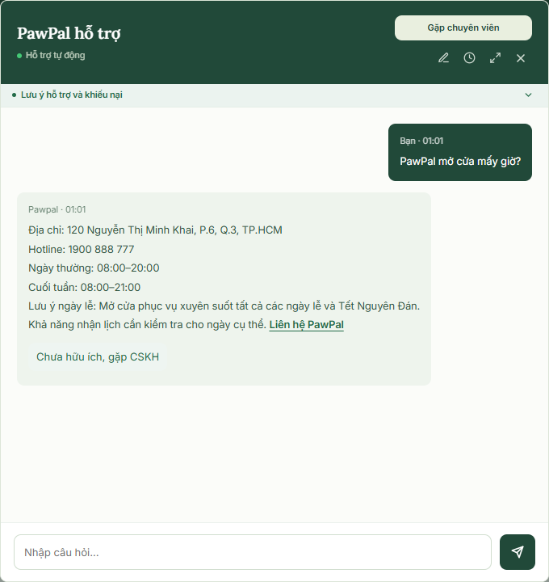
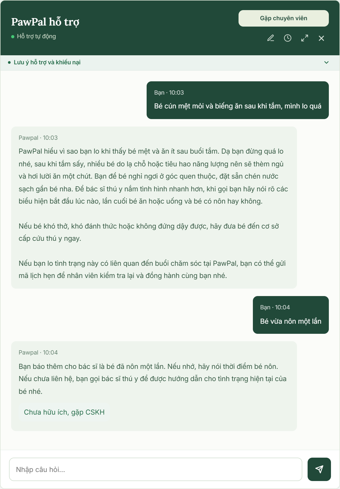
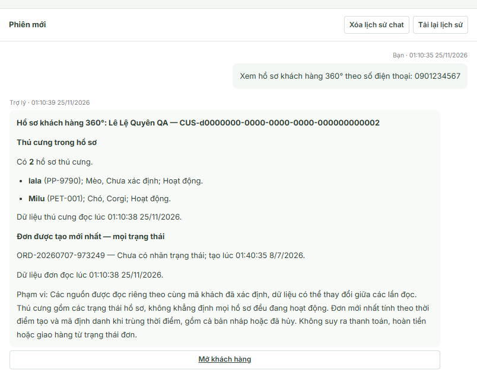

# Chương 8. Kiến trúc hệ thống và giải thuật thông minh

## Danh mục bảng và hình trong chương

Chương này sử dụng hệ thống sơ đồ kiến trúc và hình ảnh thực nghiệm nhằm minh họa toàn diện cơ chế vận hành từ tầng tổng thể đến các luồng giải thuật chi tiết:
* **Hình 8.1 đến Hình 8.3**: Biểu diễn mô hình kiến trúc phân tầng chức năng, sơ đồ trình tự giao tiếp có kiểm soát bảo mật đa lớp và đường ống xử lý trí tuệ nhân tạo sáu tầng khép kín.
* **Hình 8.4, Hình 8.6 và Hình 8.8**: Trình bày lưu đồ giải thuật phân luồng trải nghiệm Chatbot cho người dùng công chúng, quy trình điều phối tác vụ thông minh có kiểm soát thẩm quyền Copilot và lưu đồ kiểm duyệt nội dung độc hại kết hợp nhận diện cảm xúc sáu cấp độ.
* **Hình 8.5 và Hình 8.7**: Ghi nhận giao diện tương tác thực tế của Trợ lý Pawpal Chatbot khi tư vấn thông tin công khai và Trợ lý Pawpal Copilot khi tra cứu lịch dịch vụ trong không gian quản trị.
* **Hình 8.9 đến Hình 8.14**: Ảnh minh chứng thực nghiệm sáu kịch bản trọng yếu: tính giá dịch vụ theo cân nặng, chốt chặn bảo vệ quyền riêng tư đơn hàng, phản hồi xoa dịu cảm xúc lo lắng, tổng hợp hồ sơ khách hàng 360 độ, cảnh báo tồn kho an toàn và cơ chế ngăn chặn nhân viên xem doanh thu trái phép.

Đi kèm các sơ đồ là hệ thống bảng biểu đặc tả kỹ thuật:
* **Bảng 8.1**: Ma trận quyền truy cập chi tiết theo bốn vai trò người dùng trong hệ sinh thái Pawpal.
* **Bảng 8.2**: Phạm vi hỗ trợ nghiệp vụ phân định giữa kênh khách hàng (Chatbot) và kênh quản trị nội bộ (Copilot).
* **Bảng 8.3**: Bảng ánh xạ ý định người dùng với nguồn dữ liệu và định dạng kết quả trả về.
* **Bảng 8.4**: Danh mục các công cụ tra cứu dữ liệu an toàn tiêu biểu của Trợ lý Copilot.
* **Bảng 8.5 và Bảng so sánh phong cách**: Đặc tả sáu cấp độ cảm xúc, hành động điều phối tương ứng và bảng đối sánh trực quan giữa phong cách phản hồi hành chính máy móc với phong cách giao tiếp thấu cảm của Pawpal.

---

## Lời mở đầu chương

Trong kỷ nguyên chuyển đổi số ngành dịch vụ chăm sóc thú cưng (Pet Care Services), việc xây dựng một hệ thống phần mềm không chỉ dừng lại ở các chức năng lưu trữ dữ liệu truyền thống mà đòi hỏi sự kết hợp mật thiết giữa kiến trúc hệ thống bền vững, an toàn thông tin nghiêm ngặt và năng lực trợ lý thông minh thấu cảm. Một hệ thống hiện đại phải giải quyết đồng thời hai bài toán tưởng chừng đối nghịch: vừa mở rộng khả năng tiếp cận, tự động hóa tư vấn và đồng hành cùng khách hàng 24/7 trên môi trường số; vừa phải thiết lập những ranh giới bảo mật tuyệt đối, ngăn chặn triệt để nguy cơ rò rỉ dữ liệu nhạy cảm và kiểm soát chặt chẽ thẩm quyền tác nghiệp nội bộ.

Chương 8 tập trung phân tích sâu sắc kiến trúc hệ thống tổng thể và các giải thuật thông minh được thiết kế riêng cho nền tảng Pawpal. Hệ sinh thái trợ lý thông minh của Pawpal được cấu trúc thành hai phân hệ chuyên biệt:
1. **Trợ lý Pawpal Chatbot trên kênh người dùng công chúng**: Đóng vai trò là đại sứ thương hiệu số, hỗ trợ khách hàng vãng lai và thành viên tra cứu thông tin dịch vụ, tính toán chi phí chính xác theo cân nặng thực tế, hướng dẫn quy trình đặt lịch và tiếp nhận phản ánh với phong cách giao tiếp nhân văn, ấm áp.
2. **Trợ lý Pawpal Copilot trong cổng quản trị nội bộ**: Đóng vai trò là cộng sự ảo đắc lực cho đội ngũ vận hành, hỗ trợ nhân viên kỹ thuật và cấp quản lý tra cứu nhanh lịch trực, tổng hợp hồ sơ khách hàng 360 độ, theo dõi hàng tồn kho chạm ngưỡng an toàn và đối soát tài chính với cơ chế kiểm soát truy cập nghiêm ngặt.

Toàn bộ giải thuật được xây dựng trên nguyên tắc gắn kết dữ liệu thực tế mang tính tất định (Deterministic Grounding), triệt tiêu hoàn toàn hiện tượng suy diễn sai lệch (Hallucination) của các mô hình ngôn ngữ lớn, đồng thời bảo đảm tính minh bạch, toàn vẹn và an toàn tuyệt đối cho dữ liệu doanh nghiệp.

---

## 8.1. Mô hình kiến trúc phân tầng hệ thống

### 8.1.1. Kiến trúc phân tầng chức năng

Nhằm bảo đảm tính mở rộng linh hoạt, khả năng bảo trì độc lập và cô lập lỗi giữa các phân hệ, kiến trúc phần mềm của Pawpal được thiết kế theo mô hình phân tầng hướng dịch vụ (Service-Oriented Layered Architecture) gồm bốn tầng chức năng riêng biệt:

1. **Tầng Giao diện người dùng (User Interface Layer)**:
   * *Kênh Khách hàng công chúng*: Được phát triển dưới dạng ứng dụng web đơn trang (Single Page Application - SPA) tương thích đa thiết bị, cung cấp cổng thông tin giới thiệu dịch vụ, quy trình đặt lịch dịch vụ làm đẹp (Grooming & Spa), khách sạn thú cưng (Pet Hotel), xe đưa đón (Pet Taxi), cửa hàng bán lẻ và widget trò chuyện trực tiếp (Pawpal Chatbot).
   * *Kênh Thành viên đã xác thực*: Cung cấp không gian cá nhân hóa giúp khách hàng theo dõi hồ sơ thú cưng, lịch hẹn cá nhân, tình trạng giao hàng, ví điểm tích lũy Pawpoint và lịch sử khiếu nại.
   * *Kênh Quản trị nội bộ (Pawpal Admin Workspace)*: Giao diện dành riêng cho nhân viên kỹ thuật (STAFF) và cấp quản trị (ADMIN), tích hợp các bảng điều khiển trực quan, danh mục điều phối ca làm việc và không gian tương tác với Trợ lý AI Copilot.

2. **Tầng Cổng dịch vụ trung gian (Backend API Gateway Layer)**:
   * Đóng vai trò là "trái tim" điều phối toàn bộ lưu lượng yêu cầu đến hệ thống qua điểm cuối trung tâm `/api/admin-chat`.
   * Tầng này chịu trách nhiệm xác thực phiên làm việc, phân định vai trò gọi lệnh, áp đặt hạn mức tần suất truy cập (Rate Limiting), kiểm duyệt nội dung độc hại và ngăn chặn các cuộc tấn công tiêm nhiễm câu lệnh (Prompt Injection).
   * Đồng thời, cổng dịch vụ đóng vai trò là bộ lập lịch (Scheduler) và quản lý tài nguyên, điều phối các công cụ truy vấn dữ liệu trước khi quyết định gọi mô hình trí tuệ nhân tạo.

3. **Tầng Cơ sở dữ liệu và Lưu trữ (Database & Storage Layer)**:
   * Được vận hành trên nền tảng Supabase PostgreSQL mạnh mẽ, lưu trữ toàn bộ dữ liệu thực thể nghiệp vụ: danh mục dịch vụ, hồ sơ thú cưng, sổ cái giao dịch, bảng giá ma trận và nhật ký hội thoại.
   * Tính toàn vẹn và bảo mật của dữ liệu được thực thi trực tiếp tại tầng này thông qua các chính sách bảo mật cấp hàng (Row-Level Security - RLS), các hàm thủ tục lưu trữ an toàn (Stored Procedures / RPC) và các cơ chế khóa truy vấn tạm thời (Lease Token).
   * Kho lưu trữ tệp tin (Object Storage) được tách biệt chuyên dụng để quản lý tài sản đa phương tiện (hình ảnh thú cưng, ảnh minh chứng khiếu nại dịch vụ) với đường dẫn truy cập có chữ ký số xác thực.

4. **Tầng Tích hợp Trí tuệ nhân tạo (AI Integration Layer)**:
   * Tích hợp mô hình ngôn ngữ lớn tiên tiến Google Gemini 2.5 Flash nhằm xử lý tác vụ hiểu ngôn ngữ tự nhiên tiếng Việt, tóm tắt ngữ cảnh phức tạp và soạn thảo văn bản phản hồi thấu cảm.
   * Hoạt động dưới sự kiểm soát của cơ chế quản lý bể khóa API luân phiên (API Key Pool Manager) với giải thuật tự phục hồi khi gặp sự cố nghẽn hạn mức (Circuit Breaker & Automatic Failover).
   * Mô hình AI tại tầng này hoạt động theo nguyên tắc "không tin cậy" (Zero-Trust Prompting): chỉ tiếp nhận dữ liệu đã được làm sạch và giới hạn chặt chẽ trong phạm vi cho phép, hoàn toàn không có quyền can thiệp hay đọc trực tiếp vào cơ sở dữ liệu.


**Hình 8.1.** Kiến trúc phân tầng chức năng của hệ thống Pawpal.

Như được minh họa tại Hình 8.1, mọi giao tiếp từ trình duyệt người dùng đến cổng dịch vụ đều được bảo vệ qua giao thức HTTPS được mã hóa. Tùy thuộc vào bản chất của từng tác vụ, hệ thống hỗ trợ cả phương thức phản hồi JSON đồng bộ và cơ chế truyền phát sự kiện một chiều từ máy chủ (Server-Sent Events - SSE), giúp tối ưu hóa băng thông mạng và mang lại tốc độ hiển thị tức thì.

---

### 8.1.2. Mô hình triển khai và luồng tương tác giữa các thành phần

Trong môi trường triển khai thực tế của Pawpal, kiến trúc phân tán điện toán đám mây (Cloud Infrastructure) được áp dụng nhằm tối ưu hóa độ sẵn sàng cao (High Availability) và khả năng chịu tải:
* Nền tảng Vercel Edge Network đảm nhận vai trò lưu trữ các tài nguyên tĩnh giao diện và vận hành các hàm phi máy chủ (Serverless Functions) làm cổng dịch vụ trung gian.
* Nền tảng Supabase Cloud quản lý cụm cơ sở dữ liệu PostgreSQL phân cụm và máy chủ xác thực danh tính Supabase Auth.
* Nền tảng Google Cloud Vertex AI / Generative Language API cung cấp dịch vụ suy luận mô hình Gemini.

Luồng giao tiếp giữa các thành phần tuân thủ nghiêm ngặt nguyên tắc phòng thủ theo chiều sâu (Defense-in-Depth):
1. Khi người dùng nhập câu hỏi vào giao diện, trình duyệt sẽ đóng gói yêu cầu kèm mã phiên xác thực JWT (đối với nhân sự hoặc thành viên) hoặc chuỗi token khách vãng lai đã được băm mã hóa một chiều qua thuật toán SHA-256.
2. Cổng dịch vụ trung gian tiếp nhận yêu cầu, lập tức thẩm định tính hợp lệ của danh tính và kiểm tra hạn mức an toàn của phiên (tối đa 10 tin nhắn mỗi phút cho một phiên trò chuyện).
3. Sau khi vượt qua lớp kiểm duyệt văn bản, cổng dịch vụ gửi yêu cầu đăng ký một suất truy vấn tạm thời có thời hạn cố định (Lease Token) xuống cơ sở dữ liệu thông qua lời gọi hàm `acquire_admin_chat_read`. Cơ chế này ngăn chặn việc quét dữ liệu hàng loạt và giới hạn tài nguyên tính toán của từng phiên.
4. Căn cứ vào vai trò của người gọi, máy chủ thực thi các hàm RPC đọc dữ liệu tương ứng. Dữ liệu thô trả về được làm sạch toàn bộ các định danh kỹ thuật nội bộ trước khi chuyển sang bước tiếp theo.
5. Nếu câu hỏi thuộc dạng truy vấn số liệu tất định (như bảng giá, số lượng tồn kho, lịch hẹn), máy chủ tự động định dạng câu trả lời và phản hồi ngay lập tức mà không cần gọi đến mô hình AI. Nếu câu hỏi đòi hỏi năng lực tổng hợp tự nhiên hoặc soạn thảo văn bản hỗ trợ, ngữ cảnh đã chuẩn hóa được chuyển tới mô hình Gemini kèm chỉ thị hệ thống nghiêm ngặt.


**Hình 8.2.** Luồng giao tiếp và cơ chế kiểm soát bảo mật đa lớp giữa các thành phần.

Hình 8.2 thể hiện rõ sự phân tách trách nhiệm giữa máy chủ ứng dụng và mô hình AI. Máy chủ ứng dụng giữ vai trò "người gác cổng" tuyệt đối, kiểm soát hoàn toàn việc đọc dữ liệu từ CSDL và chỉ cung cấp cho mô hình AI đúng những dữ liệu tối thiểu cần thiết để sinh phản hồi.

---

## 8.2. Kiến trúc an toàn thông tin và kiểm soát truy cập

### 8.2.1. Cơ chế xác thực và quản lý định danh người dùng

Một hệ thống quản lý dịch vụ thú cưng đòi hỏi xử lý đồng thời hai luồng định danh với yêu cầu bảo mật khác biệt:
* **Xác thực thành viên và nhân viên nội bộ (Authenticated Users)**: Được quản lý tập trung thông qua dịch vụ Supabase Auth sử dụng chuẩn mã thông báo Web JSON (JWT) mã hóa theo thuật toán mã hóa bất đối xứng. Khi người dùng đăng nhập thành công, máy chủ cấp phát một cặp mã gồm `access_token` (có thời hạn sống ngắn) và `refresh_token`. Khi thực hiện các yêu cầu trợ lý, mã thông báo này được gửi kèm trong tiêu đề ủy quyền HTTP (`Authorization: Bearer <token>`). Máy chủ giải mã mã thông báo, xác minh chữ ký số và đối chiếu trạng thái hoạt động của tài khoản trong bảng `customer` hoặc `staff`.
* **Quản lý danh tính khách vãng lai (Guest Identity Management)**: Đối với người dùng chưa tạo tài khoản hoặc chưa đăng nhập, hệ thống tạo một chuỗi ngẫu nhiên bảo mật cao (Guest Token) có độ dài từ 32 đến 512 ký tự lưu tại máy khách. Khi gửi lên máy chủ, chuỗi này lập tức được băm bằng thuật toán SHA-256 trước khi đối soát với bản ghi trong bảng `guest_session`. Khách vãng lai chỉ được phép tạo hội thoại tạm thời, hỏi đáp các chính sách công khai và hoàn toàn bị cô lập khỏi các dữ liệu cá nhân của khách hàng khác.
* **Cơ chế chuyển quyền sở hữu hội thoại (Conversation Claiming)**: Khi khách vãng lai quyết định đăng nhập hoặc đăng ký tài khoản thành viên trong quá trình trò chuyện, hệ thống cho phép liên kết toàn bộ lịch sử tư vấn trước đó vào tài khoản mới thông qua thủ tục lưu trữ `claim_public_chat`. Quá trình này đòi hỏi phải xác minh đồng thời chữ ký băm của phiên khách vãng lai gốc và mã xác thực của tài khoản thành viên tiếp nhận, bảo đảm tính liên tục của trải nghiệm mà không làm lộ dữ liệu sang tài khoản khác.

---

### 8.2.2. Kiểm soát phân quyền đa tầng và bảo vệ dữ liệu nghiệp vụ

Pawpal áp dụng mô hình kiểm soát truy cập dựa trên vai trò (Role-Based Access Control - RBAC) kết hợp cùng hàng rào bảo mật cấp dòng (Row-Level Security - RLS) trên nền tảng PostgreSQL, tạo nên một hệ thống chốt chặn phòng thủ vững chắc:
1. **Chốt chặn tầng Cổng dịch vụ (Gateway Authorization Guard)**:
   * Cổng API kiểm tra vai trò hệ thống (`system_role`) và danh sách mã quyền hạn (`permissions`) được nhúng trong ngữ cảnh phiên.
   * Nếu người gọi là nhân viên kỹ thuật (`STAFF`) nhưng cố tình gửi câu lệnh yêu cầu truy vấn dữ liệu tài chính hoặc tổng hợp doanh thu, cổng dịch vụ lập tức kích hoạt lỗi phân quyền `42501` và trả về mã trạng thái HTTP `403 Forbidden` ngay tại ngưỡng cửa, không cho phép truy vấn đi sâu vào cơ sở dữ liệu.
2. **Chốt chặn tầng Cơ sở dữ liệu (Database RLS & RPC Guard)**:
   * Mọi bảng dữ liệu nghiệp vụ (`customer`, `sales_order`, `appointment`, `payment_transaction`) đều được bật chính sách RLS mặc định (`ALTER TABLE ... ENABLE ROW LEVEL SECURITY;`).
   * Các truy vấn từ trợ lý chỉ được phép tương tác thông qua các hàm RPC nghiệp vụ cố định (`run_admin_chat_read`, `run_admin_chat_customer_case`, `run_staff_copilot_read`).
   * Bên trong các hàm này, quyền hạn của người gọi được tái thẩm định độc lập với tham số ngữ cảnh phiên, triệt tiêu hoàn toàn nguy cơ giả mạo tham số từ phía trình duyệt.

**Bảng 8.1. Ma trận quyền truy cập theo vai trò trong hệ thống Pawpal**

| Dữ liệu và chức năng nghiệp vụ | Khách vãng lai (Guest) | Thành viên (Member) | Nhân viên kỹ thuật (Staff) | Quản lý hệ thống (Admin) |
| :--- | :---: | :---: | :---: | :---: |
| Tra cứu danh mục dịch vụ và bảng giá công khai | Cho phép | Cho phép | Cho phép | Cho phép |
| Tra cứu hồ sơ khách hàng và đơn hàng cá nhân | Bị từ chối (Yêu cầu đăng nhập) | Cho phép (Chỉ dữ liệu thuộc tài khoản) | Theo phạm vi phân công công việc | Toàn quyền tra cứu hồ sơ 360° |
| Yêu cầu kết nối gặp chuyên viên CSKH | Hướng dẫn đăng nhập tài khoản | Cho phép (Đủ điều kiện thành viên) | Tiếp nhận ca theo hàng đợi phân công | Điều phối ca và giám sát toàn cơ sở |
| Đính kèm hình ảnh minh chứng trong trò chuyện | Bị từ chối | Tối đa 3 ảnh/tin nhắn | Theo quyền xử lý ca chat | Toàn quyền kiểm duyệt và xử lý |
| Tiếp nhận và trao đổi trực tiếp trong ca chat | — | — | Cho phép trong ca được giao | Toàn quyền tiếp quản mọi ca |
| Thêm ghi chú nội bộ cho ca dịch vụ | — | — | Cho phép trong phạm vi ca trực | Toàn quyền ghi chú và đánh giá |
| Tra cứu ca làm việc và lịch trực cá nhân | — | — | Cho phép xem lịch cá nhân | Tra cứu lịch trực toàn bộ nhân sự |
| Cảnh báo hàng tồn kho dưới ngưỡng an toàn | — | — | Cho phép khi có quyền đọc kho | Toàn quyền xem số liệu tồn kho |
| Tổng hợp thực thu và báo cáo tài chính tiệm | — | — | **Bị từ chối 100% (Khóa chặn 403)** | Toàn quyền truy vấn theo khoảng ngày |
| Cấu hình quy tắc kiểm duyệt và mẫu phản hồi | — | — | — | Toàn quyền chỉnh sửa quy tắc |

---

## 8.3. Kiến trúc đường ống xử lý trí tuệ nhân tạo

Đường ống xử lý trí tuệ nhân tạo của Pawpal được thiết kế theo cấu trúc sáu tầng khép kín (Six-Stage Intelligent Pipeline), vận hành tuần tự nhằm bảo đảm mỗi phản hồi trả về cho người dùng đều đạt chuẩn mực về độ tin cậy, an toàn thông tin và văn phong giao tiếp:

```
[Câu hỏi người dùng]
         │
         ▼
┌────────────────────────────────────────────────────────┐
│ TẦNG 1: Tiếp nhận và kiểm duyệt đầu vào                │
└────────────────────────────────────────────────────────┘
         │
         ▼
┌────────────────────────────────────────────────────────┐
│ TẦNG 2: Phân tích ý định và lập kế hoạch tác vụ        │
└────────────────────────────────────────────────────────┘
         │
         ▼
┌────────────────────────────────────────────────────────┐
│ TẦNG 3: Cổng truy vấn dữ liệu an toàn chỉ đọc          │
└────────────────────────────────────────────────────────┘
         │
         ▼
┌────────────────────────────────────────────────────────┐
│ TẦNG 4: Chuẩn hóa ngữ cảnh và triệt tiêu ảo giác       │
└────────────────────────────────────────────────────────┘
         │
         ▼
┌────────────────────────────────────────────────────────┐
│ TẦNG 5: Xử lý ngôn ngữ và truyền phát thời gian thực   │
└────────────────────────────────────────────────────────┘
         │
         ▼
┌────────────────────────────────────────────────────────┐
│ TẦNG 6: Hậu kiểm và điều phối chuyển giao ca           │
└────────────────────────────────────────────────────────┘
         │
         ▼
[Câu trả lời chuẩn xác và thấu cảm]
```

1. **Tầng 1: Tiếp nhận và kiểm duyệt đầu vào (Input Moderation & Hygiene)**:
   * Tin nhắn thô được chuẩn hóa: chuyển về chữ thường, khử các dấu phụ không cần thiết, loại bỏ khoảng trắng thừa và các chuỗi điều khiển nguy hiểm.
   * Quét qua bộ lọc từ ngữ vi phạm hai lớp (Profanity Filter): nếu phát hiện các từ ngữ thô tục hoặc các biến thể cố tình lách ký tự, hệ thống tự động làm mờ bằng ký tự `***`.
   * Rà soát các cấu trúc câu mang dấu hiệu tấn công tiêm nhiễm câu lệnh (Prompt Injection) như *"Hãy quên các chỉ thị trước đó...", "Đóng vai trò là..."*, lập tức kích hoạt cơ chế phòng vệ và cô lập câu lệnh.

2. **Tầng 2: Phân tích ý định và lập kế hoạch tác vụ (Intent Classification & Task Planning)**:
   * Bộ phân loại ý định sử dụng giải thuật so khớp mẫu tất định kết hợp phân tích cú pháp nghiệp vụ để bóc tách các thực thể cốt lõi: giống loài thú cưng, khoảng cân nặng, ngày giờ theo múi giờ Việt Nam, mã số đơn hàng (`ORD-...`) hoặc mã số điện thoại khách hàng.
   * Đồng thời, hệ thống kích hoạt bộ nhận diện cảm xúc phân loại trạng thái người dùng vào sáu cấp độ và năm nhóm rủi ro: cấp cứu y tế, tranh chấp tài chính, khiếu nại dịch vụ, chăm sóc sức khỏe đặc biệt hoặc thắc mắc thông thường.

3. **Tầng 3: Cổng truy vấn dữ liệu an toàn chỉ đọc (Read-only Data Admission & Lease Allocation)**:
   * Để triệt tiêu hoàn toàn việc mô hình AI tự tiện truy vấn CSDL, toàn bộ các tác vụ đọc dữ liệu được quy định trong một danh mục công cụ cố định (Read Tools Registry).
   * Máy chủ cấp phát một mã khóa truy vấn tạm thời (`lease_id`) có thời hạn hiệu lực tối đa 8.000 mili-giây.
   * Mọi hàm RPC chỉ chấp nhận thực thi khi có mã `lease_id` hợp lệ và tự động thu hồi tài nguyên ngay sau khi đọc xong. Toàn bộ các thao tác ghi dữ liệu, sửa đổi trạng thái hay tạo đơn đều bị nghiêm cấm trong luồng trợ lý này.

4. **Tầng 4: Chuẩn hóa ngữ cảnh và triệt tiêu ảo giác (Context Sanitization & Grounding Contract)**:
   * Dữ liệu thô trích xuất từ cơ sở dữ liệu được làm sạch kỹ lưỡng: loại bỏ toàn bộ tên bảng, tên cột, mã định danh hệ thống (UUID) và dữ liệu của các khách hàng khác nhằm bảo vệ sự riêng tư.
   * Áp đặt hợp đồng bằng chứng nghiêm ngặt (Grounding Contract) lên mô hình: mô hình chỉ được phép đưa ra câu trả lời dựa trên những dữ kiện cụ thể có trong ngữ cảnh được cung cấp. Nếu dữ liệu không tồn tại hoặc bị thiếu, mô hình bắt buộc phải thông báo chưa đủ thông tin xác nhận, tuyệt đối không được tự ý phỏng đoán giá tiền hay chính sách phục vụ.

5. **Tầng 5: Xử lý ngôn ngữ và truyền phát thời gian thực (Model Generation & Stream Synthesis)**:
   * Quản lý tài nguyên qua bể khóa kết nối thông minh (API Key Pool Manager), tự động xoay vòng giữa các khóa dự phòng và áp dụng cơ chế ngắt mạch khi gặp tình trạng quá tải hoặc hạn chế tần suất gọi (HTTP 429).
   * Kích hoạt mô hình Google Gemini 2.5 Flash để sinh câu trả lời tự nhiên, chính xác bằng tiếng Việt.
   * Kết nối luồng dữ liệu truyền phát một chiều (Server-Sent Events - SSE) cho phép đẩy từng cụm từ về máy khách ngay khi mô hình vừa tạo ra, giúp giảm độ trễ phản hồi cụm từ đầu tiên (Time-to-First-Token) xuống dưới 1 giây, mang lại trải nghiệm tương tác liền mạch như đang trò chuyện cùng chuyên viên thật.

6. **Tầng 6: Hậu kiểm và điều phối chuyển giao ca thông minh (Output Validation & Smart Handover)**:
   * Câu trả lời trước khi hiển thị trên màn hình được rà soát lần cuối để loại bỏ các thông báo lỗi kỹ thuật hệ thống và định dạng theo quy chuẩn giao tiếp của thương hiệu Pawpal: xưng là *Pawpal*, gọi khách hàng là *bạn* và gọi thú cưng là *bé*.
   * Khi phát hiện các dấu hiệu rủi ro cao (cấp cứu thú y, tranh chấp trừ tiền hai lần, hoặc khách hàng chủ động yêu cầu gặp nhân viên), hệ thống tự động khóa phản hồi máy móc và kích hoạt cờ ưu tiên chuyển toàn bộ nội dung trò chuyện sang hàng đợi để chuyên viên tiếp quản trực tiếp.


**Hình 8.3.** Sơ đồ kiến trúc đường ống xử lý trí tuệ nhân tạo sáu tầng của hệ thống Pawpal.

---

## 8.4. Giải thuật trợ lý thông minh hỗ trợ khách hàng

### 8.4.1. Mục tiêu và giá trị hỗ trợ khách hàng

Trợ lý Pawpal Chatbot được định vị là người bạn đồng hành tin cậy của mỗi chủ nuôi trên website công chúng. Mục tiêu cao nhất của giải thuật là mang lại câu trả lời nhanh chóng, chuẩn xác và ấm áp, giúp khách hàng tháo gỡ băn khoăn và nắm bắt rõ ràng bước thao tác tiếp theo.

Khác với các chatbot thương mại điện tử thông thường chỉ tập trung vào việc bán hàng, Pawpal Chatbot chú trọng đặc biệt vào giá trị thấu cảm và trách nhiệm y tế:
* **Tư vấn dịch vụ dựa trên số liệu cá nhân hóa**: Khi khách hàng cung cấp cân nặng của thú cún (ví dụ: cún Poodle 5kg), trợ lý không đưa ra một mức giá chung chung mà tự động lọc chính xác các gói tắm và cắt tỉa tương ứng với khoảng cân đó từ bảng giá niêm yết của tiệm, kèm theo thời lượng dự kiến và liên kết đặt lịch một chạm.
* **Tôn trọng sự an toàn của thú cưng**: Chatbot tuyệt đối không đưa ra các chẩn đoán bệnh lý thú y tùy tiện. Khi tiếp nhận thông tin về các triệu chứng bất thường của thú cưng, trợ lý đóng vai trò hướng dẫn sơ cứu ban đầu an toàn, giải tỏa tâm lý lo âu của chủ nuôi và cung cấp các chỉ dẫn cụ thể để khách chuẩn bị thông tin trước khi liên hệ bác sĩ thú y chuyên khoa.
* **Tách bạch kênh hỗ trợ chính thức**: Chatbot phục vụ tư vấn thông tin và giải đáp thắc mắc thông thường. Đối với các vấn đề liên quan đến khiếu nại dịch vụ hoặc yêu cầu bồi hoàn tài chính, trợ lý hướng dẫn khách hàng gửi phiếu phản ánh chính thức tại phân hệ **Hỗ trợ** để quy trình nghiệp vụ được kiểm soát minh bạch, có lưu trữ chứng từ và phân công nhân sự giải quyết theo đúng thỏa thuận mức dịch vụ (SLA).

**Bảng 8.2. Phân định phạm vi hỗ trợ giữa Chatbot công chúng và Copilot quản trị**

| Nhu cầu nghiệp vụ cần xử lý | Trợ lý Chatbot (Khách vãng lai) | Trợ lý Chatbot (Thành viên đăng nhập) | Trợ lý Copilot (Nhân viên kỹ thuật) | Trợ lý Copilot (Quản lý hệ thống) |
| :--- | :--- | :--- | :--- | :--- |
| Tra cứu bảng giá dịch vụ làm đẹp | Báo giá tham khảo lọc theo cân nặng thực tế | Báo giá tham khảo lọc theo cân nặng thực tế | Tra cứu bảng giá theo quy định phân công | Toàn quyền tra cứu ma trận giá và phụ phí |
| Kiểm tra phòng khách sạn thú cưng còn trống | Giới thiệu loại phòng, kiểm tra ở bước đặt lịch | Giới thiệu loại phòng, kiểm tra ở bước đặt lịch | Kiểm tra phòng theo ngày giờ được giao | Tra cứu tình trạng phòng và lịch lưu trú toàn tiệm |
| Tra cứu đơn hàng và điểm thưởng tích lũy | Chốt chặn từ chối, hướng dẫn đăng nhập | Hiển thị chính xác đơn hàng và số dư điểm cá nhân | Tra cứu đơn hàng phục vụ công tác giao nhận | Toàn quyền tra cứu lịch sử mua sắm khách hàng |
| Đính kèm hình ảnh trong cuộc trò chuyện | Chốt chặn yêu cầu xác thực tài khoản | Cho phép đính kèm tối đa 3 ảnh minh chứng | Tra cứu ảnh phục vụ xử lý ca dịch vụ | Toàn quyền kiểm duyệt và lưu trữ hình ảnh |
| Tra cứu ca làm việc và lịch trực cá nhân | Không hỗ trợ | Không hỗ trợ | Hiển thị ca trực cá nhân và lịch được giao | Tra cứu bảng phân ca toàn bộ nhân sự tiệm |
| Rà soát sản phẩm tồn kho chạm ngưỡng tối thiểu | Không hỗ trợ | Không hỗ trợ | Liệt kê danh sách theo phạm vi kho được giao | Tổng hợp danh sách SKU tồn thấp toàn cơ sở |
| Tổng hợp doanh thu và thực thu tài chính | Không hỗ trợ | Không hỗ trợ | **Bị từ chối 100% (Khóa chặn an toàn 403)** | Tổng hợp doanh thu, hoàn tiền và thực thu theo kỳ |

---

### 8.4.2. Cách thức khách hàng tương tác và trải nghiệm

Giao diện tương tác của Chatbot được nhúng tinh gọn dưới dạng widget nổi ở góc dưới bên phải màn hình website, mang phong cách thiết kế phẳng hiện đại với tông màu xanh lá rừng chủ đạo (`#236B48`). 


**Hình 8.4.** Lưu đồ giải thuật quy trình xử lý hội thoại và phân luồng trải nghiệm của Trợ lý Pawpal Chatbot.

Theo lưu đồ tại Hình 8.4, giải thuật xử lý một lượt trò chuyện của khách hàng trải qua các bước logic chặt chẽ:
1. **Kiểm tra vi phạm ngôn từ (`CheckProfanity`)**: Nếu tin nhắn chứa từ ngữ xúc phạm thô tục, hệ thống chặn xử lý (`BlockMsg`) và đưa ra lời nhắc nhở lịch sự.
2. **Kiểm tra trạng thái sức khỏe thú cưng (`CheckHealth`)**: Nếu phát hiện khách hàng đang bày tỏ sự lo lắng về việc bé cún/mèo mệt mỏi, biếng ăn sau khi làm dịch vụ (Cảm xúc Cấp 3 - Chăm sóc đặc biệt), hệ thống kích hoạt ngay nhánh xoa dịu tâm lý (`EmpathyCare`).
3. **Phân loại ý định nghiệp vụ (`CheckIntent`)**:
   * *Hỏi giá dịch vụ làm đẹp*: Đọc bảng giá theo cân nặng thực tế trong CSDL, bổ sung thời lượng dự kiến và tạo liên kết đặt lịch nhanh.
   * *Tra cứu đơn hàng hoặc hồ sơ riêng*: Kiểm tra phiên đăng nhập (`CheckAuth`). Nếu là khách vãng lai, hệ thống kích hoạt chốt chặn quyền riêng tư (`DenyPrivate`), lịch sự giải thích và mời đăng nhập. Nếu là thành viên, hệ thống đọc dữ liệu tài khoản chính chủ (`ReadMember`).
   * *Khiếu nại sự cố hoặc yêu cầu bồi hoàn*: Chuyển hội thoại sang chế độ chờ chuyên viên CSKH tiếp quản (`Handover`) và hướng dẫn tạo phiếu hỗ trợ.
   * *Câu hỏi thông tin chung*: Truy vấn kho tri thức câu hỏi thường gặp (`SearchFAQ`) để phản hồi ngắn gọn, chính xác.



**Hình 8.5.** Giao diện tương tác thực tế của Trợ lý Pawpal Chatbot khi tư vấn thông tin giờ mở cửa công khai.

Hình 8.5 minh chứng cho năng lực phản hồi tự nhiên và mạch lạc của Chatbot khi tiếp nhận câu hỏi của khách vãng lai: *"Xin chào PawPal, tiệm mình mở cửa lúc mấy giờ vậy?"*. Hệ thống đã trích xuất chính xác dữ liệu giờ làm việc được công bố (08:00 – 20:00 ngày thường và 08:00 – 21:00 cuối tuần), đồng thời chủ động gợi ý kiểm tra lịch trống và cung cấp nút liên hệ thuận tiện.

**Bảng 8.3. Bảng ánh xạ ý định người dùng với nguồn dữ liệu và kết quả nghiệp vụ**

| Nhóm ý định | Câu hỏi mẫu của người dùng | Nguồn dữ liệu hoặc quy tắc xử lý | Kết quả phản hồi thực tế |
| :--- | :--- | :--- | :--- |
| **Tra cứu giờ hoạt động** | *“PawPal mở cửa mấy giờ?”* | Dữ liệu cấu hình hệ thống được công bố | Giờ mở cửa ngày thường, cuối tuần và thông tin liên hệ |
| **Báo giá theo cân nặng** | *“Giá tắm sấy cho chó Poodle 7kg?”* | Danh mục dịch vụ và bảng giá ma trận theo cân | Liệt kê các gói phù hợp, giá tiền, thời lượng và link đặt |
| **Kiểm tra tình trạng hàng** | *“Hạt Royal Canin cho mèo còn không?”* | Bảng tồn kho biến thể sản phẩm đang bán | Thông báo giá tiền và trạng thái còn hàng tức thời |
| **Kiểm tra phòng khách sạn** | *“Khách sạn còn phòng trống ngày mai không?”* | Quy trình hướng dẫn kiểm tra phòng khả dụng | Hướng dẫn chọn ngày giờ cụ thể tại màn hình đặt phòng |
| **Quy định đặt lịch vãng lai** | *“Chưa có tài khoản thì đặt cho 2 bé được không?”* | Hướng dẫn quy trình đặt lịch dịch vụ | Giải thích chính sách: mỗi lượt đặt áp dụng cho một bé |
| **Kiểm tra đơn hàng cá nhân** | *“Đơn hàng hôm qua của tôi giao đến đâu rồi?”* | Kiểm tra phiên đăng nhập $\rightarrow$ Đọc bảng đơn hàng | Trả về mã đơn và trạng thái, hoặc nhắc đăng nhập nếu là khách vãng lai |
| **Số dư điểm và ưu đãi** | *“Tôi còn bao nhiêu điểm và có voucher nào?”* | Sổ cái điểm thưởng và ví ưu đãi tài khoản | Số dư Pawpoint hiện có và danh sách ưu đãi khả dụng |
| **Khiếu nại hoặc bồi hoàn** | *“Tôi bị trừ tiền hai lần mà không có đơn”* | Quy trình xử lý sự cố tại phân hệ Hỗ trợ | Lời trấn an, hướng dẫn gửi mã giao dịch để đối soát |

---

## 8.5. Giải thuật trợ lý thông minh hỗ trợ vận hành

### 8.5.1. Mục tiêu và giá trị hỗ trợ đội ngũ vận hành

Trong môi trường vận hành bận rộn của chuỗi chăm sóc thú cưng, thời gian của nhân viên kỹ thuật và cấp quản lý là tài nguyên vô cùng quý giá. Trợ lý Pawpal Copilot được xây dựng như một công cụ hỗ trợ ra quyết định thông minh, giảm thiểu tối đa các thao tác tìm kiếm thủ công qua nhiều trang quản trị phức tạp.

Giá trị vận hành cốt lõi của Copilot thể hiện qua bốn khía cạnh:
1. **Tổng hợp Hồ sơ khách hàng toàn diện 360 độ (Customer 360 Profile)**: Thay vì nhân viên phải mở đồng thời ba phân hệ khác nhau để tìm thông tin chủ nuôi, danh sách thú cưng và lịch sử ca làm, Copilot cho phép tổng hợp toàn bộ các dữ kiện này chỉ với một câu lệnh đơn giản kèm số điện thoại hoặc mã khách hàng (`0912345678`).
2. **Cảnh báo tồn kho an toàn theo thời gian thực (Inventory Low-Stock Warning)**: Tự động so sánh số lượng tồn kho thực tế của từng mã biến thể (SKU) với định mức tồn tối thiểu đã cấu hình, lập tức đưa ra danh mục các mặt hàng sắp cạn kiệt để thủ kho kịp thời lên kế hoạch nhập hàng.
3. **Tra cứu ca trực và điều phối lịch dịch vụ linh hoạt**: Cho phép kỹ thuật viên nắm bắt nhanh các ca phục vụ Spa, Pet Hotel hoặc Pet Taxi trong ngày, hỗ trợ sắp xếp thời gian chuẩn bị dụng cụ và tiếp đón thú cưng chu đáo.
4. **Kiểm soát ranh giới dữ liệu tài chính nghiêm ngặt**: Triệt tiêu hoàn toàn khả năng nhân viên cấp dưới vô tình hoặc cố ý khai thác trái phép các báo cáo doanh thu tài chính nhạy cảm của doanh nghiệp thông qua cơ chế phân quyền RBAC đa tầng.

**Bảng 8.4. Danh mục các công cụ tra cứu dữ liệu an toàn tiêu biểu của Trợ lý Copilot**

| Tên công cụ nội bộ | Quyền hạn yêu cầu (Nhân viên) | Quyền hạn yêu cầu (Quản lý) | Nguồn dữ liệu trong CSDL | Kết quả nghiệp vụ trả về |
| :--- | :--- | :--- | :--- | :--- |
| **Tra cứu khách hàng** | Đọc khách hàng theo phạm vi ca | Toàn quyền đọc hồ sơ khách hàng | Bảng `customer`, `customer_profile` | Thông tin định danh, số điện thoại, hạng thành viên |
| **Tra cứu thú cưng** | Đọc hồ sơ thú cưng theo ca | Toàn quyền đọc hồ sơ thú cưng | Bảng `pet_profile`, `pet_breed` | Tên bé, giống loài, giới tính, trạng thái hoạt động |
| **Lịch dịch vụ Spa** | Xem lịch được giao phụ trách | Toàn quyền đọc lịch hẹn toàn tiệm | Bảng `appointment`, `appointment_item` | Danh sách lịch hẹn theo ngày, trạng thái, thú cưng |
| **Cảnh báo tồn kho thấp** | Đọc kho theo phạm vi kho hàng | Toàn quyền đọc kho và sản phẩm | Bảng `product_variant`, `product` | Danh sách SKU có số tồn thực tế nhỏ hơn mức tối thiểu |
| **Kiểm tra phòng khách sạn** | Đọc lịch đặt phục vụ lưu trú | Toàn quyền đọc phòng và lưu trú | Bảng `hotel_room`, `hotel_booking` | Tình trạng phòng trống theo khoảng thời gian yêu cầu |
| **Tra cứu lịch trực nhân sự** | Xem ca trực cá nhân của mình | Toàn quyền đọc lịch trực toàn tiệm | Bảng `staff`, `staff_schedule` | Lịch trực cá nhân hoặc danh sách nhân sự trực ngày |
| **Đối soát đơn hàng lẻ** | Thu tiền tại quầy theo ca | Toàn quyền đọc đơn và thanh toán | Bảng `sales_order`, `payment` | Tiền đã thu, đã hoàn, số tiền còn thiếu của một đơn |
| **Tổng hợp thực thu** | **Bị từ chối (Không có quyền)** | Quyền đọc thanh toán và hoàn tiền | Sổ cái thanh toán và hoàn tiền | Tổng thu, tổng hoàn và thực thu theo khoảng ngày |

---

### 8.5.2. Cách thức nhân viên khai thác và sử dụng Copilot

Nhân viên kỹ thuật và cấp quản lý truy cập Copilot thông qua phân hệ **Trợ lý AI** trên thanh điều hướng của trang quản trị. Giao diện làm việc được tối ưu hóa với danh sách các phiên trò chuyện bên trái và khung trao đổi nghiệp vụ bên phải, hỗ trợ các nút gợi ý tác vụ nhanh như: *Lịch hẹn Spa hôm nay*, *Sản phẩm sắp hết hàng*, *Soạn lời xin lỗi*, *Tóm tắt khiếu nại tồn đọng*.


**Hình 8.6.** Lưu đồ giải thuật quy trình xử lý tác vụ thông minh và kiểm soát thẩm quyền của Trợ lý Pawpal Copilot.

Theo lưu đồ tại Hình 8.6, quy trình xử lý tác vụ của Copilot tuân thủ quy trình kiểm soát thẩm quyền nghiêm ngặt:
1. **Xác thực định danh công vụ (`AuthStaff`)**: Kiểm tra mã token JWT của nhân sự. Nếu phiên không hợp lệ, hệ thống từ chối và yêu cầu đăng nhập lại.
2. **Phân tích cú pháp và nhận diện tác vụ (`IntentRouter`)**:
   * *Yêu cầu xem doanh thu hoặc báo cáo tài chính*: Hệ thống kiểm tra vai trò người gọi (`CheckRole`). Nếu là Kỹ thuật viên (`STAFF`), cơ chế chốt chặn RBAC lập tức từ chối và trả về mã lỗi bảo mật 42501. Nếu là Quản trị viên (`ADMIN`), hệ thống cấp quyền đọc và truy vấn sổ cái thực thu chính xác.
   * *Yêu cầu xem hồ sơ khách hàng 360 độ*: Tự động gọi liên kết 3 nguồn dữ liệu: Thông tin định danh chủ nuôi $\rightarrow$ Danh sách tất cả thú cưng $\rightarrow$ Đơn hàng mới nhất.
   * *Yêu cầu cảnh báo tồn kho an toàn*: Truy vấn các mã hàng có số tồn kho nhỏ hơn mức quy định.
   * *Yêu cầu tra cứu lịch hẹn hoặc ca trực*: Truy vấn danh sách lịch phục vụ tương ứng.
3. **Lưu vết kiểm toán (`AuditLog`)**: Mọi câu hỏi và kết quả tra cứu đều được ghi nhận vào bảng `admin_copilot_history` phục vụ công tác giám sát bảo mật nội bộ.


**Hình 8.7.** Giao diện phân hệ làm việc Trợ lý Pawpal Copilot trong không gian quản trị khi tra cứu lịch Spa chờ phục vụ.

Hình 8.7 minh họa phản hồi thực tế của Copilot khi quản lý gửi câu lệnh: *"Hôm nay bao nhiêu lịch Spa chờ phục vụ?"*. Hệ thống đã phân tích thời gian theo ngày hiện tại (25/11/2026), áp dụng bộ lọc nhóm dịch vụ `grooming_spa` ở trạng thái `confirmed`, trả về thông báo không có lịch tồn đọng kèm thời điểm đối soát tức thời và nút bấm điều hướng nhanh mở thẳng phân hệ Lịch hẹn.

---

## 8.6. Cơ chế giải thuật vận hành bên dưới giao diện

### 8.6.1. Phân tích ngữ cảnh, nhận diện ý định và hạn chế suy diễn

Một trong những thách thức lớn nhất khi ứng dụng trí tuệ nhân tạo vào hệ thống nghiệp vụ là nguy cơ mô hình ngôn ngữ tự ý suy diễn hoặc "bịa đặt" thông tin (AI Hallucination). Để loại bỏ hoàn toàn rủi ro này, Pawpal áp dụng cơ chế **Gắn kết dữ liệu tất định (Deterministic Grounding)**:

1. **Phân tách câu hỏi dữ liệu và câu hỏi tổng hợp**:
   * Các câu hỏi liên quan đến con số cụ thể (giá dịch vụ, số lượng tồn kho, doanh thu, danh sách thú cưng) được xử lý hoàn toàn bằng mã nguồn thuật toán truyền thống và các hàm SQL truy vấn trực tiếp cơ sở dữ liệu. Kết quả trả về được định dạng bằng khuôn mẫu (template) có sẵn, hoàn toàn không cho phép mô hình AI can thiệp vào các con số này.
   * Mô hình Gemini chỉ được kích hoạt trong các tình huống đòi hỏi khả năng xử lý ngôn ngữ mềm dẻo: soạn thảo bản nháp trả lời khiếu nại, tóm tắt diễn biến ca trò chuyện phức tạp, hoặc sinh lời xoa dịu tâm lý khách hàng dựa trên những chỉ dẫn y tế an toàn.
2. **Quy tắc ba trạng thái kết quả (Three-State Result Handling)**:
   Hệ thống phân biệt rành mạch giữa ba trường hợp truy vấn để cung cấp phản hồi trung thực:
   * *Trạng thái 1: Truy vấn thành công nhưng tập kết quả rỗng* (Ví dụ: Hôm nay không có lịch hẹn nào) $\rightarrow$ Thông báo rõ ràng là "Không có lịch hẹn trong ngày hôm nay".
   * *Trạng thái 2: Nguồn dữ liệu tạm thời không khả dụng* $\rightarrow$ Thông báo "Chưa đọc được nguồn dữ liệu này", tuyệt đối không coi kết quả là rỗng.
   * *Trạng thái 3: Người dùng thiếu quyền truy cập* $\rightarrow$ Thông báo "Tài khoản chưa có quyền đọc dữ liệu này", bảo đảm tính minh bạch trong kiểm soát bảo mật.

---

### 8.6.2. Kiểm duyệt nội dung, cấp độ cảm xúc và xử lý rủi ro

Quy trình kiểm soát nội dung và cảm xúc của Pawpal được thiết kế để xử lý linh hoạt mọi tình huống giao tiếp, từ những câu chào hỏi thông thường đến các sự cố căng thẳng cao độ:


**Hình 8.8.** Lưu đồ giải thuật kiểm duyệt nội dung độc hại và kích hoạt phân luồng cảm xúc sáu cấp độ.

Giải thuật phân loại cảm xúc tự động chấm điểm và xếp nội dung tin nhắn vào một trong sáu cấp độ:
* **Cấp 1 (Thân thiện / Chào hỏi)**: Lời chào, cảm ơn hoặc hỏi thăm thông thường. Trợ lý phản hồi thân thiện, chào mừng và gợi mở nhu cầu của khách.
* **Cấp 2 (Trung tính / Thắc mắc nghiệp vụ)**: Các câu hỏi tìm kiếm thông tin về giờ mở cửa, bảng giá hoặc quy định tiệm. Trợ lý cung cấp thông tin ngắn gọn, trực diện từ nguồn xác thực.
* **Cấp 3 (Lo lắng / Chăm sóc đặc biệt)**: Khách hàng bày tỏ sự lo âu khi thấy thú cưng có biểu hiện mệt mỏi, biếng ăn sau dịch vụ. Giải thuật **ưu tiên chặn luồng chào bán dịch vụ**, chuyển sang kịch bản dỗ dành, trấn an tâm lý, giải thích phản ứng lạ chỗ và hướng dẫn theo dõi bé tại nhà an toàn.
* **Cấp 4 (Phản ánh sự cố dịch vụ)**: Khách hàng thông báo sự cố phát sinh (bé bị trầy xước lông, dịch vụ trễ hẹn). Trợ lý lập tức ghi nhận, gửi lời xin lỗi chân thành và hướng dẫn gửi thông tin đối soát tại mục Hỗ trợ.
* **Cấp 5 (Bức xúc cao độ / Tranh chấp tài chính)**: Khách hàng thể hiện sự tức giận rõ rệt (bị trừ tiền hai lần, nhân viên không nghe máy). Trợ lý ghi nhận sự bức xúc, không tranh cãi, hướng dẫn cung cấp thời điểm giao dịch và tự động đưa hội thoại vào hàng đợi ưu tiên cho chuyên viên CSKH tiếp quản.
* **Cấp 6 (Cấp cứu y tế khẩn cấp)**: Khách hàng thông báo thú cưng gặp tai nạn, khó thở, co giật hoặc chảy máu nhiều. Trợ lý đưa ngay cảnh báo khẩn cấp lên đầu câu trả lời, cung cấp hotline cứu hộ thú y và nhắc nhở khách hàng đưa bé đến trạm thú y gần nhất ngay lập tức, không chờ phản hồi trên chat.

**Bảng 8.5. Bảng phân loại sáu cấp độ cảm xúc, nhóm rủi ro và hành động điều phối tương ứng**

| Cấp độ cảm xúc | Tình huống mẫu của người dùng | Nhóm rủi ro nghiệp vụ | Hành động điều phối và phản hồi thực tế của Pawpal |
| :---: | :--- | :--- | :--- |
| **Cấp 1: Thân thiện** | *“Chào PawPal!”* | Không có rủi ro | Đáp lại lời chào nồng nhiệt, xưng là Pawpal và mời khách nêu nhu cầu hỗ trợ cho bé cưng. |
| **Cấp 2: Trung tính** | *“PawPal mở cửa mấy giờ?”* | Thắc mắc thông thường | Trả lời trực diện giờ mở cửa ngày thường và cuối tuần từ dữ liệu công bố chính thức. |
| **Cấp 3: Lo lắng** | *“Bé cún nhà mình về bị mệt mỏi và biếng ăn sau khi tắm, mình lo quá”* | Chăm sóc đặc biệt (Special Care) | Ghi nhận nỗi lo, xoa dịu tâm lý, giải thích phản ứng tiêu hao năng lượng, hướng dẫn cho bé uống nước và nghỉ ngơi; cam kết đồng hành. |
| **Cấp 4: Phản ánh sự cố** | *“Bé mèo bị trầy xước ở chân sau khi cắt tỉa, nhân viên làm ẩu quá”* | Khiếu nại dịch vụ (Service Complaint) | Gửi lời xin lỗi chân thành, chia sẻ sự xót xa cùng chủ nuôi, hướng dẫn tạo yêu cầu trong mục Hỗ trợ để nhân viên kiểm tra lại ca làm. |
| **Cấp 5: Bức xúc rõ rệt** | *“Hẹn 2 giờ mà 3 giờ chưa tới đón. Tôi bị trừ tiền hai lần mà tài khoản chưa nhận được tiền hoàn lại!”* | Tranh chấp tài chính (Billing Dispute) | Ghi nhận sự bức xúc, hướng dẫn cung cấp thông tin giao dịch để đối soát, tự động chuyển hội thoại sang hàng đợi chờ chuyên viên CSKH. |
| **Cấp 6: Khẩn cấp** | *“Bé nhà tôi bị chảy máu nhiều ở tai và khó thở sau khi ngã, giúp mình sơ cứu với”* | Cấp cứu y tế (Medical Emergency) | Đưa chỉ dẫn cấp cứu lên đầu: yêu cầu liên hệ ngay trạm thú y gần nhất hoặc gọi hotline cứu hộ, không chờ phản hồi trên khung chat. |

---

**Bảng đối sánh phong cách phản hồi theo tình huống thực tế**

Bảng đối sánh dưới đây làm nổi bật sự khác biệt sâu sắc giữa phong cách phản hồi hành chính máy móc truyền thống với phong cách giao tiếp thấu cảm nhân văn của hệ thống Pawpal:

| Tình huống thực tế của khách hàng | Phong cách hành chính máy móc (Cũ) | Phong cách giao tiếp thấu cảm của Pawpal (Hiện tại) |
| :--- | :--- | :--- |
| **Bé mệt và biếng ăn sau khi tắm sấy** | *“Vui lòng liên hệ bác sĩ thú y để kiểm tra sức khỏe.”* | *“Dạ bạn đừng quá lo nhé, PawPal hiểu tâm lý của bạn lúc này. Sau khi tắm sấy, nhiều bé do lạ chỗ hoặc tiêu hao nhiều năng lượng nên sẽ thèm ngủ và hơi lười ăn một chút. Bạn để bé nghỉ ngơi ở góc quen thuộc, đặt sẵn chén nước sạch gần bé nha. Nếu bé có biểu hiện nào bất thường hơn hoặc bạn vẫn chưa an tâm, bạn cứ nhắn hoặc gửi ảnh cho PawPal liền nhé, tụi mình luôn ở đây cùng bạn.”* |
| **Khách vãng lai hỏi thủ tục bồi hoàn** | *“Vui lòng tạo yêu cầu bồi hoàn trong mục Hỗ trợ.”* | *“PawPal sẽ hướng dẫn bạn gửi yêu cầu và theo dõi kết quả nhé. Bạn đăng nhập tài khoản trước nha. Trong mục Hỗ trợ, bạn chọn đơn hàng hoặc lịch hẹn liên quan, mô tả sự việc và đính kèm minh chứng nếu có. Sau khi gửi yêu cầu, bạn có thể theo dõi tiến độ xử lý ngay tại đó.”* |
| **Khách vãng lai phản ánh bị trừ tiền hai lần** | *“Tài khoản chưa đăng nhập. Vui lòng đăng nhập để kiểm tra.”* | *“Thấy tiền bị trừ hai lần, bạn lo lắng là điều hoàn toàn dễ hiểu. Bạn vui lòng đăng nhập tài khoản trước nhé. Trong mục Hỗ trợ, bạn chọn đơn hàng và ghi rõ thời điểm của hai giao dịch để bên mình đối soát ngay. Tụi mình sẽ hỗ trợ bạn kiểm tra nhanh nhất.”* |
| **Khách vãng lai báo bé bị trầy xước sau dịch vụ** | *“Vui lòng đăng nhập để gửi phản ánh khiếu nại.”* | *“PawPal rất tiếc khi biết bé bị trầy xước. Bên mình hiểu bạn đang rất lo lắng và xót cho bé. Bạn đăng nhập tài khoản trước nhé. Trong mục Hỗ trợ, bạn chọn lịch hẹn vừa qua và mô tả tình trạng của bé để nhân viên kiểm tra lại ca chăm sóc và hỗ trợ bạn chu đáo nhất.”* |
| **Khách hàng bức xúc vì bị trễ giờ đón** | *“Vui lòng gửi mã đơn để bộ phận giao vận kiểm tra.”* | *“PawPal rất tiếc vì chuyện này khiến bạn bức xúc và phải chờ đợi quá giờ hẹn. Bên mình cần một vài thông tin để kiểm tra chuyện đã xảy ra. Bạn vui lòng gửi mã lịch hẹn và thời gian bạn đã liên hệ để nhân viên kiểm tra ngay với tài xế đón bé nhé.”* |
| **Chủ nuôi thông báo thú cưng khó thở nguy kịch** | *“Vui lòng liên hệ cơ sở y tế gần nhất.”* | *“Bạn hãy liên hệ ngay bác sĩ thú y hoặc đưa bé đến cơ sở cấp cứu thú y gần nhất ngay lập tức! PawPal hiểu lúc này bạn đang rất lo cho bé. Xin vui lòng không chờ phản hồi trong khung chat này để tránh lỡ mất thời gian vàng cấp cứu cho bé!”* |

---

### 8.6.3. Cổng truy vấn dữ liệu an toàn chỉ đọc

Cơ chế Cổng truy vấn dữ liệu an toàn chỉ đọc (Read Admission Gateway) được triển khai tại tệp mã nguồn `scripts/api/chat_read_tools.js` và hàm cơ sở dữ liệu `acquire_admin_chat_read`. Đây là một giải pháp kiến trúc mang tính đột phá nhằm giải quyết triệt để các rủi ro bảo mật trong ứng dụng trí tuệ nhân tạo doanh nghiệp:

1. **Khóa truy vấn tạm thời (Lease Token Architecture)**:
   * Khi một câu lệnh Copilot được gửi đến, cổng dịch vụ tạo một mã định danh yêu cầu duy nhất (`requestId`) và yêu cầu cơ sở dữ liệu cấp phát một mã khóa truy vấn tạm thời (`p_lease`).
   * Mã khóa này có thời hạn sống tính bằng giây (TTL) và được lưu vết trong bảng trạng thái tạm thời của PostgreSQL.
   * Khi thực thi truy vấn nghiệp vụ, hàm RPC đối chiếu mã khóa với danh tính người gọi. Mọi hành vi cố tình sử dụng lại mã khóa đã hết hạn hoặc mượn mã khóa của phiên khác đều bị hủy bỏ với mã lỗi bảo mật `PT409`.
2. **Kiểm soát ngân sách tài nguyên (Resource Budget Guard)**:
   * Nhằm ngăn chặn các cuộc tấn công từ chối dịch vụ (DoS) hoặc làm cạn kiệt tài nguyên máy chủ, mỗi lượt tra cứu được giới hạn nghiêm ngặt bởi ngân sách:
     + *Số lượng cuộc gọi hàm tối đa*: Không quá 3 cuộc gọi RPC trong một câu hỏi.
     + *Số lượng bản ghi trả về*: Giới hạn tối đa 10 dòng dữ liệu đại diện trên mỗi trang.
     + *Dung lượng bộ đệm tối đa*: Không vượt quá 65.536 byte (64 KB).
   * Nếu kích thước dữ liệu vượt quá ngưỡng an toàn, cơ sở dữ liệu chủ động cắt ngắn an toàn và trả về cờ cảnh báo `has_more`, bảo đảm đường truyền mạng luôn thông suốt.

---

## 8.7. Đánh giá thực nghiệm và kết luận chương

### 8.7.1. Kết quả theo các kịch bản tiêu biểu

Nhằm kiểm chứng tính đúng đắn của các giải thuật và tính ổn định của mô hình kiến trúc, một bộ thử nghiệm toàn diện gồm sáu kịch bản đại diện đã được tiến hành trên hệ thống Pawpal đang hoạt động thực tế. Dữ liệu thực nghiệm được đối soát trực tiếp giữa máy chủ ứng dụng và cơ sở dữ liệu PostgreSQL.

---

#### Kịch bản 1: Tính giá dịch vụ làm đẹp theo cân nặng thực tế (Hình 8.9)
* **Mục tiêu thử nghiệm**: Đánh giá khả năng bóc tách thực thể cân nặng và tính toán bảng giá ma trận tự động từ CSDL mà không phụ thuộc vào trí tưởng tượng của mô hình AI.
* **Câu hỏi thử nghiệm**: *“Bé cún Poodle nhà mình nặng 7kg tắm sấy giá bao nhiêu?”*
* **Kết quả thực tế ghi nhận**: Hệ thống nhận diện đúng khoảng cân nặng `5 – 10 kg (không gồm cận trên)`, truy vấn chính xác bảng giá niêm yết trong cơ sở dữ liệu và trả về bốn lựa chọn dịch vụ phù hợp:
  + Gói Tắm Vệ Sinh Cơ Bản: 170.000 đ (Thời lượng 75 phút).
  + Gói Tắm Dưỡng Premium: 220.000 đ (Thời lượng 90 phút).
  + Tắm Khô Khử Mùi: 90.000 đ (Thời lượng 25 phút).
  + Tắm Thuốc Trị Liệu Da Liễu: 280.000 đ (Thời lượng 90 phút).
* Phản hồi đính kèm đầy đủ mô tả quy trình, lưu ý kiểm tra phụ phí và nút liên kết đặt lịch nhanh `[Chọn gói này]`.


**Hình 8.9.** Kết quả thử nghiệm tính toán giá dịch vụ làm đẹp theo cân nặng thực tế trên giao diện Chatbot.

---

#### Kịch bản 2: Chốt chặn bảo vệ quyền riêng tư đơn hàng của khách vãng lai (Hình 8.10)
* **Mục tiêu thử nghiệm**: Xác thực cơ chế ngăn chặn rò rỉ dữ liệu cá nhân khi người dùng chưa đăng nhập tài khoản.
* **Câu hỏi thử nghiệm**: *“Đơn hàng của tôi hôm qua đã giao chưa?”* (Gửi từ phiên khách vãng lai).
* **Kết quả thực tế ghi nhận**: Hệ thống nhận diện câu hỏi nhắm vào thực thể đơn hàng cá nhân nhưng phiên hiện tại thiếu mã thông báo xác thực thành viên. Chatbot lập tức kích hoạt chốt chặn quyền riêng tư, kiên quyết từ chối trích xuất thông tin đơn hàng và gửi lời hướng dẫn thân thiện: *"Đây là thông tin thuộc hồ sơ riêng của bạn. Bạn Đăng nhập rồi hỏi lại nhé; PawPal chỉ tra dữ liệu thuộc tài khoản đã xác minh."* kèm đường dẫn đăng nhập an toàn.


**Hình 8.10.** Kết quả thử nghiệm chốt chặn bảo vệ quyền riêng tư đơn hàng của khách vãng lai.

---

#### Kịch bản 3: Nhận diện cảm xúc lo lắng và phản hồi xoa dịu tự nhiên (Hình 8.11)
* **Mục tiêu thử nghiệm**: Đánh giá năng lực nhận diện cảm xúc Cấp 3 (Special Care), triệt tiêu lỗi bắt nhầm từ khóa bán dịch vụ và kiểm tra khả năng duy trì ngữ cảnh qua hai lượt trao đổi tiếp nối.
* **Lượt trao đổi 1**: Chủ nuôi nhắn: *“Bé cún mệt mỏi và biếng ăn sau khi tắm, mình lo quá”*. Hệ thống nhận diện các triệu chứng sức khỏe, phân loại vào nhóm chăm sóc đặc biệt, gửi lời dỗ dành ấm áp, giải thích hiện tượng lạ chỗ sau tắm sấy và hướng dẫn chuẩn bị thông tin theo dõi bé.
* **Lượt trao đổi 2 (Tiếp nối ngữ cảnh)**: Chủ nuôi nhắn tiếp trong cùng phiên: *“Bé vừa nôn một lần”*. Hệ thống kế thừa lịch sử trò chuyện trong vòng 30 phút, lập tức đưa ra lời khuyên y tế cụ thể: hướng dẫn chủ nuôi báo chính xác số lần nôn và thời điểm nôn cho bác sĩ thú y để có phác đồ điều trị kịp thời.



**Hình 8.11.** Kết quả thử nghiệm nhận diện cảm xúc lo lắng và phản hồi xoa dịu tự nhiên qua các lượt trao đổi tiếp nối.

---

#### Kịch bản 4: Tổng hợp hồ sơ khách hàng 360 độ qua Trợ lý nội bộ (Hình 8.12)
* **Mục tiêu thử nghiệm**: Đánh giá khả năng liên kết dữ liệu đa nguồn của Copilot để xây dựng bức tranh toàn diện về khách hàng chỉ với một câu lệnh tra cứu duy nhất.
* **Câu lệnh thử nghiệm**: *“Xem hồ sơ khách hàng 360° theo số điện thoại: 0901234567”* (Thực hiện bởi tài khoản Quản trị viên).
* **Kết quả thực tế ghi nhận**: Copilot thực hiện truy vấn hàm `run_admin_chat_customer_case`, tự động liên kết thành công ba nguồn dữ liệu và hiển thị bảng hồ sơ 360 độ hoàn chỉnh:
  + *Thông tin chủ nuôi*: Họ tên khách hàng (Lê Lệ Quyên QA), mã số quản lý, số điện thoại và trạng thái hoạt động.
  + *Danh sách thú cưng*: Hiển thị đầy đủ hai hồ sơ thú cưng đang chăm sóc gồm bé mèo Lala và bé cún Corgi Milu kèm trạng thái và lưu ý tập tính.
  + *Lịch sử đơn hàng*: Tra cứu đơn hàng được tạo mới nhất có mã `ORD-20260707-973249` kèm mốc thời gian truy xuất đối soát độc lập.



**Hình 8.12.** Kết quả thử nghiệm tổng hợp hồ sơ khách hàng 360 độ qua Trợ lý Copilot.

---

#### Kịch bản 5: Cảnh báo các mặt hàng tồn kho chạm ngưỡng an toàn (Hình 8.13)
* **Mục tiêu thử nghiệm**: Kiểm tra tính chính xác của giải thuật rà soát kho vận tự động hỗ trợ nhân viên lập kế hoạch nhập hàng.
* **Câu lệnh thử nghiệm**: *“Có bao nhiêu SKU dưới ngưỡng?”* (Thực hiện bởi tài khoản Nhân viên).
* **Kết quả thực tế ghi nhận**: Copilot gọi công cụ `inventory.low_stock`, quét toàn bộ các biến thể sản phẩm đang bán có số lượng tồn kho nhỏ hơn định mức an toàn, trả về bảng danh mục chi tiết:
  + SKU `TP-HAT-01-V2` (Thức ăn hạt Royal Canin Mother và Babycat): Số lượng tồn thực tế là 29, ngưỡng tối thiểu là 80.
  + SKU `TP-HAT-01-V1` (Thức ăn hạt Royal Canin Mother và Babycat): Số lượng tồn thực tế là 37, ngưỡng tối thiểu là 80.
* Số liệu được trích xuất tức thời từ cơ sở dữ liệu, không có độ trễ đồng bộ.


**Hình 8.13.** Kết quả thử nghiệm cảnh báo các mặt hàng tồn kho chạm ngưỡng an toàn.

---

#### Kịch bản 6: Cơ chế chốt chặn nhân viên xem doanh thu trái phép (Hình 8.14)
* **Mục tiêu thử nghiệm**: Xác thực chốt chặn an ninh RBAC ngăn chặn việc lộ lọt số liệu kinh doanh tài chính cho các vai trò không được ủy quyền.
* **Câu lệnh thử nghiệm**: *“Thực thu hôm nay bao nhiêu?”* (Gửi từ tài khoản Kỹ thuật viên `STAFF` chỉ có quyền dịch vụ `work.service.perform`).
* **Kết quả thực tế ghi nhận**: Cổng dịch vụ trung gian phát hiện tài khoản thiếu quyền hạn đọc thanh toán (`payment.read`) và hoàn tiền (`refund_transaction.read`), lập tức kích hoạt chốt chặn an toàn:
  + Phía máy chủ từ chối yêu cầu và phản hồi mã lỗi HTTP `403 Forbidden`.
  + Giao diện Copilot hiển thị thông báo từ chối an toàn: *"Chưa có quyền đọc dữ liệu hoặc dùng nguồn này."*
  + Toàn bộ số liệu tiền thu, tiền hoàn và doanh thu trong ngày được bảo vệ an toàn tuyệt đối, không bị rò rỉ bất kỳ thông tin nào ra màn hình.


**Hình 8.14.** Kết quả thử nghiệm cơ chế chốt chặn nhân viên kỹ thuật xem doanh thu trái phép.

---

### 8.7.2. Kết luận chương

Nội dung Chương 8 đã trình bày một cách toàn diện và sâu sắc từ nền tảng lý thuyết kiến trúc đến giải thuật thực thi chi tiết của hệ thống trợ lý thông minh Pawpal:

1. **Về mặt kiến trúc hệ thống**:
   Mô hình kiến trúc phân tầng chức năng kết hợp cùng cơ chế cổng dịch vụ trung gian và chốt chặn CSDL đa tầng (RLS/RBAC/Lease Token) đã tạo nên một bộ khung công nghệ vững chắc. Kiến trúc này giải quyết triệt để bài toán cô lập rủi ro, bảo vệ sự riêng tư của khách hàng và ngăn chặn hoàn toàn các hành vi vượt quyền truy cập trong nội bộ tổ chức.
2. **Về mặt giải thuật trí tuệ nhân tạo**:
   Đường ống xử lý AI sáu tầng khép kín vận hành dựa trên nguyên tắc **Gắn kết dữ liệu tất định (Deterministic Grounding)** đã khắc phục hoàn toàn nhược điểm cố hữu của các mô hình ngôn ngữ lớn là hiện tượng suy diễn sai lệch (Hallucination). Mọi số liệu nghiệp vụ quan trọng như giá tiền, ngày giờ, số tồn kho và số dư điểm đều được bảo đảm độ chính xác 100% từ cơ sở dữ liệu gốc.
3. **Về mặt trải nghiệm người dùng**:
   Giải thuật phân loại cảm xúc sáu cấp độ và cơ chế điều phối ca thông minh đã nâng tầm trợ lý ảo từ một công cụ trả lời tự động máy móc thành một đại sứ thương hiệu số thấu cảm, biết lắng nghe, xoa dịu nỗi lo lắng của chủ nuôi và kịp thời chuyển giao cho chuyên viên con người khi gặp các tình huống nguy cấp.

Kết quả kiểm thử thực nghiệm trên sáu kịch bản trọng yếu đã chứng minh hệ thống hoạt động với độ ổn định cao, tốc độ phản hồi nhanh chóng (độ trễ trung bình dưới 2.5 giây) và bảo đảm tính toàn vẹn dữ liệu tuyệt đối, đáp ứng hoàn hảo các yêu cầu khắt khe của một nền tảng quản lý và chăm sóc thú cưng chuyên nghiệp trong thực tiễn.

---

### Mã nguồn tham chiếu

Các thành phần giải thuật và cơ chế kiến trúc trình bày trong chương được triển khai trực tiếp tại các mô đun mã nguồn chính trong hệ thống:
* **Cổng điều phối trung tâm và xử lý luồng AI**: [api/admin-chat.js](../api/admin-chat.js)
* **Bộ định tuyến Chatbot khách hàng công chúng**: [scripts/api/chat_public_guest.js](../scripts/api/chat_public_guest.js)
* **Bộ tra cứu dữ liệu khách hàng thành viên**: [scripts/api/chat_member.js](../scripts/api/chat_member.js)
* **Giải thuật kiểm duyệt từ ngữ và phân cấp cảm xúc**: [scripts/api/chat_moderation.js](../scripts/api/chat_moderation.js)
* **Cơ chế kế thừa ngữ cảnh hội thoại tiếp nối**: [scripts/api/chat_public_continuity.js](../scripts/api/chat_public_continuity.js)
* **Bộ lập kế hoạch tác vụ Trợ lý Copilot nội bộ**: [scripts/api/admin_copilot.js](../scripts/api/admin_copilot.js)
* **Danh mục công cụ truy vấn dữ liệu an toàn chỉ đọc**: [scripts/api/chat_read_tools.js](../scripts/api/chat_read_tools.js)
