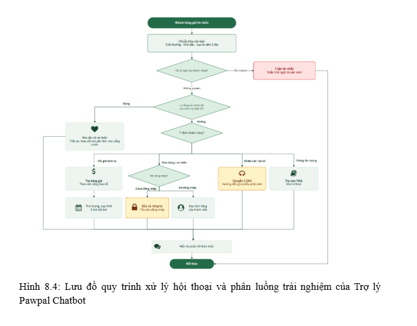
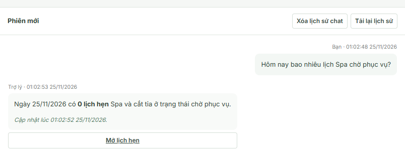
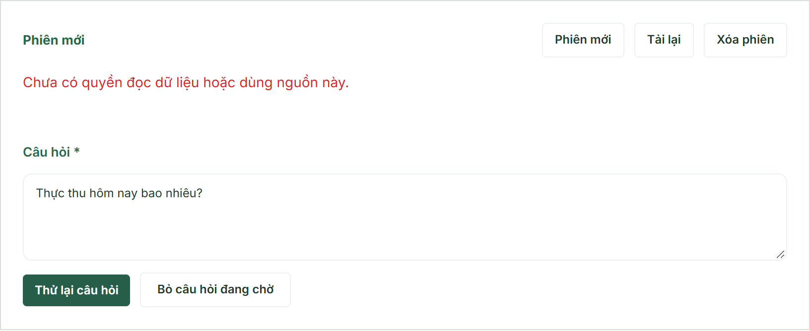

# Chương 8. Kiến trúc hệ thống và giải thuật thông minh

Chương này trình bày kiến trúc kỹ thuật và các giải thuật xử lý thông minh trong hệ thống Pawpal. Hệ thống được chia thành hai phân hệ trợ lý gồm Trợ lý trò chuyện phục vụ khách hàng trên website công khai và Trợ lý điều phối hỗ trợ nhân viên kỹ thuật cùng cấp quản lý trong giao diện quản trị nội bộ. Các cơ chế vận hành được thiết kế dựa trên nguyên tắc gắn kết dữ liệu thực tế, kiểm soát phân quyền chặt chẽ và xử lý ngôn ngữ tự nhiên tiếng Việt.

---

## 8.1. Mô hình kiến trúc phân tầng hệ thống

### 8.1.1. Kiến trúc phân tầng chức năng

Kiến trúc phần mềm của Pawpal được xây dựng theo mô hình phân tầng hướng dịch vụ gồm bốn tầng chức năng riêng biệt nhằm đảm bảo tính độc lập và khả năng bảo trì.

Tầng giao diện người dùng tiếp nhận tương tác từ các nhóm người dùng. Kênh khách hàng công cộng là ứng dụng web một trang, cung cấp thông tin dịch vụ, quy trình đặt lịch làm đẹp và chăm sóc, dịch vụ khách sạn thú cưng, dịch vụ xe đưa đón thú cưng, danh mục sản phẩm và khung trò chuyện trực tiếp với Trợ lý Pawpal. Kênh thành viên đã đăng nhập cho phép khách hàng theo dõi hồ sơ thú cưng, lịch hẹn cá nhân, tình trạng đơn hàng, điểm tích lũy và lịch sử khiếu nại. Kênh quản trị nội bộ là giao diện làm việc dành cho nhân viên kỹ thuật và cấp quản lý, tích hợp các bảng theo dõi ca làm việc, quản lý kho hàng và khung giao tiếp với Trợ lý điều phối.

Tầng cổng dịch vụ trung gian tiếp nhận và xử lý tập trung các yêu cầu gửi đến điểm cuối `/api/admin-chat`. Cổng dịch vụ thực hiện kiểm tra tính hợp lệ của phiên làm việc, xác định vai trò người dùng, áp dụng hạn mức gửi tối đa mười tin nhắn trong một phút cho mỗi phiên, kiểm duyệt từ ngữ vi phạm và ngăn chặn các câu lệnh tiêm nhiễm nguy hiểm. Tầng này cũng phân tích nội dung câu hỏi để quyết định đọc dữ liệu có sẵn từ cơ sở dữ liệu hay chuyển tiếp ngữ cảnh sang mô hình trí tuệ nhân tạo.

Tầng cơ sở dữ liệu và lưu trữ vận hành trên hệ quản trị cơ sở dữ liệu PostgreSQL lưu trữ dữ liệu nghiệp vụ gồm danh mục dịch vụ, hồ sơ thú cưng, lịch sử giao dịch, bảng giá theo cân nặng và nhật ký trò chuyện. Dữ liệu được bảo vệ bằng chính sách an toàn cấp dòng dữ liệu, các hàm thủ tục nội bộ và cơ chế cấp khóa truy cập tạm thời. Các tệp hình ảnh thú cưng và hình ảnh đính kèm khiếu nại được quản lý riêng trong kho lưu trữ đối tượng có chữ ký số xác thực đường dẫn.

Tầng tích hợp trí tuệ nhân tạo sử dụng mô hình Google Gemini 2.5 Flash để hỗ trợ hiểu câu hỏi tiếng Việt, tóm tắt nội dung hội thoại và tạo văn bản phản hồi. Việc kết nối được quản lý qua danh sách khóa truy cập có cơ chế tự động chuyển đổi khi một khóa bị đầy hạn mức. Mô hình chỉ tiếp nhận các dữ liệu đã được làm sạch và không có quyền truy vấn trực tiếp vào cơ sở dữ liệu.


**Hình 8.1.** Kiến trúc phân tầng chức năng của hệ thống Pawpal.

Hình 8.1 minh họa bốn tầng chức năng trong hệ thống. Giao tiếp giữa trình duyệt và cổng dịch vụ được mã hóa qua giao thức mạng an toàn. Hệ thống hỗ trợ phản hồi nhanh dạng đối tượng dữ liệu và phương thức truyền luồng dữ liệu liên tục từ máy chủ để giảm độ trễ hiển thị câu trả lời trên màn hình.

---

### 8.1.2. Mô hình triển khai và luồng tương tác giữa các thành phần

Hệ thống Pawpal triển khai trên nền tảng điện toán đám mây phân tán. Nền tảng mạng biên Vercel đảm nhận việc lưu trữ giao diện tĩnh và chạy các hàm xử lý trung gian. Nền tảng Supabase quản lý cơ sở dữ liệu PostgreSQL và máy chủ xác thực tài khoản. Nền tảng Google Cloud cung cấp dịch vụ suy luận mô hình ngôn ngữ Gemini.

Quy trình giao tiếp giữa các thành phần diễn ra theo trình tự kiểm soát nhiều bước. Khi người dùng nhập tin nhắn, trình duyệt gửi yêu cầu kèm chuỗi mã xác thực người dùng đối với nhân viên và thành viên, hoặc chuỗi mã định danh phiên tạm thời đối với khách vãng lai. Cổng dịch vụ trung gian kiểm tra tính hợp lệ của tài khoản và kiểm tra tần suất gửi tin nhắn trong phiên.

Sau khi tin nhắn vượt qua bộ lọc ngôn từ, cổng dịch vụ gửi yêu cầu xin cấp khóa truy cập tạm thời có hiệu lực tối đa tám giây xuống cơ sở dữ liệu thông qua thủ tục bảo mật phiên nội bộ. Cơ chế này nhằm giới hạn tài nguyên truy vấn của từng phiên trò chuyện. Dựa trên quyền của người gọi, máy chủ thực thi các hàm thủ tục đọc dữ liệu tương ứng và loại bỏ các mã định danh kỹ thuật nội bộ. Nếu câu hỏi yêu cầu dữ liệu có sẵn như bảng giá hoặc lịch làm việc, máy chủ định dạng câu trả lời trả về ngay cho người dùng mà không gọi qua mô hình trí tuệ nhân tạo. Nếu câu hỏi cần diễn đạt tự nhiên hoặc soạn văn bản hướng dẫn, dữ liệu đã làm sạch được chuyển tiếp đến mô hình ngôn ngữ lớn để tạo nội dung trả lời.


**Hình 8.2.** Luồng giao tiếp và cơ chế kiểm soát bảo mật giữa các thành phần.

Hình 8.2 biểu diễn luồng tương tác giữa trình duyệt, máy chủ ứng dụng, cơ sở dữ liệu và mô hình ngôn ngữ. Máy chủ ứng dụng đóng vai trò điều phối trung tâm, kiểm soát hoàn toàn việc trích xuất dữ liệu và chỉ cung cấp cho mô hình ngôn ngữ các dữ liệu cần thiết để tạo câu trả lời.

---

## 8.2. Kiến trúc an toàn thông tin và kiểm soát truy cập

### 8.2.1. Cơ chế xác thực và quản lý định danh người dùng

Hệ thống quản lý định danh người dùng theo hai nhóm đối tượng. Đối với thành viên và nhân viên nội bộ, quá trình đăng nhập và xác thực được quản lý tập trung bằng chuỗi mã xác thực có thời hạn ngắn kết hợp mã làm mới phiên. Khi gửi câu hỏi đến trợ lý, mã này được đính kèm trong phần tiêu đề xác thực mạng. Máy chủ tiến hành giải mã, kiểm tra chữ ký số và đối chiếu trạng thái hoạt động của tài khoản trong bảng dữ liệu khách hàng hoặc bảng nhân viên.

Đối với khách vãng lai chưa tạo tài khoản, hệ thống tạo một chuỗi ký tự ngẫu nhiên có độ dài từ 32 đến 512 ký tự lưu tại trình duyệt máy khách. Khi gửi lên máy chủ, chuỗi ký tự này được băm bằng giải thuật mã hóa một chiều trước khi đối chiếu với bảng phiên khách vãng lai. Khách vãng lai chỉ được phép tạo cuộc trò chuyện tạm thời, hỏi thông tin dịch vụ công khai và không thể truy cập dữ liệu cá nhân của người dùng khác.

Khi khách vãng lai quyết định đăng nhập hoặc đăng ký tài khoản thành viên trong lúc đang trò chuyện, hệ thống thực hiện chuyển quyền sở hữu cuộc trò chuyện sang tài khoản mới thông qua thủ tục kế thừa và chuyển giao phiên hội thoại. Quá trình này đòi hỏi xác thực đồng thời chuỗi mã băm của phiên khách vãng lai và mã phiên của tài khoản đăng nhập, đảm bảo lịch sử hội thoại được kế thừa liên tục mà không làm lộ dữ liệu sang tài khoản khác.

---

### 8.2.2. Kiểm soát phân quyền đa tầng và bảo vệ dữ liệu nghiệp vụ

Pawpal áp dụng cơ chế phân quyền theo vai trò kết hợp chính sách an toàn cấp dòng dữ liệu trong hệ quản trị cơ sở dữ liệu PostgreSQL.

Tại cổng dịch vụ trung gian, hệ thống kiểm tra vai trò và danh sách quyền hạn được gắn với phiên làm việc. Khi tài khoản có vai trò kỹ thuật viên gửi câu lệnh yêu cầu xem doanh thu hoặc báo cáo tài chính của cửa hàng, cổng dịch vụ sẽ từ chối ngay lập tức và trả về mã lỗi 403 cấm truy cập mà không chuyển lệnh xuống cơ sở dữ liệu.

Tại cơ sở dữ liệu, toàn bộ các bảng nghiệp vụ như khách hàng, đơn hàng, lịch hẹn và giao dịch thanh toán đều được kích hoạt chính sách an toàn cấp dòng dữ liệu. Các truy vấn từ trợ lý chỉ được phép thực hiện thông qua các hàm thủ tục nội bộ chuyên trách gồm thủ tục đọc dữ liệu hội thoại, thủ tục tra cứu hồ sơ khách hàng và thủ tục tra cứu tác vụ vận hành. Quyền hạn của người gọi được thẩm định lại độc lập bên trong từng hàm, ngăn chặn tình trạng sửa đổi tham số từ phía trình duyệt.

**Bảng 8.1. Ma trận quyền truy cập theo vai trò trong hệ thống Pawpal**

| Dữ liệu và chức năng nghiệp vụ | Khách vãng lai | Thành viên đăng nhập | Nhân viên kỹ thuật | Quản lý hệ thống |
| :--- | :---: | :---: | :---: | :---: |
| Tra cứu danh mục dịch vụ và bảng giá công khai | Cho phép | Cho phép | Cho phép | Cho phép |
| Tra cứu hồ sơ khách hàng và đơn hàng cá nhân | Bị từ chối (Yêu cầu đăng nhập) | Cho phép (Chỉ dữ liệu chính chủ) | Theo phạm vi phân công ca làm | Toàn quyền tra cứu hồ sơ đầy đủ |
| Yêu cầu kết nối gặp nhân viên hỗ trợ trực tiếp | Hướng dẫn đăng nhập tài khoản | Cho phép (Tài khoản thành viên) | Tiếp nhận ca theo danh sách phân công | Điều phối ca và theo dõi toàn bộ tiệm |
| Đính kèm hình ảnh trong cuộc trò chuyện | Bị từ chối | Tối đa 3 ảnh trong một tin nhắn | Theo quyền xử lý ca trò chuyện | Toàn quyền kiểm tra và lưu trữ ảnh |
| Tiếp nhận và trao đổi trực tiếp trong ca chat | Không áp dụng | Không áp dụng | Cho phép trong ca được giao | Toàn quyền tiếp quản mọi ca |
| Thêm ghi chú nội bộ cho ca dịch vụ | Không áp dụng | Không áp dụng | Cho phép trong phạm vi ca trực | Toàn quyền ghi chú và đánh giá |
| Tra cứu ca làm việc và lịch trực cá nhân | Không áp dụng | Không áp dụng | Cho phép xem lịch cá nhân | Tra cứu lịch trực toàn bộ nhân viên |
| Cảnh báo hàng tồn kho dưới ngưỡng an toàn | Không áp dụng | Không áp dụng | Cho phép khi có quyền xem kho | Toàn quyền xem số lượng tồn kho |
| Báo cáo doanh thu và thực thu tài chính | Không áp dụng | Không áp dụng | Bị từ chối (Mã lỗi 403) | Toàn quyền xem theo khoảng ngày |
| Cấu hình quy tắc kiểm duyệt và mẫu phản hồi | Không áp dụng | Không áp dụng | Không áp dụng | Toàn quyền chỉnh sửa quy tắc |

---

## 8.3. Kiến trúc đường ống xử lý trí tuệ nhân tạo

Đường ống xử lý trí tuệ nhân tạo của hệ thống Pawpal được thiết kế gồm sáu tầng vận hành tuần tự nhằm bảo đảm mỗi câu trả lời đều chính xác về mặt dữ liệu và phù hợp về mặt văn phong giao tiếp:

```
[Câu hỏi người dùng (Khách hàng hoặc Nhân viên)]
                      │
                      ▼
┌────────────────────────────────────────────────────────┐
│ TẦNG 1: Tiếp nhận và kiểm duyệt đầu vào                │
│ • Chuẩn hóa chuỗi ký tự đầu vào                        │
│ • Khớp danh mục từ ngữ vi phạm hai lớp                 │
│ • Chặn câu lệnh tiêm nhiễm nguy hiểm                   │
└────────────────────────────────────────────────────────┘
                      │
                      ▼
┌────────────────────────────────────────────────────────┐
│ TẦNG 2: Phân tích ý định và trích xuất thực thể        │
│ • Trích xuất cân nặng, mã đơn hàng, ngày hẹn           │
│ • Phân loại nhóm nhu cầu (Giá cả, tra cứu, khiếu nại)  │
│ • Quyết định đọc dữ liệu có sẵn hay gọi mô hình ngôn ngữ│
└────────────────────────────────────────────────────────┘
                      │
                      ▼
┌────────────────────────────────────────────────────────┐
│ TẦNG 3: Nhận diện cảm xúc và phân luồng xử lý          │
│ • Phân loại cảm xúc người dùng theo sáu cấp độ         │
│ • Kích hoạt lời giải thích xoa dịu và hướng dẫn an toàn│
│ • Bật cờ ưu tiên chuyển giao ca cho nhân viên hỗ trợ   │
└────────────────────────────────────────────────────────┘
                      │
                      ▼
┌────────────────────────────────────────────────────────┐
│ TẦNG 4: Cổng truy vấn dữ liệu an toàn chỉ đọc          │
│ • Cấp mã khóa truy cập tạm thời có hiệu lực 8 giây     │
│ • Thực thi các hàm thủ tục nội bộ chỉ đọc              │
│ • Cấm quyền ghi hoặc sửa đổi dữ liệu từ phía trí tuệ   │
└────────────────────────────────────────────────────────┘
                      │
                      ▼
┌────────────────────────────────────────────────────────┐
│ TẦNG 5: Kiểm soát quyền hạn và bảo vệ dữ liệu          │
│ • Kiểm tra quyền theo bốn vai trò người dùng           │
│ • Chặn mã lỗi 403 khi nhân viên hỏi dữ liệu doanh thu  │
│ • Làm sạch dữ liệu riêng tư và mã kỹ thuật nội bộ      │
└────────────────────────────────────────────────────────┘
                      │
                      ▼
┌────────────────────────────────────────────────────────┐
│ TẦNG 6: Suy luận mô hình và truyền dữ liệu thời gian   │
│ • Quản lý danh sách khóa kết nối và ngắt mạch quá tải  │
│ • Tạo câu trả lời bằng Gemini 2.5 Flash theo mẫu chuẩn │
│ • Truyền luồng dữ liệu liên tục và kiểm tra câu chữ    │
└────────────────────────────────────────────────────────┘
                      │
                      ▼
[Câu trả lời chính xác, an toàn và thấu cảm]
```

Tầng thứ nhất là Tầng tiếp nhận và kiểm duyệt đầu vào. Tin nhắn của người dùng được chuẩn hóa bằng cách đưa về chữ thường, loại bỏ các ký tự lạ, xóa khoảng trắng thừa và chuẩn hóa bảng mã tiếng Việt. Tiếp theo, chuỗi văn bản được so khớp với danh mục từ ngữ vi phạm hai lớp để làm mờ các từ ngữ thô tục hoặc chặn xử lý tin nhắn. Đồng thời, hệ thống rà soát các mẫu câu có dấu hiệu tấn công tiêm lệnh như yêu cầu mô hình bỏ qua chỉ thị ban đầu, từ đó kích hoạt chế độ phòng vệ để cô lập câu lệnh.

Tầng thứ hai là Tầng phân tích ý định và trích xuất thực thể. Bộ phân tích ngữ pháp trích xuất các thông tin cụ thể trong câu hỏi gồm giống loài thú cưng, khoảng cân nặng, ngày giờ hẹn, mã số đơn hàng hoặc số điện thoại. Sau đó, hệ thống phân loại nhu cầu của người dùng thành các nhóm như hỏi giá dịch vụ, kiểm tra trạng thái đơn hàng, tra cứu lịch trống, hỏi thông tin chung hoặc phản ánh sự cố. Từ kết quả này, hệ thống quyết định trả lời ngay bằng dữ liệu có sẵn trong cơ sở dữ liệu hay gửi ngữ cảnh sang mô hình ngôn ngữ lớn.

Tầng thứ ba là Tầng nhận diện cảm xúc và phân luồng xử lý. Bộ nhận diện cảm xúc phân loại mức độ bức xúc của người dùng theo sáu cấp độ: cấp cứu y tế thú cưng ở cấp một, tranh chấp thanh toán trừ tiền hai lần ở cấp hai, lo lắng sức khỏe sau khi làm dịch vụ ở cấp ba, khiếu nại chất lượng dịch vụ hoặc trễ hẹn ở cấp bốn và câu hỏi thông thường ở cấp năm và sáu. Hệ thống áp dụng lời phản hồi phù hợp để giải tỏa tâm lý lo âu của khách hàng, đồng thời tự động kích hoạt cờ chuyển giao cuộc trò chuyện cho nhân viên tiếp quản khi có sự cố nghiêm trọng.

Tầng thứ tư là Tầng cổng truy vấn dữ liệu an toàn chỉ đọc. Toàn bộ các thao tác đọc dữ liệu của trợ lý được quản lý trong danh mục công cụ cố định. Máy chủ cấp một mã khóa truy cập tạm thời có thời hạn tối đa tám giây. Các hàm thủ tục cơ sở dữ liệu chỉ hoạt động khi nhận đúng mã khóa hợp lệ và tự động hủy quyền khi hoàn tất tác vụ đọc. Cơ chế này ngăn chặn việc thay đổi dữ liệu đơn hàng hay lịch hẹn từ luồng trò chuyện.

Tầng thứ năm là Tầng kiểm soát quyền hạn và bảo vệ dữ liệu. Hệ thống kiểm tra quyền hạn của người gọi theo bốn vai trò gồm khách vãng lai, thành viên đã đăng nhập, nhân viên kỹ thuật và quản lý hệ thống. Nếu nhân viên kỹ thuật gửi câu hỏi về doanh thu cửa hàng, chốt chặn bảo mật sẽ trả về mã lỗi 403 cấm truy cập. Đồng thời, hệ thống loại bỏ các mã số kỹ thuật, tên cột cơ sở dữ liệu và thông tin cá nhân của khách hàng khác trước khi đưa dữ liệu vào ngữ cảnh trả lời, yêu cầu mô hình chỉ trả lời dựa trên thông tin thực tế đã được cung cấp.

Tầng thứ sáu là Tầng suy luận mô hình và truyền dữ liệu thời gian thực. Hệ thống điều phối các khóa kết nối của mô hình Gemini 2.5 Flash và áp dụng cơ chế tạm ngắt mạch khi cổng kết nối bị quá tải. Mô hình tạo câu trả lời bằng tiếng Việt bám sát dữ liệu đã được làm sạch. Dữ liệu được đẩy về màn hình theo luồng một chiều liên tục giúp giảm độ trễ hiển thị từ đầu tiên xuống dưới một giây. Trước khi hiển thị, nội dung được kiểm tra lại để đảm bảo đúng quy chuẩn xưng hô của Pawpal: xưng là Pawpal, gọi người dùng là bạn và gọi thú cưng là bé.


**Hình 8.3.** Sơ đồ kiến trúc đường ống xử lý trí tuệ nhân tạo sáu tầng của hệ thống Pawpal.

---

## 8.4. Giải thuật trợ lý thông minh hỗ trợ khách hàng

### 8.4.1. Mục tiêu và giá trị hỗ trợ khách hàng

Trợ lý Pawpal Chatbot được tích hợp trên website công cộng nhằm cung cấp thông tin nhanh chóng, chính xác và lịch sự cho khách hàng nuôi thú cưng.

Chatbot cung cấp báo giá dịch vụ dựa trên cân nặng thực tế. Khi khách hàng cung cấp cân nặng của thú cưng, hệ thống truy vấn cơ sở dữ liệu để lọc đúng các gói dịch vụ tắm hoặc cắt tỉa thuộc khoảng cân đó, cung cấp thời lượng thực hiện dự kiến và liên kết đặt lịch tương ứng.

Hệ thống đặt an toàn sức khỏe của thú cưng lên hàng đầu và không đưa ra các chẩn đoán bệnh học tùy tiện. Khi nhận được thông tin về biểu hiện mệt mỏi của thú cưng, trợ lý giải thích các nguyên nhân thông thường sau khi tắm sấy, hướng dẫn theo dõi tại nhà và nhắc nhở khách hàng đưa bé đến bác sĩ thú y khi xuất hiện dấu hiệu bất thường.

Hệ thống phân định rõ ràng giữa kênh tư vấn chung và kênh tiếp nhận khiếu nại. Đối với các phản ánh về sự cố dịch vụ hoặc trừ tiền giao dịch, trợ lý hướng dẫn khách hàng tạo yêu cầu chính thức trong mục Hỗ trợ để nhân viên tiếp nhận, lưu trữ chứng từ và xử lý theo đúng quy trình.

**Bảng 8.2. Phân định phạm vi hỗ trợ giữa Chatbot công chúng và Copilot quản trị**

| Nhu cầu nghiệp vụ cần xử lý | Trợ lý Chatbot (Khách vãng lai) | Trợ lý Chatbot (Thành viên đăng nhập) | Trợ lý Copilot (Nhân viên kỹ thuật) | Trợ lý Copilot (Quản lý hệ thống) |
| :--- | :--- | :--- | :--- | :--- |
| Tra cứu bảng giá dịch vụ làm đẹp | Báo giá theo cân nặng thực tế | Báo giá theo cân nặng thực tế | Tra cứu bảng giá theo phân công | Toàn quyền xem ma trận giá và phụ phí |
| Kiểm tra phòng khách sạn thú cưng | Giới thiệu loại phòng ở bước đặt | Giới thiệu loại phòng ở bước đặt | Kiểm tra phòng theo ngày được giao | Tra cứu phòng và tình trạng lưu trú toàn tiệm |
| Tra cứu đơn hàng và điểm tích lũy | Hướng dẫn đăng nhập tài khoản | Xem đơn hàng và điểm tích lũy chính chủ | Tra cứu đơn hàng phục vụ giao nhận | Toàn quyền tra cứu lịch sử mua hàng |
| Đính kèm hình ảnh trong cuộc trò chuyện | Yêu cầu đăng nhập tài khoản | Cho phép gửi tối đa 3 ảnh minh chứng | Tra cứu ảnh phục vụ xử lý ca làm việc | Toàn quyền kiểm tra và lưu trữ hình ảnh |
| Tra cứu ca làm việc và lịch trực cá nhân | Không hỗ trợ | Không hỗ trợ | Xem ca trực cá nhân được phân công | Tra cứu bảng phân ca toàn bộ nhân sự |
| Cảnh báo sản phẩm tồn kho dưới mức tối thiểu | Không hỗ trợ | Không hỗ trợ | Xem danh sách trong kho được giao | Tổng hợp sản phẩm tồn kho thấp toàn cơ sở |
| Báo cáo doanh thu và thực thu tài chính | Không hỗ trợ | Không hỗ trợ | Bị từ chối (Khóa chặn mã lỗi 403) | Xem doanh thu và tiền hoàn theo khoảng ngày |

---

### 8.4.2. Cách thức khách hàng tương tác và trải nghiệm

Giao diện Chatbot hiển thị dưới dạng nút nổi ở góc dưới bên phải màn hình website, sử dụng phong cách thiết kế phẳng với màu xanh lá rừng chủ đạo. Người dùng có thể bấm mở khung trò chuyện trên cả máy tính và điện thoại di động.



**Hình 8.4.** Lưu đồ giải thuật quy trình xử lý hội thoại và phân luồng trải nghiệm của Trợ lý Pawpal Chatbot.

Theo lưu đồ tại Hình 8.4, quy trình xử lý một lượt trò chuyện bắt đầu khi khách hàng gửi tin nhắn. Chuỗi văn bản được tiếp nhận và chuẩn hóa để loại bỏ khoảng trắng và ký tự lạ. Tiếp theo, hệ thống kiểm tra vi phạm từ ngữ; nếu có từ ngữ xúc phạm, hệ thống dừng xử lý tin nhắn, gửi lời nhắc nhở lịch sự và kết thúc lượt trò chuyện.

Nếu nội dung hợp lệ, hệ thống kiểm tra dấu hiệu sức khỏe của thú cưng. Khi khách hàng bày tỏ sự lo lắng vì bé mệt mỏi hoặc biếng ăn sau dịch vụ, hệ thống kích hoạt luồng xoa dịu tâm lý, giải thích nguyên nhân và hướng dẫn chăm sóc ban đầu an toàn.

Nếu không có vấn đề sức khỏe khẩn cấp, hệ thống chuyển sang phân loại ý định. Khi khách hỏi giá làm đẹp, hệ thống đọc bảng giá theo cân nặng trong cơ sở dữ liệu và gửi liên kết đặt lịch. Khi khách tra cứu đơn hàng hoặc thông tin cá nhân, hệ thống kiểm tra trạng thái đăng nhập: khách vãng lai sẽ nhận lời mời đăng nhập tài khoản, còn thành viên sẽ nhận được thông tin đơn hàng chính chủ. Khi có phản ánh sự cố hoặc yêu cầu bồi hoàn, hệ thống kích hoạt cờ chuyển giao cho nhân viên và hướng dẫn gửi yêu cầu trong mục Hỗ trợ. Với các câu hỏi thông tin chung, hệ thống truy vấn danh mục câu hỏi thường gặp để phản hồi trực tiếp.


**Hình 8.5.** Giao diện tương tác thực tế của Trợ lý Pawpal Chatbot khi tư vấn thông tin giờ mở cửa công khai.

Hình 8.5 ghi nhận phản hồi của Chatbot khi khách vãng lai hỏi: *"Xin chào PawPal, tiệm mình mở cửa lúc mấy giờ vậy?"*. Hệ thống trích xuất thông tin giờ mở cửa từ 08:00 đến 20:00 vào ngày thường và từ 08:00 đến 21:00 vào cuối tuần, kèm theo gợi ý kiểm tra lịch trống và nút liên hệ.

**Bảng 8.3. Bảng ánh xạ ý định người dùng với nguồn dữ liệu và kết quả nghiệp vụ**

| Nhóm ý định | Câu hỏi mẫu của người dùng | Nguồn dữ liệu và quy tắc xử lý | Kết quả phản hồi thực tế |
| :--- | :--- | :--- | :--- |
| **Tra cứu giờ hoạt động** | *“PawPal mở cửa mấy giờ?”* | Dữ liệu cấu hình hệ thống đã công bố | Giờ mở cửa ngày thường, cuối tuần và thông tin liên hệ |
| **Báo giá theo cân nặng** | *“Giá tắm sấy cho chó Poodle 7kg?”* | Bảng giá dịch vụ theo cân nặng | Liệt kê các gói phù hợp, giá tiền, thời lượng và liên kết đặt |
| **Kiểm tra tình trạng hàng** | *“Hạt Royal Canin cho mèo còn không?”* | Bảng tồn kho sản phẩm đang bán | Thông báo giá bán và tình trạng còn hàng |
| **Kiểm tra phòng khách sạn** | *“Khách sạn còn phòng trống ngày mai không?”* | Hướng dẫn kiểm tra phòng khả dụng | Hướng dẫn chọn ngày giờ cụ thể tại màn hình đặt phòng |
| **Quy định đặt lịch vãng lai** | *“Chưa có tài khoản thì đặt cho 2 bé được không?”* | Hướng dẫn quy định đặt lịch | Giải thích quy định: mỗi lượt đặt áp dụng cho một bé |
| **Kiểm tra đơn hàng cá nhân** | *“Đơn hàng hôm qua của tôi giao đến đâu rồi?”* | Kiểm tra đăng nhập và đọc bảng đơn hàng | Trả về mã đơn và trạng thái, hoặc nhắc đăng nhập nếu là khách vãng lai |
| **Số dư điểm và ưu đãi** | *“Tôi còn bao nhiêu điểm và có voucher nào?”* | Sổ cái điểm thưởng và danh sách ưu đãi | Số dư điểm hiện có và danh sách ưu đãi khả dụng |
| **Khiếu nại hoặc bồi hoàn** | *“Tôi bị trừ tiền hai lần mà không có đơn”* | Quy trình tiếp nhận tại mục Hỗ trợ | Lời trấn an, hướng dẫn gửi mã giao dịch để đối soát |

---

## 8.5. Giải thuật trợ lý thông minh hỗ trợ vận hành

### 8.5.1. Mục tiêu và giá trị hỗ trợ đội ngũ vận hành

Trợ lý Pawpal Copilot hỗ trợ nhân viên kỹ thuật và cấp quản lý tra cứu thông tin nhanh chóng, giảm thiểu thao tác thủ công qua nhiều màn hình quản trị.

Trợ lý cho phép tổng hợp hồ sơ khách hàng đầy đủ từ một câu lệnh chứa số điện thoại hoặc mã khách hàng, liên kết thông tin chủ nuôi, danh sách thú cưng và các đơn hàng gần nhất.

Hệ thống cung cấp tính năng cảnh báo tồn kho tự động bằng cách so sánh số lượng tồn kho thực tế của từng mã sản phẩm với định mức tối thiểu, đưa ra danh mục các mặt hàng cần nhập thêm.

Trợ lý hỗ trợ tra cứu lịch hẹn dịch vụ làm đẹp, khách sạn và xe đưa đón trong ngày, giúp nhân viên chủ động chuẩn bị ca làm việc. Ngoài ra, cơ chế phân quyền đảm bảo nhân viên kỹ thuật không thể xem được các báo cáo tài chính và doanh thu của cửa hàng.

**Bảng 8.4. Danh mục các công cụ tra cứu dữ liệu an toàn tiêu biểu của Trợ lý Copilot**

| Tên công cụ nội bộ | Quyền hạn yêu cầu (Nhân viên) | Quyền hạn yêu cầu (Quản lý) | Nguồn dữ liệu trong cơ sở dữ liệu | Kết quả nghiệp vụ trả về |
| :--- | :--- | :--- | :--- | :--- |
| **Tra cứu khách hàng** | Xem khách hàng theo phạm vi ca làm | Toàn quyền xem hồ sơ khách hàng | Dữ liệu khách hàng và hồ sơ chủ nuôi | Thông tin định danh, số điện thoại, hạng thành viên |
| **Tra cứu thú cưng** | Xem hồ sơ thú cưng theo ca làm | Toàn quyền xem hồ sơ thú cưng | Dữ liệu hồ sơ thú cưng và giống loài | Tên bé, giống loài, giới tính, trạng thái hoạt động |
| **Lịch dịch vụ làm đẹp** | Xem lịch được giao phụ trách | Toàn quyền xem lịch hẹn toàn tiệm | Dữ liệu lịch hẹn và dịch vụ chăm sóc | Danh sách lịch hẹn theo ngày, trạng thái, tên thú cưng |
| **Cảnh báo tồn kho thấp** | Xem kho theo phạm vi được giao | Toàn quyền xem kho và sản phẩm | Dữ liệu biến thể sản phẩm và kho hàng | Danh sách sản phẩm có tồn kho nhỏ hơn mức tối thiểu |
| **Kiểm tra phòng khách sạn** | Xem lịch đặt lưu trú được giao | Toàn quyền xem phòng và lưu trú | Dữ liệu phòng khách sạn và lịch lưu trú | Tình trạng phòng trống theo khoảng thời gian yêu cầu |
| **Tra cứu lịch trực nhân sự** | Xem ca trực cá nhân của mình | Toàn quyền xem lịch trực toàn tiệm | Dữ liệu nhân sự và lịch trực ca | Lịch trực cá nhân hoặc danh sách nhân sự trực theo ngày |
| **Đối soát đơn hàng lẻ** | Thu tiền tại quầy theo ca làm | Toàn quyền xem đơn và thanh toán | Dữ liệu đơn hàng và giao dịch thanh toán | Tiền đã thu, đã hoàn và số tiền còn thiếu của đơn hàng |
| **Tổng hợp thực thu** | Bị từ chối (Không có quyền) | Quyền xem thanh toán và hoàn tiền | Dữ liệu tổng hợp thanh toán và hoàn tiền | Tổng tiền thu, tổng tiền hoàn và thực thu theo ngày |

---

### 8.5.2. Cách thức nhân viên khai thác và sử dụng Copilot

Nhân viên kỹ thuật và cấp quản lý sử dụng Copilot trong mục Trợ lý trí tuệ nhân tạo trên thanh điều hướng trang quản trị. Giao diện hiển thị danh sách các phiên trò chuyện bên trái và khung trao đổi nghiệp vụ bên phải, kèm các nút tác vụ nhanh như xem lịch hẹn hôm nay, kiểm tra hàng sắp hết hoặc xem các khiếu nại chưa xử lý.


**Hình 8.6.** Lưu đồ giải thuật quy trình xử lý tác vụ thông minh và kiểm soát thẩm quyền của Trợ lý Pawpal Copilot.

Theo lưu đồ tại Hình 8.6, khi nhân viên gửi yêu cầu, hệ thống tiến hành kiểm tra mã xác thực phiên làm việc. Nếu hợp lệ, bộ phân tích cú pháp tiếp nhận và phân loại tác vụ.

Khi có yêu cầu xem doanh thu hoặc báo cáo tài chính, hệ thống kiểm tra vai trò người gọi: nếu là nhân viên kỹ thuật, cơ chế phân quyền từ chối yêu cầu và trả về mã lỗi 403; nếu là quản lý hệ thống, yêu cầu được chấp thuận và trả về số liệu thực thu. Đối với yêu cầu xem hồ sơ khách hàng, hệ thống liên kết ba nguồn dữ liệu gồm thông tin chủ nuôi, danh sách thú cưng và đơn hàng gần nhất. Đối với yêu cầu kiểm tra hàng tồn kho hoặc lịch hẹn, hệ thống truy vấn bảng dữ liệu tương ứng. Toàn bộ câu hỏi và kết quả tra cứu được ghi nhật ký kiểm toán trong bảng nhật ký trợ lý để phục vụ giám sát nội bộ.



**Hình 8.7.** Giao diện phân hệ làm việc Trợ lý Pawpal Copilot trong không gian quản trị khi tra cứu lịch Spa chờ phục vụ.

Hình 8.7 ghi nhận phản hồi của Copilot khi quản lý gửi câu lệnh: *"Hôm nay bao nhiêu lịch Spa chờ phục vụ?"*. Hệ thống phân tích thời gian theo ngày hiện tại, lọc các lịch hẹn làm đẹp ở trạng thái đã xác nhận, trả về thông báo không có lịch tồn đọng kèm thời gian đối soát và nút mở phân hệ lịch hẹn.

---

## 8.6. Cơ chế giải thuật vận hành bên dưới giao diện

### 8.6.1. Phân tích ngữ cảnh, nhận diện ý định và hạn chế suy diễn

Hệ thống Pawpal áp dụng nguyên tắc gắn kết dữ liệu thực tế nhằm loại bỏ hiện tượng mô hình ngôn ngữ tự tạo ra thông tin không có thực.

Các câu hỏi về số liệu cụ thể như giá dịch vụ, số lượng tồn kho, doanh thu hoặc danh sách thú cưng được xử lý bằng các câu truy vấn cơ sở dữ liệu và trả về theo mẫu văn bản cố định, không cho phép mô hình ngôn ngữ can thiệp vào các con số này. Mô hình ngôn ngữ chỉ được sử dụng khi cần diễn đạt văn bản tự nhiên như giải thích nguyên nhân thú cưng mệt mỏi hoặc hướng dẫn quy trình khiếu nại.

Hệ thống xử lý câu trả lời theo ba trạng thái rõ ràng. Khi truy vấn thành công nhưng không có bản ghi nào, hệ thống thông báo không có dữ liệu trong ngày. Khi nguồn dữ liệu bị gián đoạn kết nối, hệ thống thông báo chưa đọc được nguồn dữ liệu thay vì báo kết quả rỗng. Khi tài khoản không đủ quyền hạn, hệ thống thông báo rõ tài khoản chưa có quyền xem dữ liệu này.

---

### 8.6.2. Kiểm duyệt nội dung, cấp độ cảm xúc và xử lý rủi ro

Quy trình kiểm soát nội dung và cảm xúc phân loại tin nhắn người dùng thành sáu cấp độ để xử lý phù hợp.


**Hình 8.8.** Lưu đồ giải thuật kiểm duyệt nội dung độc hại và kích hoạt phân luồng cảm xúc sáu cấp độ.

Cấp 1 là tin nhắn chào hỏi hoặc cảm ơn thông thường, trợ lý đáp lại lịch sự và hỏi nhu cầu hỗ trợ. Cấp 2 là câu hỏi thông thường về giờ mở cửa hoặc bảng giá, trợ lý cung cấp thông tin ngắn gọn từ nguồn niêm yết. Cấp 3 là trạng thái khách hàng lo lắng khi thấy thú cưng mệt mỏi hoặc biếng ăn sau dịch vụ; hệ thống dừng chào dịch vụ, chuyển sang giải thích phản ứng tiêu hao năng lượng, hướng dẫn nghỉ ngơi uống nước và chỉ dẫn theo dõi sức khỏe. Cấp 4 là phản ánh về sự cố như bé bị trầy xước hoặc trễ hẹn; trợ lý gửi lời xin lỗi và hướng dẫn tạo yêu cầu tại mục Hỗ trợ để quản lý kiểm tra lại ca làm việc. Cấp 5 là tranh chấp thanh toán như bị trừ tiền hai lần; trợ lý tiếp nhận thông tin, hướng dẫn ghi rõ thời gian giao dịch để đối soát hoàn tiền và đưa cuộc trò chuyện vào danh sách chờ nhân viên hỗ trợ. Cấp 6 là cấp cứu y tế khẩn cấp khi thú cưng chảy máu hoặc khó thở; trợ lý đưa cảnh báo khẩn cấp lên đầu, cung cấp số điện thoại hỗ trợ và nhắc khách đưa bé đến cơ sở thú y gần nhất ngay lập tức mà không chờ tin nhắn.

**Bảng 8.5. Bảng phân loại sáu cấp độ cảm xúc, nhóm rủi ro và hành động điều phối tương ứng**

| Cấp độ cảm xúc | Tình huống mẫu của người dùng | Nhóm rủi ro nghiệp vụ | Hành động điều phối và phản hồi thực tế của Pawpal |
| :---: | :--- | :--- | :--- |
| **Cấp 1: Thân thiện** | *“Chào PawPal!”* | Không có rủi ro | Đáp lại lời chào lịch sự, xưng là Pawpal và hỏi nhu cầu hỗ trợ cho thú cưng. |
| **Cấp 2: Trung tính** | *“PawPal mở cửa mấy giờ?”* | Thắc mắc thông thường | Trả lời giờ mở cửa ngày thường và cuối tuần từ thông tin công bố chính thức. |
| **Cấp 3: Lo lắng** | *“Bé cún nhà mình về bị mệt mỏi và biếng ăn sau khi tắm, mình lo quá”* | Chăm sóc đặc biệt | Nhận biết nỗi lo, giải thích phản ứng tiêu hao năng lượng, hướng dẫn cho bé uống nước và nghỉ ngơi, cam kết đồng hành. |
| **Cấp 4: Phản ánh sự cố** | *“Bé mèo bị trầy xước ở chân sau khi cắt tỉa, nhân viên làm ẩu quá”* | Khiếu nại dịch vụ | Gửi lời xin lỗi, chia sẻ sự lo lắng với chủ nuôi, hướng dẫn tạo yêu cầu trong mục Hỗ trợ để kiểm tra lại ca làm việc. |
| **Cấp 5: Bức xúc rõ rệt** | *“Hẹn 2 giờ mà 3 giờ chưa tới đón. Tôi bị trừ tiền hai lần mà tài khoản chưa nhận được tiền hoàn lại!”* | Tranh chấp thanh toán | Ghi nhận sự việc, hướng dẫn cung cấp thông tin giao dịch để đối soát, chuyển cuộc trò chuyện sang hàng đợi nhân viên hỗ trợ. |
| **Cấp 6: Khẩn cấp** | *“Bé nhà tôi bị chảy máu nhiều ở tai và khó thở sau khi ngã, giúp mình sơ cứu với”* | Cấp cứu y tế | Đưa cảnh báo cấp cứu lên đầu: yêu cầu liên hệ ngay trạm thú y gần nhất hoặc gọi số điện thoại cứu hộ, không chờ tin nhắn chat. |

---

**Bảng đối sánh phong cách phản hồi theo tình huống thực tế**

| Tình huống thực tế của khách hàng | Phong cách phản hồi cũ | Phong cách giao tiếp hiện tại của Pawpal |
| :--- | :--- | :--- |
| **Bé mệt và biếng ăn sau khi tắm sấy** | *“Vui lòng liên hệ bác sĩ thú y để kiểm tra sức khỏe.”* | *“PawPal hiểu vì sao bạn lo khi thấy bé mệt và ăn ít sau buổi tắm. Dạ bạn đừng quá lo nhé, sau khi tắm sấy, nhiều bé do lạ chỗ hoặc tiêu hao năng lượng nên sẽ thèm ngủ và hơi lười ăn một chút. Bạn để bé nghỉ ngơi ở góc quen thuộc, đặt sẵn chén nước sạch gần bé nha. Nếu bé có biểu hiện nào bất thường hơn hoặc bạn vẫn chưa an tâm, bạn cứ nhắn hoặc gửi ảnh cho PawPal liền nhé, tụi mình luôn ở đây cùng bạn.”* |
| **Khách vãng lai hỏi thủ tục bồi hoàn** | *“Vui lòng tạo yêu cầu bồi hoàn trong mục Hỗ trợ.”* | *“PawPal sẽ hướng dẫn bạn gửi yêu cầu và theo dõi kết quả nhé. Bạn đăng nhập tài khoản trước nha. Trong mục Hỗ trợ, bạn chọn đơn hàng hoặc lịch hẹn liên quan, mô tả sự việc và đính kèm minh chứng nếu có. Sau khi gửi yêu cầu, bạn có thể theo dõi tiến độ xử lý ngay tại đó.”* |
| **Khách vãng lai phản ánh bị trừ tiền hai lần** | *“Tài khoản chưa đăng nhập. Vui lòng đăng nhập để kiểm tra.”* | *“Thấy tiền bị trừ hai lần, bạn lo lắng là điều hoàn toàn dễ hiểu. Bạn an tâm nhé, PawPal sẽ hỗ trợ đối soát để bạn không bị thiệt thòi. Bạn vui lòng đăng nhập tài khoản trước nhé. Trong mục Hỗ trợ, bạn chọn đơn hàng và ghi rõ thời điểm của hai giao dịch để bên mình đối soát ngay. Tụi mình sẽ hỗ trợ bạn kiểm tra nhanh nhất.”* |
| **Khách vãng lai báo bé bị trầy xước sau dịch vụ** | *“Vui lòng đăng nhập để gửi phản ánh khiếu nại.”* | *“PawPal rất tiếc khi biết bé bị trầy. Bên mình hiểu bạn đang rất lo lắng và xót cho bé nhiều lắm. Bạn đăng nhập tài khoản trước nhé. Trong mục Hỗ trợ, bạn chọn lịch hẹn vừa qua và mô tả tình trạng của bé để nhân viên kiểm tra lại ca chăm sóc và hỗ trợ bạn chu đáo nhất.”* |
| **Khách hàng bức xúc vì bị trễ giờ đón** | *“Vui lòng gửi mã đơn để bộ phận giao vận kiểm tra.”* | *“PawPal rất tiếc vì chuyện này khiến bạn bức xúc và phải chờ đợi quá giờ hẹn. Tụi mình thành thật xin lỗi vì sự bất tiện này. Bên mình cần một vài thông tin để kiểm tra chuyện đã xảy ra. Bạn vui lòng gửi mã lịch hẹn và thời gian bạn đã liên hệ để nhân viên kiểm tra ngay với tài xế đón bé nhé.”* |
| **Chủ nuôi thông báo thú cưng khó thở nguy kịch** | *“Vui lòng liên hệ cơ sở y tế gần nhất.”* | *“Bạn hãy liên hệ ngay bác sĩ thú y hoặc đưa bé đến cơ sở cấp cứu thú y gần nhất ngay lập tức! PawPal hiểu lúc này bạn đang rất lo cho bé. Xin vui lòng không chờ phản hồi trong khung chat này để tránh lỡ mất thời gian vàng cấp cứu cho bé!”* |

---

### 8.6.3. Cổng truy vấn dữ liệu an toàn chỉ đọc

Cơ chế cổng truy vấn dữ liệu an toàn chỉ đọc được thiết lập tại lớp điều phối công cụ tra cứu của máy chủ trung gian kết hợp với thủ tục cấp mã khóa truy cập tạm thời của cơ sở dữ liệu.

Khi nhận lệnh từ Trợ lý Copilot, cổng dịch vụ tạo mã yêu cầu duy nhất và gửi lệnh xin cấp mã khóa truy cập tạm thời từ cơ sở dữ liệu. Mã khóa này có thời hạn sống tính bằng giây và được lưu trong bảng trạng thái tạm thời. Khi thực thi các hàm đọc dữ liệu, cơ sở dữ liệu kiểm tra tính hợp lệ của mã khóa; các yêu cầu dùng lại mã khóa hết hạn đều bị từ chối với mã lỗi bảo mật.

Hệ thống đặt hạn mức tài nguyên cho mỗi lần tra cứu: tối đa ba lần gọi hàm thủ tục trong một câu hỏi, hiển thị tối đa mười dòng dữ liệu trên mỗi trang và dung lượng dữ liệu tối đa không vượt quá 65.536 byte. Nếu lượng dữ liệu vượt quá ngưỡng này, cơ sở dữ liệu sẽ cắt ngắn an toàn và gắn cờ cảnh báo còn dữ liệu để đảm bảo tốc độ phản hồi.

---

## 8.7. Đánh giá thực nghiệm các kịch bản thực tế

Bộ thử nghiệm gồm sáu kịch bản thực tế được thực hiện trực tiếp trên hệ thống Pawpal để kiểm tra tính ổn định của các giải thuật và cơ chế phân quyền.

Kịch bản thứ nhất kiểm tra việc bóc tách cân nặng và tính giá dịch vụ làm đẹp từ cơ sở dữ liệu. Khách hàng gửi câu hỏi: *“Bé cún Poodle nhà mình nặng 7kg tắm sấy giá bao nhiêu?”*. Hệ thống nhận diện khoảng cân nặng từ 5 đến 10 kg và truy vấn đúng bảng giá trong cơ sở dữ liệu. Hình 8.9 hiển thị kết quả gồm bốn gói dịch vụ: Gói Tắm Vệ Sinh Cơ Bản (170.000 đồng, 75 phút), Gói Tắm Dưỡng Premium (220.000 đồng, 90 phút), Tắm Khô Khử Mùi (90.000 đồng, 25 phút) và Tắm Thuốc Trị Liệu Da Liễu (280.000 đồng, 90 phút), kèm theo liên kết đặt lịch nhanh.


**Hình 8.9.** Kết quả thử nghiệm tính toán giá dịch vụ làm đẹp theo cân nặng thực tế trên giao diện Chatbot.

Kịch bản thứ hai kiểm tra việc bảo vệ quyền riêng tư đơn hàng của khách vãng lai. Khi khách chưa đăng nhập hỏi: *“Đơn hàng của tôi hôm qua đã giao chưa?”*, hệ thống nhận diện đây là thông tin đơn hàng cá nhân nhưng phiên hiện tại chưa có thông tin xác thực. Chatbot từ chối cung cấp dữ liệu và hướng dẫn: *"Đây là thông tin thuộc hồ sơ riêng của bạn. Bạn Đăng nhập rồi hỏi lại nhé; PawPal chỉ tra dữ liệu thuộc tài khoản đã xác minh."* kèm đường dẫn đăng nhập như thể hiện tại Hình 8.10.


**Hình 8.10.** Kết quả thử nghiệm chốt chặn bảo vệ quyền riêng tư đơn hàng của khách vãng lai.

Kịch bản thứ ba kiểm tra khả năng nhận diện cảm xúc lo lắng và duy trì ngữ cảnh qua hai lượt trao đổi liên tiếp. Ở lượt thứ nhất, khách hàng nhắn: *“Bé cún mệt mỏi và biếng ăn sau khi tắm, mình lo quá”*. Hệ thống nhận diện triệu chứng sức khỏe, đưa ra lời giải thích hiện tượng tiêu hao năng lượng và hướng dẫn theo dõi bé. Ở lượt thứ hai trong cùng phiên, khách hàng bổ sung: *“Bé vừa nôn một lần”*. Hệ thống kế thừa ngữ cảnh hội thoại trong vòng 30 phút, lập tức hướng dẫn chủ nuôi báo rõ số lần nôn và thời điểm nôn cho bác sĩ thú y như ghi nhận tại Hình 8.11.


**Hình 8.11.** Kết quả thử nghiệm nhận diện cảm xúc lo lắng và phản hồi xoa dịu tự nhiên qua các lượt trao đổi tiếp nối.

Kịch bản thứ tư kiểm tra khả năng liên kết dữ liệu hồ sơ khách hàng đầy đủ của Trợ lý Copilot. Khi tài khoản quản lý gửi câu lệnh: *“Xem hồ sơ khách hàng 360° theo số điện thoại: 0901234567”*, hệ thống kích hoạt thủ tục tổng hợp hồ sơ đa chiều và liên kết thông tin chủ nuôi Lê Lệ Quyên, danh sách hai thú cưng gồm mèo Lala và cún Corgi Milu, cùng đơn hàng gần nhất có mã `ORD-20260707-973249` như thể hiện tại Hình 8.12.


**Hình 8.12.** Kết quả thử nghiệm tổng hợp hồ sơ khách hàng đầy đủ qua Trợ lý Copilot.

Kịch bản thứ năm kiểm tra giải thuật rà soát sản phẩm tồn kho chạm ngưỡng tối thiểu. Khi nhân viên gửi câu lệnh: *“Sản phẩm sắp hết hàng”* hoặc *“Có bao nhiêu mã sản phẩm dưới ngưỡng an toàn?”*, hệ thống quét các biến thể sản phẩm đang bán có số lượng tồn kho thấp hơn định mức an toàn. Hình 8.13 hiển thị kết quả gồm hai mã sản phẩm thức ăn hạt có số lượng tồn thực tế là 29 và 37 so với mức tồn tối thiểu quy định là 80.


**Hình 8.13.** Kết quả thử nghiệm cảnh báo các mặt hàng tồn kho chạm ngưỡng an toàn.

Kịch bản thứ sáu kiểm tra cơ chế ngăn chặn nhân viên kỹ thuật xem doanh thu cửa hàng. Khi tài khoản nhân viên kỹ thuật gửi câu lệnh: *“Thực thu hôm nay bao nhiêu?”*, cổng dịch vụ phát hiện tài khoản không có quyền đọc dữ liệu thanh toán và hoàn tiền, từ chối thực hiện yêu cầu với mã lỗi 403. Màn hình Copilot tại Hình 8.14 hiển thị thông báo: *"Chưa có quyền đọc dữ liệu hoặc dùng nguồn này."*, đảm bảo số liệu tài chính không bị lộ ra ngoài.



**Hình 8.14.** Kết quả thử nghiệm cơ chế chốt chặn nhân viên kỹ thuật xem doanh thu trái phép.

---

## 8.8. Kết luận chương

Chương 8 đã trình bày kiến trúc phân tầng hệ thống và các giải thuật thông minh trong nền tảng Pawpal. Mô hình phân tầng kết hợp cổng dịch vụ trung gian và các cơ chế bảo vệ cấp dòng dữ liệu giúp phân định quyền hạn rõ ràng, bảo vệ dữ liệu cá nhân của khách hàng và ngăn chặn việc truy cập vượt quyền nội bộ. Đường ống xử lý trí tuệ nhân tạo sáu tầng vận hành dựa trên nguyên tắc gắn kết dữ liệu thực tế giúp đảm bảo tính chính xác của các số liệu về giá dịch vụ, số lượng tồn kho và lịch hẹn. Giải thuật nhận diện cảm xúc sáu cấp độ và cơ chế duy trì ngữ cảnh hội thoại giúp nâng cao chất lượng phản hồi, hỗ trợ khách hàng kịp thời trong các tình huống phát sinh và chuyển giao phiên làm việc cho nhân viên khi cần thiết.

---

### Các phân hệ thành phần chính

Các giải thuật và cơ chế kiến trúc trình bày trong chương được tổ chức tại các phân hệ xử lý chuyên trách:
* **Cổng điều phối trung tâm và xử lý luồng trí tuệ nhân tạo**: Đảm nhận tiếp nhận yêu cầu, kiểm soát giới hạn tài nguyên và truyền phản hồi thời gian thực.
* **Phân hệ trợ lý hỗ trợ khách hàng công cộng**: Đảm nhận định tuyến hội thoại, cung cấp thông tin dịch vụ và bảng giá cho khách vãng lai.
* **Phân hệ tra cứu dữ liệu thành viên**: Đảm nhận đối chiếu dữ liệu cá nhân, lịch sử đơn hàng và hồ sơ cho tài khoản đã đăng nhập.
* **Phân hệ kiểm duyệt từ ngữ và phân cấp cảm xúc**: Đảm nhận lọc nội dung vi phạm, nhận diện trạng thái tâm lý sáu cấp độ và đưa ra phản hồi thấu cảm.
* **Phân hệ duy trì ngữ cảnh hội thoại tiếp nối**: Đảm nhận lưu vết ngữ cảnh, liên kết các lượt trao đổi liên tiếp trong cùng phiên trò chuyện.
* **Phân hệ trợ lý điều hành nội bộ**: Đảm nhận tổng hợp hồ sơ 360 độ, phát hiện sản phẩm chạm ngưỡng tồn kho và hỗ trợ vận hành.
* **Phân hệ cổng truy vấn dữ liệu an toàn chỉ đọc**: Đảm nhận cấp mã khóa tạm thời, kiểm soát thời hạn truy cập và chặn quyền ghi từ phía trợ lý.
