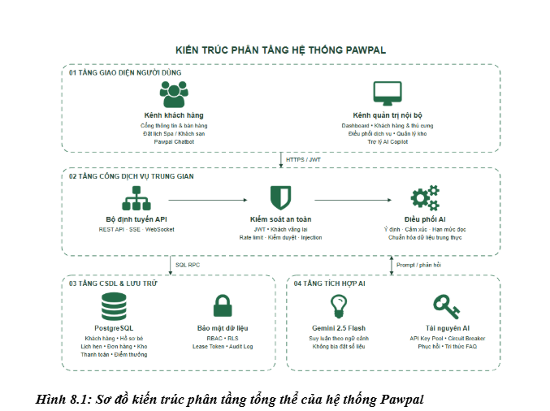
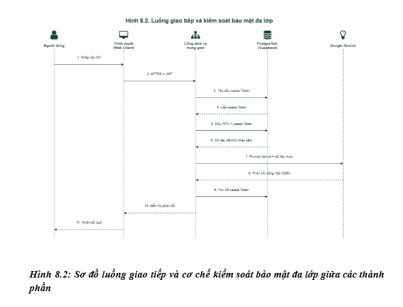
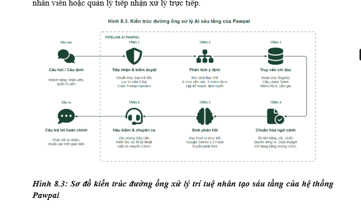
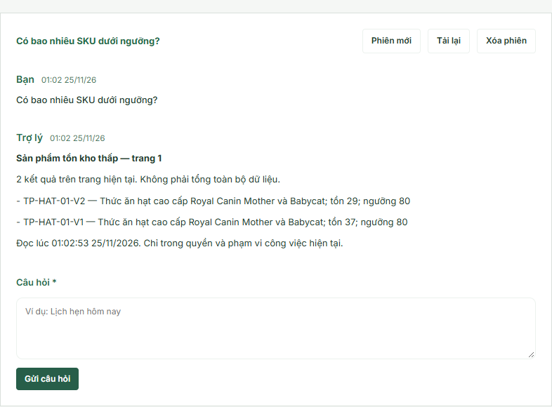

# Chương 8. Kiến trúc hệ thống và giải thuật thông minh

## Danh mục bảng và hình trong chương

Chương này sử dụng Hình 8.1 đến Hình 8.3 để trình bày kiến trúc phân tầng, kiểm soát truy cập và các bước xử lý một yêu cầu. Hình 8.4, Hình 8.6 và Hình 8.8 lần lượt mô tả luồng Chatbot, luồng Copilot và cách xử lý nội dung có rủi ro. Các ảnh giao diện gồm lượt hỏi giờ mở cửa ở Hình 8.5, lượt tra lịch Spa ở Hình 8.7 và sáu lượt thử nghiệp vụ ở Hình 8.9 đến Hình 8.14.

Bảng 8.1 và Bảng 8.2 tổng hợp quyền truy cập và phạm vi hỗ trợ theo vai trò. Bảng 8.3 trình bày cách Chatbot chọn nguồn theo câu hỏi. Bảng 8.4 liệt kê các công cụ tra cứu của Copilot. Bảng 8.5 và bảng bổ sung mô tả cấp độ cảm xúc cùng cách phản hồi theo tình huống.

## Lời mở đầu chương

Chương này trình bày kiến trúc hệ thống PawPal, cơ chế kiểm soát truy cập và quy trình xử lý yêu cầu của hai trợ lý thông minh. Chatbot trên website hỗ trợ khách tra cứu thông tin công khai và dữ liệu thuộc tài khoản đã xác thực. Copilot trong cổng quản trị hỗ trợ nhân viên và quản lý khai thác dữ liệu theo phạm vi công việc. Phần thực nghiệm sử dụng các tình huống đại diện để minh họa kết quả tra cứu, cách phản hồi và những giới hạn truy cập của từng vai trò.

## 8.1. Mô hình kiến trúc phân tầng hệ thống

### 8.1.1. Kiến trúc phân tầng chức năng

Kiến trúc PawPal gồm bốn tầng. Tầng giao diện cung cấp website công khai, khu vực tài khoản khách hàng và cổng quản trị. Khách hàng sử dụng website để tra giá, đặt lịch, mua sản phẩm và trao đổi với Chatbot. Thành viên có thể theo dõi hồ sơ và giao dịch của mình trong khu vực tài khoản. Nhân viên và quản lý thực hiện các nghiệp vụ được phân quyền trong cổng quản trị.

Tầng cổng dịch vụ tiếp nhận yêu cầu từ Chatbot và Copilot qua cùng địa chỉ `/api/admin-chat`. API xác thực phiên, kiểm tra đầu vào và hạn mức, sau đó chọn nhánh xử lý theo vai trò và nội dung yêu cầu.

Tầng dữ liệu dùng Supabase PostgreSQL để lưu hồ sơ, lịch hẹn, giao dịch và hội thoại. Các thủ tục truy vấn và chính sách truy cập theo hàng xác định những bản ghi mà người dùng được phép đọc. Ảnh đính kèm hội thoại được lưu trong kho tệp riêng và truy cập qua API quản lý tệp.

Tầng tích hợp mô hình dùng Gemini cho những tác vụ cần tổng hợp hướng dẫn hoặc soạn bản nháp. Máy chủ chịu trách nhiệm chọn và đọc nguồn. Mô hình nhận câu hỏi và ngữ cảnh đã được máy chủ giới hạn cho tác vụ đó.

**Hình 8.1.** Kiến trúc phân tầng của PawPal.

Như thể hiện ở Hình 8.1, trình duyệt gửi yêu cầu trợ lý đến cổng dịch vụ qua HTTP. Cơ chế truyền sự kiện một chiều từ máy chủ (SSE) được sử dụng ở các nhánh hỗ trợ truyền phát. Supabase Realtime phục vụ các màn hình cần cập nhật khi dữ liệu thay đổi. Phiên bản Gemini ghi trong sơ đồ minh họa một cấu hình triển khai.

### 8.1.2. Mô hình triển khai và luồng tương tác giữa các thành phần

Trong mô hình triển khai của PawPal, Vercel lưu trữ giao diện web và vận hành các API phía máy chủ. Supabase cung cấp dịch vụ xác thực người dùng và cơ sở dữ liệu PostgreSQL. Trình duyệt kết nối với Supabase Auth khi người dùng đăng nhập và dùng phiên đã xác thực để gọi các thủ tục được cấp quyền. Các nghiệp vụ cần xử lý phía máy chủ được gửi đến API tương ứng.

Khi người dùng gửi câu hỏi đến Chatbot hoặc Copilot, API kiểm tra phiên đăng nhập hoặc quyền sở hữu hội thoại của khách vãng lai trước khi xác định phạm vi tra cứu. Yêu cầu về dữ liệu cá nhân được xử lý theo phiên của chủ tài khoản. Yêu cầu trong cổng quản trị được kiểm tra theo quyền nghiệp vụ của nhân viên hoặc quản lý.

Chatbot trên website và Copilot dành cho quản lý có thể gửi sự kiện từ máy chủ để giao diện hiển thị trạng thái xử lý hoặc nội dung phản hồi. Copilot dành cho nhân viên trả kết quả dưới dạng JSON sau khi xác minh lại quyền truy cập và phạm vi dữ liệu.

**Hình 8.2.** Luồng giao tiếp và các lớp kiểm soát truy cập.

Hình 8.2 mô tả trình tự xử lý một yêu cầu Copilot có sử dụng Gemini. Sau khi xác thực phiên, cổng dịch vụ đăng ký một suất tra cứu có thời hạn để kiểm soát số yêu cầu xử lý đồng thời. Suất này được dùng trong quá trình đọc dữ liệu và được giải phóng khi yêu cầu kết thúc. Máy chủ chọn phần dữ liệu cần thiết để xây dựng ngữ cảnh trước khi gọi Gemini. Với câu hỏi đã có kết quả trực tiếp từ cơ sở dữ liệu, máy chủ định dạng kết quả và trả về giao diện.

## 8.2. Kiến trúc an toàn thông tin và kiểm soát truy cập

### 8.2.1. Cơ chế xác thực và quản lý định danh người dùng

Thành viên đăng nhập qua Supabase Auth. Khi gọi chức năng cần xác thực, trình duyệt gửi mã truy cập của phiên để máy chủ kiểm tra và đối chiếu với hồ sơ khách hàng đang hoạt động. Trợ lý xác định chủ tài khoản từ phiên đó trước khi đọc hồ sơ, lịch hẹn hoặc đơn hàng cá nhân.

Khách vãng lai có thể hỏi thông tin công khai qua phiên khách. Cổng dịch vụ sử dụng SHA-256 để băm mã phiên trước khi đối chiếu với bản ghi chưa hết hạn và chưa bị thu hồi. Khi liên kết hội thoại với tài khoản thành viên, máy chủ xác minh quyền sở hữu phiên khách và điều kiện của tài khoản nhận hội thoại. Việc đọc giao dịch cá nhân yêu cầu xác thực tài khoản và kiểm tra quyền sở hữu giao dịch.

### 8.2.2. Kiểm soát phân quyền đa tầng và bảo vệ dữ liệu nghiệp vụ

Cổng API kiểm tra danh tính và quyền sử dụng chức năng. Khi truy vấn tiếp tục xuống cơ sở dữ liệu, các thủ tục đọc giới hạn kết quả theo quyền trên nguồn và phạm vi công việc. Chẳng hạn, quyền thực hiện dịch vụ cho phép nhân viên xem các lịch được giao. Quyền thu tiền tại quầy có thể cho phép đối soát một đơn xác định, còn tổng hợp thực thu toàn cơ sở cần quyền đọc thanh toán và hoàn tiền của quản lý.

Khách vãng lai có thể xem danh mục, giá công khai và nhận hướng dẫn đăng nhập khi hỏi về giao dịch cá nhân. Tài khoản thành viên đang hoạt động và đã thiết lập mật khẩu có thể đề nghị gặp chuyên viên hoặc đính kèm tối đa ba ảnh mỗi tin khi đáp ứng điều kiện của hệ thống. Cơ sở dữ liệu kiểm tra điều kiện thành viên khi chuyển hội thoại sang chờ nhân viên.

Trong cổng quản trị, nhân viên tiếp nhận hội thoại từ hàng đợi theo quyền tác nghiệp và thêm ghi chú nội bộ trong phạm vi ca được phép xử lý. Quyền xem lịch trực, lịch dịch vụ, tồn kho và phòng khả dụng được kiểm tra theo từng tác vụ. Bảng 8.1 tổng hợp quyền truy cập của bốn nhóm người dùng.

**Bảng 8.1. Ma trận quyền truy cập theo vai trò**

| Dữ liệu hoặc chức năng | Khách vãng lai | Thành viên | Nhân viên | Quản lý |
| --- | --- | --- | --- | --- |
| Danh mục và bảng giá công khai | Có | Có | Có | Có |
| Hồ sơ khách hàng và giao dịch cá nhân qua trợ lý | Yêu cầu xác thực | Thuộc tài khoản | Theo quyền công việc | Theo quyền quản trị |
| Yêu cầu gặp chuyên viên | Hướng dẫn đăng nhập hoặc thiết lập tài khoản | Có khi đủ điều kiện thành viên | Tiếp nhận theo quyền tác nghiệp | Điều phối theo quyền quản trị |
| Đính kèm ảnh trong chat | Yêu cầu đủ điều kiện thành viên | Tối đa 3 ảnh mỗi tin | Theo quyền xử lý hội thoại | Theo quyền quản trị |
| Tiếp nhận và trao đổi trong ca chat | — | — | Theo hàng đợi hoặc ca được giao và quyền xử lý | Theo quyền quản trị |
| Ghi chú nội bộ của ca chat | — | — | Theo quyền và phạm vi ca | Theo quyền quản trị |
| Lịch trực cá nhân và lịch dịch vụ được giao | — | — | Theo quyền công việc | Theo quyền quản trị |
| Tra cứu tồn kho và phòng khả dụng qua Copilot | — | — | Cần quyền đọc kho hoặc quyền đặt lịch tương ứng | Theo quyền đọc nguồn tương ứng |
| Tổng hợp thực thu toàn cơ sở | — | — | API từ chối | Cần quyền đọc thanh toán và hoàn tiền |
| Sửa quy định hoặc câu trả lời mẫu | — | — | — | Theo quyền quản trị |

## 8.3. Kiến trúc đường ống xử lý trí tuệ nhân tạo

**Bước 1. Tiếp nhận và kiểm duyệt.** API kiểm tra phiên, quyền của người gửi và tính hợp lệ của dữ liệu đầu vào. Với tin nhắn gửi qua Chatbot trên website, hệ thống áp dụng quy tắc kiểm duyệt và xác định hai kết quả riêng là cấp độ cảm xúc và nhóm rủi ro. Kết quả này giúp chọn hướng trả lời hoặc xem xét chuyển hội thoại cho nhân viên.

**Bước 2. Phân tích ý định.** Bộ định tuyến xác định người dùng đang hỏi giá, tra hồ sơ, xem lịch hay cần hỗ trợ. Hệ thống trích các tham số cần thiết như loài, cân nặng, mã giao dịch và ngày theo giờ Việt Nam. Với câu hỏi tiếp nối, hệ thống dùng thông tin từ lịch sử khi có đủ căn cứ để xác định đúng đối tượng hoặc bộ lọc.

**Bước 3. Truy vấn chỉ đọc.** Máy chủ chọn công cụ trong danh mục đã đăng ký và kiểm tra quyền đọc, bộ lọc cùng phạm vi dữ liệu. Hạn mức số lần gọi, số bản ghi và dung lượng phản hồi giúp giới hạn mỗi lượt tra cứu. Các tác vụ nghiệp vụ như tạo lịch hoặc hoàn tiền được xử lý qua chức năng riêng.

**Bước 4. Chuẩn hóa ngữ cảnh.** Máy chủ chọn thông tin cần thiết từ nguồn đã đọc và sắp xếp theo tác vụ. Nếu cần gọi mô hình, ngữ cảnh được giới hạn theo quyền, phạm vi và dung lượng. Chỉ dẫn yêu cầu mô hình bám vào nguồn được cung cấp và nói rõ khi dữ liệu còn thiếu.

**Bước 5. Tạo phản hồi.** Câu hỏi về giá, số dư, lịch hoặc thực thu có thể được trả lời bằng cách định dạng dữ liệu đã đọc. Khi cần tổng hợp hướng dẫn hoặc soạn bản nháp, máy chủ có thể dùng Gemini. Giao diện nhận kết quả qua luồng sự kiện máy chủ hoặc dưới dạng JSON, tùy nhánh xử lý.

**Bước 6. Hậu kiểm và chuyển ca.** Hệ thống kiểm tra cấu trúc phản hồi và lưu lượt trao đổi. Copilot nhân viên xác minh lại phạm vi công việc trước khi gửi kết quả. Với Chatbot, nếu tài khoản và quy tắc điều phối cho phép, hội thoại được đưa vào hàng đợi để nhân viên tiếp nhận.

**Hình 8.3.** Đường ống sáu bước xử lý yêu cầu trợ lý.

## 8.4. Giải thuật trợ lý thông minh hỗ trợ khách hàng

### 8.4.1. Mục tiêu và giá trị hỗ trợ khách hàng

Mục tiêu của Chatbot là giúp khách hàng nhận được thông tin đáng tin cậy và biết bước tiếp theo cần thực hiện. Khi khách bày tỏ lo lắng hoặc không hài lòng, trợ lý ghi nhận sự việc cụ thể, giải thích cách xử lý và hướng đến người có chuyên môn khi cần. Trong các lượt trao đổi tiếp theo, phản hồi sử dụng thông tin khách vừa bổ sung để hướng dẫn tiếp. Giá trị của phản hồi thấu cảm được thể hiện qua mức độ phù hợp với tình huống và tính rõ ràng của hướng dẫn.

Chatbot hỗ trợ khách hàng tra cứu giờ mở cửa, danh mục dịch vụ, bảng giá và tình trạng còn hàng của sản phẩm. Khi khách cung cấp cân nặng của thú cưng, trợ lý có thể tìm các mức giá tắm phù hợp với khoảng cân. Điều kiện nhận từng loài, khung giờ và phụ phí được kiểm tra khi đặt lịch. Với dịch vụ lưu trú, Chatbot giới thiệu loại phòng và mức giá, còn tình trạng phòng được xác định sau khi khách chọn ngày và giờ.

Sau khi đăng nhập, thành viên có thể tra cứu hồ sơ thú cưng, lịch hẹn theo các khoảng thời gian được hỗ trợ, đơn hàng, số dư điểm, ưu đãi, nhật ký chăm sóc và yêu cầu hỗ trợ. Với vấn đề cần đánh giá về sức khỏe, Chatbot hướng chủ nuôi liên hệ bác sĩ thú y. Cửa sổ trò chuyện phục vụ trao đổi với bộ phận chăm sóc khách hàng, còn mục **Hỗ trợ** tiếp nhận và theo dõi khiếu nại hoặc đề nghị bồi hoàn.

**Bảng 8.2. Phạm vi hỗ trợ của Chatbot và Copilot**

| Nhu cầu | Khách vãng lai | Thành viên | Nhân viên | Quản lý |
| --- | --- | --- | --- | --- |
| Tra giá dịch vụ công khai | Giá tham khảo theo thông tin cung cấp | Giá tham khảo theo thông tin cung cấp | Theo phạm vi tác nghiệp | Theo quyền đọc danh mục |
| Kiểm tra phòng khách sạn khả dụng | Kiểm tra ở bước đặt | Kiểm tra ở bước đặt | Kiểm tra theo khoảng thời gian khi có quyền đặt lịch | Kiểm tra theo quyền đọc phòng và lưu trú |
| Tra đơn hàng và điểm tích lũy | Hướng dẫn đăng nhập | Dữ liệu thuộc tài khoản | Theo quyền công việc | Theo quyền quản trị |
| Đính kèm hình ảnh trong hội thoại | Hướng dẫn đăng nhập hoặc thiết lập tài khoản | Tối đa 3 ảnh mỗi tin khi đủ điều kiện | Theo quyền xử lý hội thoại | Theo quyền quản trị |
| Tra cứu ca làm việc và lịch trực | — | — | Xem lịch cá nhân và lịch được giao theo quyền | Tra theo phạm vi được cấp |
| Hàng tồn dưới mức tối thiểu | — | — | Danh sách theo quyền đọc kho | Tổng và danh sách theo quyền |
| Thực thu toàn cơ sở | — | — | Từ chối | Tổng hợp theo kỳ được hỗ trợ |

### 8.4.2. Cách thức khách hàng tương tác và trải nghiệm

Người dùng mở khung Chatbot ở góc dưới trang và nhập câu hỏi bằng tiếng Việt. Tùy nội dung, câu trả lời có thể kèm liên kết đến trang đặt lịch, chi tiết sản phẩm, đăng nhập hoặc tài khoản để người dùng tiếp tục thao tác.

**Hình 8.4.** Luồng Chatbot theo danh tính khách hàng.

Hình 8.4 cho thấy hệ thống xác định danh tính trước khi lựa chọn nguồn dữ liệu. Khách vãng lai được hỗ trợ thông tin công khai. Khi yêu cầu liên quan đến hồ sơ cá nhân, hệ thống kiểm tra phiên đăng nhập trước khi thực hiện tra cứu. Các câu hỏi về sức khỏe và khiếu nại được xử lý theo nhóm rủi ro trình bày ở mục 8.6.2.

Trong lượt hỏi “PawPal mở cửa mấy giờ?”, khách vãng lai nhận được giờ hoạt động từ 08:00 đến 20:00 vào ngày thường và từ 08:00 đến 21:00 vào cuối tuần. Hình 8.5 cũng cho thấy Chatbot hướng khách kiểm tra khả năng nhận lịch theo ngày cụ thể và cung cấp liên kết liên hệ.

**Hình 8.5.** Giao diện Chatbot công khai khi hỏi giờ mở cửa.

Bảng 8.3 trình bày cách hệ thống chọn nguồn và phản hồi theo từng ý định. Các câu hỏi về giờ mở cửa và giá dịch vụ sử dụng nguồn công khai. Các câu hỏi về đơn hàng, điểm tích lũy và ưu đãi sử dụng dữ liệu thuộc tài khoản đã xác thực. Khi khách muốn kiểm tra phòng trống cho một ngày cụ thể, trợ lý hướng dẫn nhập ngày và giờ trong luồng đặt lịch.

**Bảng 8.3. Ánh xạ ý định với nguồn và kết quả**

| Ý định | Câu hỏi minh họa | Nguồn hoặc quy tắc | Kết quả |
| --- | --- | --- | --- |
| Giờ mở cửa | PawPal mở cửa mấy giờ? | Thông tin cửa hàng được công bố | Giờ ngày thường, cuối tuần và thông tin liên hệ |
| Giá tắm theo cân nặng | Giá tắm cho chó 7 kg? | Danh mục công khai và khoảng cân | Mức giá, thời lượng và liên kết đặt lịch |
| Tình trạng bán hàng | Hạt cho mèo còn hàng không? | Danh mục và biến thể công khai | Giá và trạng thái còn hàng tại lúc kiểm tra |
| Phòng khách sạn còn trống | Khách sạn còn phòng ngày mai không? | Hướng dẫn kiểm tra khả dụng | Chuyển đến bước đặt để chọn ngày và giờ |
| Đặt lịch cho khách vãng lai | Chưa có tài khoản thì đặt cho hai bé được không? | Hướng dẫn đặt lịch công khai | Có thể đặt khi chưa đăng nhập, mỗi yêu cầu chọn một bé |
| Trạng thái đơn cá nhân | Đơn hàng của tôi đang ở đâu? | Xác thực tài khoản rồi đọc đơn thuộc tài khoản | Mã đơn và trạng thái ghi nhận hoặc hướng dẫn đăng nhập |
| Điểm và ưu đãi | Tôi còn bao nhiêu điểm, ưu đãi nào dùng được? | Số dư điểm và ví ưu đãi thuộc tài khoản | Số dư và thông tin ưu đãi, điều kiện áp dụng được kiểm tra khi mua hoặc đặt |
| Phản ánh dịch vụ hoặc thanh toán | Tôi muốn yêu cầu bồi hoàn | Quy trình tiếp nhận tại mục Hỗ trợ | Hướng dẫn tạo yêu cầu và theo dõi kết quả |

## 8.5. Giải thuật trợ lý thông minh hỗ trợ vận hành

### 8.5.1. Mục tiêu và giá trị hỗ trợ đội ngũ vận hành

Copilot tập trung các chức năng tra cứu nghiệp vụ trong cổng quản trị. Nhân viên có thể xem lịch được giao, ca trực cá nhân, tồn kho hoặc hồ sơ thuộc phạm vi công việc. Quản lý có thể tổng hợp lịch, tồn kho và thực thu theo các kỳ được hỗ trợ. Với hồ sơ khách hàng 360°, hệ thống xác định một khách hàng cụ thể trước khi đọc các nguồn liên quan. Tác vụ minh họa ở Hình 8.12 kết hợp hồ sơ thú cưng và đơn hàng được tạo mới nhất. Tra cứu lịch hẹn và phiếu hỗ trợ được thực hiện theo yêu cầu riêng.

Mỗi công cụ kiểm tra quyền tương ứng với nguồn dữ liệu cần truy vấn. Chẳng hạn, quyền xem lịch trực cá nhân và quyền xem lịch dịch vụ được giao phục vụ hai tác vụ khác nhau. Khi tra phòng khả dụng, công cụ kiểm tra lịch lưu trú trong khoảng ngày giờ được yêu cầu. Việc xác nhận giữ phòng được thực hiện ở bước đặt.

Công cụ tồn kho so sánh số lượng hiện tại của biến thể đang bán với mức tối thiểu. Khi đối soát một đơn xác định, Copilot đọc số đã thu, số đã hoàn và phần còn phải thu theo quyền. Khi tổng hợp thực thu toàn cơ sở, hệ thống dùng các giao dịch thanh toán và hoàn tiền thành công có thời điểm nằm trong kỳ tra cứu. Tác vụ tổng hợp này yêu cầu quyền đọc cả hai nguồn.

**Bảng 8.4. Các công cụ tra cứu tiêu biểu của Copilot**

| Công cụ | Quyền của nhân viên | Quyền của quản lý | Nguồn dữ liệu | Kết quả và phạm vi |
| --- | --- | --- | --- | --- |
| Tra cứu khách hàng | Đọc thông tin khách hàng theo phạm vi công việc | Đọc hồ sơ và thông tin liên hệ của khách hàng | Khách hàng và hồ sơ liên hệ | Khách khớp mã, tên hoặc số điện thoại theo phạm vi |
| Tra cứu thú cưng | Đọc hồ sơ thú cưng theo phạm vi công việc | Đọc hồ sơ thú cưng | Hồ sơ thú cưng, loài và giống | Dữ liệu hồ sơ được phép đọc |
| Lịch dịch vụ | Thực hiện dịch vụ theo lịch được giao | Đọc lịch hẹn và danh mục dịch vụ | Lịch hẹn, hạng mục và nhóm dịch vụ | Lịch được giao hoặc lịch theo bộ lọc của quản lý |
| Tồn kho dưới mức tối thiểu | Xem tồn kho theo phạm vi công việc | Đọc dữ liệu tồn kho và sản phẩm | Tồn kho, biến thể và sản phẩm | Biến thể đang bán có tồn nhỏ hơn mức tối thiểu |
| Phòng còn khả dụng | Tạo lịch hẹn | Đọc thông tin phòng và lịch lưu trú | Phòng, loại phòng và lịch lưu trú | Kiểm tra phòng cho khoảng ngày giờ được hỏi |
| Lịch trực | Xem thông tin và ca trực của mình | Đọc hồ sơ nhân sự và lịch trực | Hồ sơ nhân viên và ca trực | Lịch cá nhân hoặc lịch trong phạm vi quản lý |
| Đối soát một đơn | Thu tiền tại quầy | Đọc đơn hàng, thanh toán và hoàn tiền | Đơn hàng, giao dịch thanh toán và hoàn tiền | Tiền đã thu, đã hoàn và phần còn phải thu của đơn xác định |
| Thực thu | Không có quyền tổng hợp thực thu toàn cơ sở | Đọc giao dịch thanh toán và giao dịch hoàn tiền | Giao dịch thanh toán và hoàn tiền thành công | Tổng thu, tổng hoàn và thực thu theo thời điểm giao dịch trong kỳ |

### 8.5.2. Cách thức nhân viên khai thác và sử dụng Copilot

Nhân viên truy cập Copilot tại mục **Trợ lý** trong không gian làm việc. Quản lý sử dụng mục **Trợ lý AI** trong cổng quản trị. Sau khi nhận câu hỏi, Copilot lựa chọn công cụ theo nội dung yêu cầu và quyền của tài khoản. Các câu hỏi tiếp nối có thể sử dụng bộ lọc của phiên hiện tại. Khi thông tin về đối tượng hoặc kỳ tra cứu chưa đủ, trợ lý yêu cầu người dùng bổ sung.

Nhân viên có quyền truy cập hội thoại có thể yêu cầu tóm tắt nội dung hoặc soạn bản nháp phản hồi. Copilot xây dựng bản nháp từ phần hội thoại được phép đọc. Nhân viên kiểm tra nội dung và quyết định gửi theo quy trình hỗ trợ.

**Hình 8.6.** Luồng Copilot và kiểm tra quyền tác nghiệp.

Hình 8.6 mô tả cách Copilot lựa chọn công cụ, kiểm tra quyền và xác định phạm vi tra cứu trước khi trả kết quả.

Tình huống ở Hình 8.7 kiểm tra bộ lọc theo ngày và trạng thái bằng câu hỏi “Hôm nay bao nhiêu lịch Spa chờ phục vụ?”. Copilot ghi nhận 0 lịch hẹn Spa và cắt tỉa ở trạng thái chờ phục vụ ngày 25/11/2026. Phản hồi kèm thời điểm cập nhật và liên kết **Mở lịch hẹn** để quản lý xem dữ liệu trong phân hệ tương ứng.

**Hình 8.7.** Giao diện Copilot của quản lý khi tra lịch Spa.

## 8.6. Cơ chế giải thuật vận hành bên dưới giao diện

### 8.6.1. Phân tích ngữ cảnh, nhận diện ý định và hạn chế suy diễn

Bộ định tuyến chuẩn hóa câu hỏi tiếng Việt và nhận diện các tham số nghiệp vụ. Công cụ tra cứu thực hiện việc lọc hoặc tổng hợp số liệu tại cơ sở dữ liệu. Trợ lý trình bày giá, số lượng bản ghi, số tiền hoặc khoảng ngày dựa trên kết quả truy vấn. Hệ thống phân biệt ba trường hợp gồm truy vấn thành công với tập kết quả rỗng, nguồn dữ liệu không khả dụng và tài khoản thiếu quyền đọc. Với câu hỏi cần kết hợp nhiều nguồn, phản hồi ghi rõ phần dữ liệu đã tra cứu được và phần chưa thể xác nhận.

Khi sử dụng mô hình ngôn ngữ, máy chủ giới hạn số bản ghi, dung lượng và phạm vi thông tin được đưa vào ngữ cảnh. Chỉ dẫn yêu cầu mô hình dựa trên dữ liệu đã cung cấp và thông báo khi thiếu căn cứ. Đối với câu hỏi có kết quả xác định từ nguồn nghiệp vụ, hệ thống ưu tiên trả lời trực tiếp để hạn chế sai lệch khi diễn đạt số liệu.

### 8.6.2. Kiểm duyệt nội dung, cấp độ cảm xúc và xử lý rủi ro

Bộ lọc nhận diện từ ngữ vi phạm và một số biến thể chính tả. Tùy cấu hình, hệ thống che phần vi phạm hoặc chặn tin nhắn. Đồng thời, bộ phân loại xác định cấp độ cảm xúc và nhóm rủi ro của tình huống. Các nhóm rủi ro bao gồm vấn đề cần lưu ý về chăm sóc, chủ đề y tế thường gặp, cấp cứu thú y, khiếu nại dịch vụ và tranh chấp thanh toán.

**Hình 8.8.** Luồng kiểm duyệt nội dung và xử lý rủi ro.

Hình 8.8 minh họa cách hệ thống sử dụng kết quả kiểm duyệt và phân loại để chọn nhánh xử lý. Cấp độ biểu thị mức ưu tiên, còn nhóm rủi ro giúp xác định nội dung phản hồi. Lời chào hoặc lời cảm ơn đứng riêng thuộc cấp 1. Câu hỏi thông tin thông thường được xử lý ở cấp 2 nếu chưa có dấu hiệu nâng mức. Một phản ánh thanh toán có thể thuộc cấp 4 và được nâng lên cấp 5 khi khách thể hiện sự bức xúc rõ ràng. Quy tắc cấu hình cũng có thể nâng mức ưu tiên của một khiếu nại. Lời đáp vẫn dựa vào sự việc và cảm xúc khách thể hiện trong tin nhắn. Hướng dẫn cấp cứu thú y được dùng khi nhận diện dấu hiệu cấp cứu.

Cùng một cấp độ có thể dẫn đến các phản hồi khác nhau tùy nhóm rủi ro. Khi chủ nuôi lo bé mệt sau tắm, Chatbot ghi nhận sự lo lắng và giúp khách chuẩn bị thông tin để gọi bác sĩ thú y. Phản hồi cũng nêu các dấu hiệu cần đưa bé đi cấp cứu ngay. Nếu khách báo đã có một trong các dấu hiệu đó, hướng dẫn liên hệ ngay bác sĩ thú y được đặt ở đầu câu trả lời. [Hướng dẫn thú y của VCA về tình trạng mệt bất thường](https://vcahospitals.com/urgent-care/health-concerns/lethargy) · [Hướng dẫn của Cornell về dấu hiệu hô hấp ở chó](https://www.vet.cornell.edu/departments-centers-and-institutes/riney-canine-health-center/canine-health-topics/canine-respiratory-disease-outbreaks).

Với phản ánh dịch vụ, tranh chấp thanh toán hoặc câu hỏi về thủ tục bồi hoàn, Chatbot ghi nhận vấn đề và hướng dẫn gửi yêu cầu trong mục **Hỗ trợ**. Khách vãng lai được hướng dẫn đăng nhập để thực hiện bước này. Khi đáp ứng điều kiện chuyển giao, hội thoại được đưa vào hàng đợi chờ nhân viên tiếp nhận.

Đối với câu hỏi tiếp nối về sức khỏe hoặc yêu cầu hỗ trợ, máy chủ có thể đối chiếu tối đa bốn tin nhắn gần nhất của khách trong cùng hội thoại nếu hội thoại có hoạt động trong 30 phút gần đây. Các thông tin mới được dùng để tiếp tục hướng dẫn ở đúng chủ đề. Ví dụ, khi chủ nuôi cho biết bé vừa nôn một lần, Chatbot nhắc báo đúng số lần và thời điểm nôn cho bác sĩ thú y. Khi khách cho biết đã gửi yêu cầu bồi hoàn, Chatbot hướng dẫn theo dõi và bổ sung thông tin trong yêu cầu đã có. Nếu khách chỉ nói mình còn lo nhưng ngữ cảnh chưa xác định được sự việc, trợ lý hỏi một câu ngắn để làm rõ.

Với khách vãng lai chỉ nhắn “Tôi tức giận quá!”, Chatbot ghi nhận sự bức xúc và hỏi “Bạn có thể kể ngắn chuyện vừa xảy ra để bên mình hướng dẫn bước tiếp theo không?”. Khi sự việc đã rõ, lời đáp tập trung vào cách xử lý. Trong tình huống khách bức xúc vì bị trừ tiền hai lần, nếu khách cho biết đã gửi yêu cầu, Chatbot hướng dẫn theo dõi yêu cầu hiện có. Chuỗi phản hồi này được kiểm tra ở cấp API.

Chatbot cũng nhận diện mức độ ưu tiên dựa trên sự việc khách mô tả. Chẳng hạn, câu “Hẹn 2 giờ mà 3 giờ rồi vẫn chưa tới đón bé. Tôi gọi mấy lần không ai nghe.” có các dấu hiệu quá giờ hẹn, đã liên hệ nhiều lần và chưa được phản hồi. Hệ thống xử lý tình huống này ở cấp 5. Lời đáp mở đầu bằng “PawPal rất tiếc vì bạn đã phải chờ quá giờ hẹn” và hướng dẫn ghi lại giờ hẹn cùng lần liên hệ gần nhất để nhân viên kiểm tra. Khi khách nhắn tiếp rằng vấn đề vẫn chưa được xử lý, Chatbot hướng dẫn theo dõi hoặc bổ sung thông tin trong yêu cầu đang mở. Các trường hợp này được kiểm tra ở cấp API cùng với các câu hỏi trung tính có nhiều dấu hỏi hoặc chỉ đề cập số lần liên hệ.

**Bảng 8.5. Sáu cấp độ cảm xúc và ví dụ phản hồi**

| Cấp độ | Tình huống minh họa | Cách xử lý | Trích lời đáp của PawPal |
| --- | --- | --- | --- |
| 1. Thân thiện | “Chào PawPal!” | Đáp lời chào hoặc cảm ơn và mời khách nêu điều cần hỗ trợ. | “Chào bạn! PawPal có thể giúp gì cho bạn và bé hôm nay?” |
| 2. Trung tính | “PawPal mở cửa mấy giờ?” | Cung cấp thông tin theo yêu cầu từ nguồn được xác nhận. | “Ngày thường: 08:00–20:00” và “Cuối tuần: 08:00–21:00”. |
| 3. Lo lắng | “Bé cún mệt mỏi và biếng ăn sau khi tắm.” | Ghi nhận nỗi lo cụ thể, hướng dẫn chuẩn bị thông tin khi gọi bác sĩ thú y và nêu dấu hiệu cấp cứu. | “PawPal hiểu vì sao bạn lo khi thấy bé mệt và ăn ít sau buổi tắm.” |
| 4. Phản ánh sự cố | “Tôi bị trừ tiền hai lần.” | Ghi nhận vấn đề và hướng dẫn gửi thông tin liên quan để kiểm tra. | “Thấy tiền bị trừ hai lần, bạn lo là điều dễ hiểu.” |
| 5. Bức xúc rõ rệt | “Hẹn 2 giờ mà 3 giờ rồi vẫn chưa tới đón bé. Tôi gọi mấy lần không ai nghe.” | Ghi nhận sự việc, hướng dẫn gửi thông tin để kiểm tra và xét điều kiện chuyển ca. Nếu tin nhắn vi phạm quy tắc ở mức bị chặn, yêu cầu khách diễn đạt lại. | “PawPal rất tiếc vì bạn đã phải chờ quá giờ hẹn.” |
| 6. Khẩn cấp | “Bé nhà tôi khó thở.” | Đưa hướng dẫn cấp cứu lên đầu câu trả lời, sau đó ghi nhận nỗi lo của chủ nuôi. | “Bạn hãy liên hệ ngay bác sĩ thú y hoặc cơ sở cấp cứu thú y gần nhất. PawPal hiểu lúc này bạn rất lo cho bé. Đừng chờ phản hồi trong chat.” |

**Bảng bổ sung. So sánh phong cách phản hồi theo tình huống**

Cột giữa sử dụng các câu minh họa cho cách diễn đạt hành chính. Cột bên phải ghi nguyên văn phản hồi dành cho khách vãng lai trong phiên bản cập nhật. Phản hồi về sức khỏe và thủ tục bồi hoàn được xác minh trên trình duyệt ở môi trường cục bộ. Các nhánh tranh chấp, khiếu nại và cấp cứu được kiểm tra tại cổng dịch vụ, còn cơ chế lưu phản hồi được xác minh trên PostgreSQL thử nghiệm.

| Tình huống thực tế | Phong cách hành chính máy móc | Phong cách thấu cảm PawPal đang áp dụng |
| --- | --- | --- |
| Bé mệt và biếng ăn sau tắm | “Vui lòng liên hệ bác sĩ thú y.” | “PawPal hiểu vì sao bạn lo khi thấy bé mệt và ăn ít sau buổi tắm. Để bác sĩ thú y nắm tình hình nhanh hơn, khi gọi bạn hãy nói rõ các biểu hiện bắt đầu lúc nào, lần cuối bé ăn hoặc uống và bé có nôn hay không.  Nếu bé khó thở, khó đánh thức hoặc không đứng dậy được, hãy đưa bé đến cơ sở cấp cứu thú y ngay.  Nếu bạn lo tình trạng này có liên quan đến buổi chăm sóc tại PawPal, bạn có thể gửi mã lịch hẹn để nhân viên kiểm tra lại.” |
| Khách hỏi thủ tục bồi hoàn | “Vui lòng tạo yêu cầu bồi hoàn trong mục Hỗ trợ.” | “PawPal sẽ hướng dẫn bạn gửi yêu cầu và theo dõi kết quả nhé.  Bạn đăng nhập trước nhé. Trong mục Hỗ trợ, bạn chọn đơn hàng hoặc lịch hẹn liên quan, mô tả sự việc và đính kèm minh chứng nếu có. Sau khi gửi yêu cầu, bạn có thể theo dõi kết quả ngay tại đó.” |
| Khách vãng lai phản ánh bị trừ tiền hai lần | “Tài khoản chưa đăng nhập. Vui lòng đăng nhập.” | “Thấy tiền bị trừ hai lần, bạn lo là điều dễ hiểu.  Bạn đăng nhập trước nhé. Trong mục Hỗ trợ, bạn chọn đơn hàng và ghi thời điểm của hai giao dịch để bên mình đối soát. Sau khi gửi yêu cầu, bạn có thể theo dõi kết quả ngay tại đó.” |
| Khách vãng lai báo bé bị trầy xước sau cắt tỉa | “Vui lòng đăng nhập để gửi phản ánh.” | “PawPal rất tiếc khi biết bé bị trầy. Bên mình hiểu bạn lo khi thấy bé như vậy.  Bạn đăng nhập trước nhé. Trong mục Hỗ trợ, bạn chọn lịch hẹn và mô tả tình trạng của bé để nhân viên kiểm tra lại buổi chăm sóc. Sau khi gửi yêu cầu, bạn có thể theo dõi kết quả ngay tại đó.” |
| Khách nói rất bức xúc vì bị trừ tiền hai lần | “Vui lòng gửi yêu cầu đối soát.” | “PawPal rất tiếc vì chuyện này khiến bạn bức xúc. Bên mình cần một vài thông tin để kiểm tra chuyện đã xảy ra.  Bạn đăng nhập trước nhé. Trong mục Hỗ trợ, bạn chọn đơn hàng và ghi thời điểm của hai giao dịch để bên mình đối soát. Sau khi gửi yêu cầu, bạn có thể theo dõi kết quả ngay tại đó.” |
| Chủ nuôi báo dấu hiệu cấp cứu | “Vui lòng liên hệ cơ sở cấp cứu thú y.” | “Bạn hãy liên hệ ngay bác sĩ thú y hoặc cơ sở cấp cứu thú y gần nhất. PawPal hiểu lúc này bạn rất lo cho bé. Đừng chờ phản hồi trong chat.” |

### 8.6.3. Cổng truy vấn dữ liệu an toàn chỉ đọc

Cổng truy vấn chỉ đọc sử dụng danh mục công cụ đã đăng ký. Mỗi công cụ quy định bộ lọc hợp lệ và quyền cần thiết. Trước khi gọi thủ tục truy vấn, máy chủ xác thực phiên và kiểm tra các giới hạn tài nguyên. Đối với Copilot dành cho nhân viên, hệ thống kiểm tra lại phạm vi công việc trước khi trả kết quả mới hoặc hiển thị phản hồi đã lưu.

Các thao tác tạo lịch, thay đổi đơn hàng, điều chỉnh điểm và hoàn tiền được thực hiện qua các chức năng nghiệp vụ có kiểm tra quyền. Phân hệ hội thoại lưu câu hỏi, câu trả lời và trạng thái chuyển ca để phục vụ việc theo dõi.

## 8.7. Đánh giá thực nghiệm và kết luận chương

### 8.7.1. Kết quả theo các kịch bản tiêu biểu

Các tình huống thực nghiệm được tiến hành ngày 25/11/2026. Các lượt tra cứu nghiệp vụ sử dụng bản PawPal triển khai trên Vercel. Tình huống phản hồi về sức khỏe ở Hình 8.11 được thực hiện trong môi trường cục bộ sau khi cập nhật cách xử lý hội thoại tiếp nối. Mỗi tình huống dùng một phiên hội thoại riêng với vai trò tương ứng. Các lượt trao đổi trong cùng một tình huống tiếp nối được thực hiện trong cùng phiên. [Kịch bản chụp ảnh Chương 8](chuong-8-kich-ban-chup-anh.md).

Tình huống thứ nhất đánh giá khả năng tra cứu giá theo cân nặng. Khi khách hỏi “Giá tắm cho chó 7 kg?”, Chatbot trả về bốn lựa chọn. Trong số đó, gói tắm vệ sinh cơ bản áp dụng từ 5 kg đến dưới 10 kg, có giá 170.000 đồng và thời lượng dự kiến 75 phút. Phản hồi trong Hình 8.9 cung cấp liên kết chọn gói và hướng dẫn khách kiểm tra điều kiện nhận loài, giá theo lịch cụ thể và phụ phí tại bước đặt.

**Hình 8.9.** Giá các gói tắm trả về cho câu hỏi về chó 7 kg.

Tình huống thứ hai kiểm tra quyền truy cập vào dữ liệu đơn hàng cá nhân. Khách vãng lai hỏi “Đơn hàng của tôi hôm qua đã giao chưa?”. Phản hồi trong Hình 8.10 yêu cầu khách đăng nhập và gửi lại câu hỏi để hệ thống xác minh tài khoản trước khi tra cứu.

**Hình 8.10.** Giới hạn tra đơn hàng của khách vãng lai.

Trong lượt kiểm tra tiếp nối ở môi trường cục bộ, khách cho biết đã có mã đơn và hỏi có cần đăng nhập hay không. Chatbot giải thích rằng mã đơn xác định giao dịch, còn việc xem trạng thái đòi hỏi xác minh người đặt. Với đơn đặt bằng tài khoản, khách được hướng dẫn đăng nhập. Với đơn đặt khi chưa đăng nhập, khách được hướng dẫn mở trang **Tra cứu đơn hàng** và xác minh số điện thoại đã dùng khi đặt.

Tình huống thứ ba kiểm tra khả năng phản hồi qua hai lượt trao đổi. Ở lượt đầu, chủ nuôi báo “Bé cún mệt mỏi và biếng ăn sau khi tắm.” Chatbot ghi nhận nỗi lo, hướng dẫn chuẩn bị thông tin khi gọi bác sĩ thú y và nêu các dấu hiệu cần đi cấp cứu. Ở lượt tiếp theo trong cùng phiên, chủ nuôi bổ sung “Bé vừa nôn một lần.” Chatbot trả lời “Bạn báo thêm cho bác sĩ là bé đã nôn một lần. Nếu nhớ, hãy nói thời điểm bé nôn.” Hai lượt phản hồi được trình bày trong Hình 8.11.

**Hình 8.11.** Phản hồi khi chủ nuôi báo bé mệt và bổ sung dấu hiệu ở lượt tiếp theo.

Một chuỗi kiểm tra bổ sung trong môi trường cục bộ gồm ba lượt hỏi về thủ tục bồi hoàn, thông báo đã gửi yêu cầu và hỏi thời điểm có kết quả. Sau khi khách cho biết đã gửi, Chatbot hướng dẫn mở lại mục **Hỗ trợ** để theo dõi hoặc bổ sung dữ liệu vào yêu cầu đang mở. Khi khách hỏi thời điểm xử lý, Chatbot trả lời rằng chưa thể xác nhận và chỉ nơi xem cập nhật.

Tình huống thứ tư kiểm tra khả năng tổng hợp hồ sơ 360° theo số điện thoại. Quản lý nhập “Xem hồ sơ khách hàng 360° theo số điện thoại: 0901234567”. Copilot xác định hồ sơ kiểm thử Lê Lệ Quyên QA và trả về hai hồ sơ thú cưng đang hoạt động là mèo lala và chó Corgi Milu. Hình 8.12 ghi nhận đơn được tạo mới nhất có mã `ORD-20260707-973249` với thông báo “Chưa có nhãn trạng thái”. Phản hồi hiển thị thời điểm đọc riêng cho nguồn thú cưng và nguồn đơn hàng.

**Hình 8.12.** Tra hồ sơ khách hàng 360° theo số điện thoại qua Copilot.

Tình huống thứ năm kiểm tra việc xác định các biến thể sản phẩm có tồn kho dưới mức tối thiểu. Khi nhân viên hỏi “Có bao nhiêu SKU dưới ngưỡng?”, Copilot hiển thị hai kết quả trên trang đầu tiên. Hình 8.13 ghi nhận SKU TP-HAT-01-V2 còn 29 đơn vị và SKU TP-HAT-01-V1 còn 37 đơn vị. Mức tồn tối thiểu của cả hai biến thể là 80 đơn vị. Số lượng kết quả được tính trong phạm vi trang đang hiển thị và dữ liệu mà nhân viên được phép đọc.

**Hình 8.13.** Danh sách hàng tồn dưới mức tối thiểu trong luồng nhân viên.

Tình huống thứ sáu kiểm tra quyền truy cập số liệu tài chính. Khi nhân viên hỏi “Thực thu hôm nay bao nhiêu?”, API trả mã HTTP 403. Hình 8.14 ghi lại thông báo “Chưa có quyền đọc dữ liệu hoặc dùng nguồn này”. Câu hỏi được giữ trong ô nhập sau khi hệ thống từ chối yêu cầu.

**Hình 8.14.** Từ chối yêu cầu xem thực thu trong luồng nhân viên.

### 8.7.2. Kết luận chương

Kiến trúc phân tầng của PawPal xác định trách nhiệm của giao diện, cổng dịch vụ, tầng dữ liệu và tầng tích hợp mô hình. Chatbot và Copilot khai thác dữ liệu nghiệp vụ theo phạm vi quyền của người dùng. Các câu hỏi cần số liệu được xử lý qua công cụ tra cứu, còn mô hình ngôn ngữ hỗ trợ các tác vụ tổng hợp hướng dẫn hoặc soạn bản nháp.

Kết quả thực nghiệm minh họa khả năng tra cứu giá, tổng hợp hồ sơ, kiểm tra tồn kho và kiểm soát quyền truy cập. Các lượt thử cũng ghi nhận cách Chatbot hướng dẫn chủ nuôi khi được báo về dấu hiệu sức khỏe. Phạm vi thực nghiệm của chương là kiểm tra chức năng theo tình huống đại diện. Việc đánh giá thời gian phản hồi, độ bao phủ câu hỏi và tỷ lệ chuyển giao hội thoại cần tập thử và tiêu chí đo lường riêng.

### Mã nguồn tham chiếu

Luồng khách hàng được triển khai qua các mô đun phụ trách cổng API, định tuyến câu hỏi công khai, tra cứu theo tài khoản, kiểm duyệt và xử lý lượt trao đổi tiếp nối. [Cổng Chatbot và Copilot](../api/admin-chat.js), [định tuyến Chatbot công khai](../scripts/api/chat_public_guest.js), [tra cứu dành cho thành viên](../scripts/api/chat_member.js), [kiểm duyệt tin nhắn](../scripts/api/chat_moderation.js), [xử lý lượt trao đổi tiếp nối](../scripts/api/chat_public_continuity.js).

Luồng nội bộ dùng bộ lập kế hoạch để nhận diện tác vụ và danh mục công cụ để giới hạn bộ lọc, quyền và dữ liệu trả về. [Bộ lập kế hoạch Copilot](../scripts/api/admin_copilot.js), [danh mục công cụ đọc nội bộ](../scripts/api/chat_read_tools.js).
