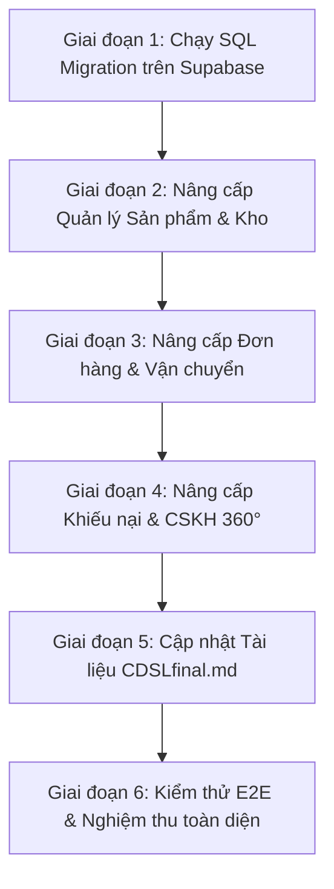

# LỘ TRÌNH VÀ CHECKLIST ĐỒNG BỘ CSDL VÀ NÂNG CẤP HỆ THỐNG PAWPAL
> **Tài liệu chuẩn hóa kiến trúc CSDL & Codebase**  
> **Phiên bản:** 1.0 — Ngày tạo: 19/10/2026  
> **Căn cứ thiết kế:** [`CDSLfinal.md`](file:///d:/Aboutme/MyProject/Pawpal/CDSLfinal.md) (62 thực thể) và Schema thực tế Supabase (81 bảng/view)  
> **File migration:** [`scripts/database/20261019_sync_schema_with_cdsl.sql`](file:///d:/Aboutme/MyProject/Pawpal/scripts/database/20261019_sync_schema_with_cdsl.sql)

---

## 1. TỔNG QUAN VÀ MỤC TIÊU CHIẾN LƯỢC

### 1.1. Bối cảnh
Quá trình đối soát tự động giữa tài liệu thiết kế gốc [`CDSLfinal.md`](file:///d:/Aboutme/MyProject/Pawpal/CDSLfinal.md) và CSDL Supabase thực tế cho thấy:
1. **Thiếu cột CSDL:** 19 bảng cốt lõi trên Supabase đang thiếu các cột nghiệp vụ trọng yếu (ví dụ: `brand_name`, `target_pet` trong bảng `product`; `tracking_code`, `shipping_provider_id` trong `sales_order`; `product_variant_id` trong các bảng giao dịch...).
2. **Hệ quả ở tầng Codebase:** Do CSDL thiếu cột, trong quá trình phát triển trước đây, codebase đã phải sử dụng các giải pháp "chắp vá" (workarounds):
   - Nhồi mã vận đơn vào chuỗi ghi chú: `note = "Hãng: GHTK; Vận đơn: JT123456"` và dùng biểu thức chính quy (Regex) để bóc tách ngược lại.
   - Nhồi mã tham chiếu vào tiêu đề khiếu nại: `title = "Giao hàng trễ [DH-1002]"` do thiếu khóa ngoại `order_id`, `appointment_id`.
   - Gán cứng nhãn hàng `brand = 'PawPal'` hoặc tự suy đoán từ tên sản phẩm; không lưu được thương hiệu khi tạo/sửa sản phẩm.
   - Bảng sản phẩm và kho hàng hiển thị dấu gạch ngang `—` cho cột Thương hiệu, Tạm giữ, Khả dụng.
3. **Thiếu tài liệu thiết kế:** 19 bảng/view mới đang hoạt động ổn định trên Supabase (hệ thống AI Chatbot, Đặt phòng Hotel, Đổi ca nhân viên, Lịch sử cân nặng...) chưa được cập nhật vào `CDSLfinal.md`.

### 1.2. Mục tiêu
* **Đồng bộ hóa 100% CSDL Supabase** theo đúng chuẩn thiết kế `CDSLfinal.md`.
* **Loại bỏ 100% các đoạn code chắp vá, regex nhồi chuỗi**, đưa codebase về chuẩn RESTful / ORM sạch sẽ, minh bạch.
* **Đảm bảo An toàn tuyệt đối (Zero Breaking Changes):** Quá trình nâng cấp diễn ra song song (Backward Compatibility), không làm gián đoạn hay phát sinh lỗi ở bất kỳ màn hình nào.

---

## 2. MA TRẬN ĐỐI SOÁT & CÁC VÙNG CODE CẦN NÂNG CẤP

| STT | Bảng CSDL | Các cột bổ sung mới | Cách code chắp vá trước đây | Cách code chuẩn sau khi nâng cấp |
| :---: | :--- | :--- | :--- | :--- |
| **1** | `product` | `brand_name`<br>`target_pet`<br>`min_price`<br>`description`<br>`slug` | • Suy đoán brand từ tên sản phẩm hoặc gán cứng `'PawPal'`<br>• Gán cứng `petType: 'Chó và Mèo'`<br>• Website hiện thông báo *"Đang cập nhật mô tả"* | • Đọc & ghi trực tiếp `p.brand_name`, `p.target_pet`, `p.description` lên Supabase.<br>• Khi Admin Thêm/Sửa sản phẩm, dữ liệu được lưu vĩnh viễn vào CSDL. |
| **2** | `sales_order` | `shipping_provider_id`<br>`tracking_code`<br>`shipped_at`<br>`delivered_at` | • Nhồi chuỗi `"Hãng: ...; Vận đơn: ..."` vào cột `note`<br>• Dùng Regex để parse mã vận đơn khi render bảng | • Lưu trực tiếp mã vận đơn vào cột `tracking_code`<br>• Đọc `o.tracking_code` trực tiếp, bỏ hoàn toàn hàm Regex và giữ `note` thuần túy cho khách hàng. |
| **3** | `inventory` | `product_variant_id`<br>`quantity_reserved` | • Tồn kho chỉ gắn với sản phẩm đơn (`product_id`)<br>• Tạm giữ phải tính runtime từ đơn hàng | • Quản lý tồn kho theo từng biến thể SKU cụ thể (`product_variant_id`).<br>• Lưu trữ trực tiếp số lượng tạm giữ `quantity_reserved`. |
| **4** | `sales_order_detail`<br>`cart_item`<br>`purchase_order_detail`<br>`inventory_transaction`<br>`return_request_detail`<br>`promotion_product` | `product_variant_id` | • Mọi chi tiết giao dịch chỉ liên kết qua `product_id` (không phân biệt rõ màu sắc, kích cỡ, hương vị thực tế đã bán/nhập) | • Lưu đồng thời cả `product_id` và `product_variant_id`.<br>• Hỗ trợ quản lý báo cáo doanh thu, tồn kho chính xác theo từng SKU biến thể con. |
| **5** | `support_ticket`<br>`support_ticket_message` | `ticket_code`<br>`customer_id`<br>`order_id`<br>`appointment_id`<br>`channel`<br>`category`<br>`subject`... (19 cột) | • Dùng bảng sơ khai (10 cột)<br>• Ghép mã đơn hàng `[DH-1002]` vào chuỗi `title`<br>• Nhồi `[Tham chiếu: ...]` vào tin nhắn | • Lưu trực tiếp khóa ngoại `order_id`, `appointment_id`, `customer_id`.<br>• Xem hồ sơ 360° bấm nhảy trực tiếp sang đơn hàng/lịch hẹn liên quan. |
| **6** | `return_request` | `refund_transaction_id`<br>`resolution_type`<br>`refund_amount`<br>`resolved_by` | • Số tiền hoàn và loại xử lý không lưu đúng trường chuẩn | • Liên kết chặt chẽ với bảng giao dịch hoàn tiền `refund_transaction`. |
| **7** | `appointment` | `support_ticket_id`<br>`check_in_time`<br>`check_out_time` | • Giờ check-in/out thực tế không lưu được vào CSDL | • Ghi nhận chính xác mốc thời gian khách đưa và nhận thú cưng tại tiệm. |
| **8** | `payment` | `customer_id`<br>`payment_method_config_id` | • Truy vấn ngược khách hàng qua bảng `order` hoặc `appointment` | • Truy vấn trực tiếp thanh toán theo khách hàng `customer_id`. |

---

## 3. CHECKLIST LỘ TRÌNH TRIỂN KHAI CHI TIẾT (6 GIAI ĐOẠN)



---

### GIAI ĐOẠN 1: MIGRATION CSDL TRÊN SUPABASE (DBA / ADMIN)
> **Mục tiêu:** Bổ sung toàn bộ các cột mới và backfill dữ liệu cũ mà không làm gián đoạn hệ thống.

- [ ] **1.1. Chạy file SQL:** Mở Supabase SQL Editor $\rightarrow$ Chạy file [`scripts/database/20261019_sync_schema_with_cdsl.sql`](file:///d:/Aboutme/MyProject/Pawpal/scripts/database/20261019_sync_schema_with_cdsl.sql).
- [ ] **1.2. Xác nhận cột bảng `product`:** Kiểm tra các cột `brand_name`, `target_pet`, `min_price`, `description`, `slug` đã xuất hiện trong bảng `product`.
- [ ] **1.3. Xác nhận Backfill dữ liệu `product`:** Chạy query kiểm tra xem các sản phẩm như Royal Canin, Petkit, King's Pet đã được tự động điền `brand_name` hay chưa:
  ```sql
  SELECT id, product_name, brand_name, target_pet, description FROM product LIMIT 10;
  ```
- [ ] **1.4. Xác nhận cột bảng `sales_order` & Backfill vận đơn:** Kiểm tra xem `tracking_code` đã được trích xuất từ chuỗi `note` hay chưa:
  ```sql
  SELECT id, order_code, tracking_code, note FROM sales_order WHERE tracking_code IS NOT NULL LIMIT 5;
  ```
- [ ] **1.5. Chạy lại script đối soát:** Chạy lệnh `node scripts/test/compare_schema_cdsl.js` để xác nhận số lượng cột thiếu về **0**.

---

### GIAI ĐOẠN 2: NÂNG CẤP MODULE SẢN PHẨM & KHO HÀNG (ADMIN & SHOP)
> **Mục tiêu:** Đọc và lưu trực tiếp `brand_name`, `target_pet`, `description` trên giao diện Admin và Website.

- [ ] **2.1. Cập nhật `pages/admin/modules/orders/orders.js`:**
  - Bổ sung `brand_name, target_pet, description, min_price` vào câu lệnh `client.from('product').select(...)`.
  - Gán `brand: p.brand_name || 'PawPal'`, `petType: p.target_pet || 'Chó và Mèo'`.
- [ ] **2.2. Cập nhật `tab-order-products.js` (Thao tác Thêm/Sửa sản phẩm):**
  - Khi Admin bấm **Lưu sản phẩm mới**: Bổ sung `brand_name`, `target_pet`, `description` vào payload `client.from('product').insert(...)`.
  - Khi Admin bấm **Cập nhật sản phẩm**: Bổ sung các trường trên vào payload `client.from('product').update(...)`.
  - Đảm bảo khi F5 hoặc tải lại trang, giá trị thương hiệu và loài thú cưng đã lưu không bị mất.
- [ ] **2.3. Cập nhật Website Khách hàng (`pages/shop/product-detail/product-detail.js`):**
  - Đọc trực tiếp trường `product.description` thật từ Supabase thay vì chuỗi mặc định.
- [ ] **2.4. Kiểm tra phân trang và lọc thương hiệu:**
  - Thử gõ tìm kiếm *"Petkit"*, *"Royal Canin"* trên thanh tìm kiếm kho $\rightarrow$ Xác nhận kết quả lọc chính xác.

---

### GIAI ĐOẠN 3: NÂNG CẤP MODULE ĐƠN HÀNG & VẬN CHUYỂN (ORDERS)
> **Mục tiêu:** Lưu và đọc trực tiếp mã vận đơn `tracking_code`, xóa bỏ hoàn toàn việc nhồi chuỗi vào `note`.

- [ ] **3.1. Cập nhật `tab-order-list.js` (Xử lý Bàn giao vận chuyển):**
  - Tìm hàm `handleShipOrder` / `handleBatchShipOrders`:
  - Cập nhật câu lệnh update CSDL:
    ```javascript
    await client.from('sales_order').update({
        order_status: 'shipping',
        tracking_code: tracking,
        shipped_at: new Date().toISOString(),
        updated_at: new Date().toISOString()
    }).eq('id', orderId);
    ```
  - Loại bỏ hoàn toàn đoạn nối chuỗi `const shipNote = 'Hãng: ' + carrier + '; Vận đơn: ' + tracking;`. Giữ nguyên ghi chú gốc của khách hàng.
- [ ] **3.2. Cập nhật `orders.js` & `tab-order-detail.js` (Hiển thị đơn hàng):**
  - Bổ sung `tracking_code, shipping_provider_id, shipped_at, delivered_at` vào câu truy vấn `client.from('sales_order').select(...)`.
  - Đọc trực tiếp `o.tracking_code`, bỏ đoạn code Regex `o.note.match(/Vận đơn:\s*([^\n;]+)/i)`.
- [ ] **3.3. Kiểm tra In phiếu giao hàng & Xuất file:**
  - Xác nhận Mã vận đơn hiển thị chính xác trên Phiếu giao hàng in tại quầy và file Excel xuất kho.

---

### GIAI ĐOẠN 4: NÂNG CẤP MODULE KHIẾU NẠI & CSKH 360° (COMPLAINTS)
> **Mục tiêu:** Chuẩn hóa bảng `support_ticket`, liên kết khóa ngoại trực tiếp tới Đơn hàng và Lịch hẹn.

- [ ] **4.1. Cập nhật `pages/admin/modules/complaints/complaints.js` (Tạo khiếu nại mới):**
  - Trong hàm `handleCreateComplaintSubmit`:
  - Khi khiếu nại thuộc đơn hàng: Gửi thẳng `order_id: refId`.
  - Khi khiếu nại thuộc lịch hẹn: Gửi thẳng `appointment_id: refId`.
  - Lưu mã khiếu nại tự sinh vào cột `ticket_code: 'KN-' + Date.now().toString().slice(-6)`.
  - Bỏ việc ghép `[DH-1002]` vào trường `title`.
- [ ] **4.2. Cập nhật liên kết 360° giữa các Subtab:**
  - Từ màn hình Đơn hàng bấm *"Tạo khiếu nại"* $\rightarrow$ Khiếu nại tự động gắn `order_id`.
  - Từ màn hình Khiếu nại bấm vào mã đơn hàng $\rightarrow$ Nhảy trực tiếp sang xem chi tiết đơn hàng tương ứng.
- [ ] **4.3. Cập nhật `support_ticket_message`:**
  - Bổ sung lưu `sender_id`, `is_internal` (ghi chú nội bộ kỹ thuật viên không gửi cho khách hàng).

---

### GIAI ĐOẠN 5: CẬP NHẬT TÀI LIỆU THIẾT KẾ `CDSLfinal.md`
> **Mục tiêu:** Bổ sung 19 bảng thực tế trên Supabase vào tài liệu để hồ sơ thiết kế phản ánh đúng 100% hệ thống.

- [ ] **5.1. Bổ sung Phân hệ AI Chatbot & CSKH thông minh (14 bảng):**
  - `chat_conversation`, `chat_message`, `chat_moderation_log`
  - `chatbot_knowledge_faq`, `chatbot_system_prompt`, `chatbot_canned_response`
  - `chatbot_sentiment_tier`, `chatbot_sentiment_trigger`, `chatbot_sentiment_action`
  - `chatbot_compensation_policy`, `chatbot_handover_rule`, `chatbot_profanity_filter`
  - `chatbot_scenario_matrix`, `document_embeddings`
- [ ] **5.2. Bổ sung Phân hệ Lưu trú Pet Hotel (1 bảng):**
  - `hotel_booking` (đặt phòng khách sạn thực tế: phòng, ngày nhận/trả, chế độ ăn, tiền cọc).
- [ ] **5.3. Bổ sung Phân hệ Nhân sự & Lịch trực (2 bảng/view):**
  - `staff_shift_request` (đổi ca, xin nghỉ phép của nhân viên).
  - `staff_public_view` (view dữ liệu công khai an toàn).
- [ ] **5.4. Bổ sung Phân hệ Thú cưng & Bảo mật (2 bảng):**
  - `pet_weight_history` (lịch sử biến thiên cân nặng của thú cưng).
  - `api_keys` (quản lý khóa tích hợp cổng dịch vụ).

---

### GIAI ĐOẠN 6: KIỂM THỬ E2E & NGHIỆM THU TOÀN DIỆN
> **Mục tiêu:** Chạy kiểm thử tự động và thủ công xác nhận toàn bộ luồng nghiệp vụ hoạt động trơn tru.

- [ ] **6.1. Kiểm thử Luồng Sản phẩm & Kho hàng:**
  - Tạo 1 sản phẩm mới có thương hiệu *"Petkit"* $\rightarrow$ Reload trang $\rightarrow$ Thương hiệu vẫn hiển thị đúng.
  - Sửa tên, đổi giá, đổi thương hiệu $\rightarrow$ Kiểm tra CSDL cập nhật chính xác.
  - Kiểm tra 3 cột: *Thương hiệu*, *Tạm giữ*, *Khả dụng* hiển thị đầy đủ số liệu thực tế.
- [ ] **6.2. Kiểm thử Luồng Đơn hàng & Vận đơn:**
  - Tạo đơn hàng mới tại quầy POS $\rightarrow$ Chuyển trạng thái *"Đang giao"* $\rightarrow$ Nhập mã vận đơn `JT889900`.
  - Kiểm tra trong Supabase cột `sales_order.tracking_code` có giá trị `JT889900` và `sales_order.note` không bị nhồi chuỗi rác.
- [ ] **6.3. Kiểm thử Luồng Khiếu nại:**
  - Tạo khiếu nại cho đơn hàng $\rightarrow$ Kiểm tra `support_ticket.order_id` có lưu đúng ID đơn hàng.
- [ ] **6.4. Chạy bộ Suite Test:**
  - Chạy `node scripts/test/test_sales_lifecycle.js` $\rightarrow$ Kết quả: PASS.
  - Chạy `node scripts/test/test_complaints_lifecycle.js` $\rightarrow$ Kết quả: PASS.
  - Chạy `node scripts/test/compare_schema_cdsl.js` $\rightarrow$ Kết quả: 0 bảng thiếu, 0 cột lệch.

---

## 4. MA TRẬN RỦI RO VÀ PHƯƠNG ÁN DỰ PHÒNG (ROLLBACK PLAN)

| Rủi ro tiềm ẩn | Mức độ | Nguyên nhân | Biện pháp phòng ngừa & Xử lý |
| :--- | :---: | :--- | :--- |
| **Trùng lặp cột khi chạy migration** | Thấp | Chạy file SQL nhiều lần | Đã áp dụng `ADD COLUMN IF NOT EXISTS` cho 100% câu lệnh. Chạy lại nhiều lần vẫn an toàn tuyệt đối. |
| **Gãy câu lệnh SELECT cũ** | Không có | Cột mới bắt buộc có giá trị | 100% cột mới đều là `NULLABLE` hoặc có `DEFAULT`. Code cũ không gọi cột mới vẫn chạy bình thường. |
| **Mất mã vận đơn cũ** | Thấp | Dữ liệu cũ nằm trong `note` | Khối Backfill SQL tự động dùng Regex lấy mã vận đơn từ `note` điền sang `tracking_code`, giữ nguyên nội dung `note` gốc. |
| **Cần quay về trạng thái cũ** | Cực thấp | Người dùng muốn rollback | Chỉ cần chạy lệnh `ALTER TABLE [table] DROP COLUMN IF EXISTS [col];` cho các cột mới nếu cần. |

---

## 5. KẾT LUẬN & HÀNH ĐỘNG TIẾP THEO

File lộ trình này đã vạch ra toàn bộ các bước chuyển đổi từ một hệ thống có những đoạn xử lý chắp vá sang một hệ thống chuẩn hóa CSDL theo mô hình doanh nghiệp chuẩn mực.

> **Hành động ngay bây giờ:**
> 1. Mở Supabase và thực thi file [**`scripts/database/20261019_sync_schema_with_cdsl.sql`**](file:///d:/Aboutme/MyProject/Pawpal/scripts/database/20261019_sync_schema_with_cdsl.sql).
> 2. Báo lại cho trợ lý để bắt đầu thực hiện **Giai đoạn 2** (Nâng cấp code module Sản phẩm & Kho hàng).
